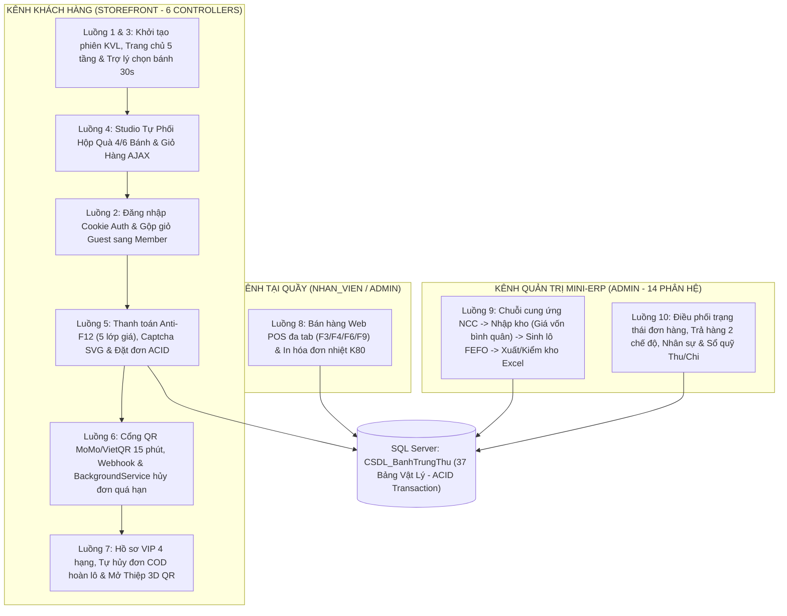
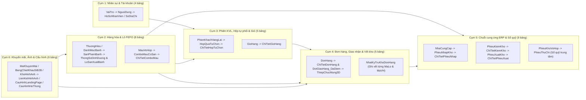

# KỊCH BẢN BÁO CÁO & BẢO VỆ ĐỒ ÁN TỐT NGHIỆP / MÔN HỌC
## Đề tài: Nguyệt Cát ERP — Hệ Thống Thương Mại Điện Tử B2C/B2B & Mini-ERP Quản Lý Phân Phối Bánh Trung Thu Đa Thương Hiệu

- **Sinh viên thực hiện:** Lê Minh Đức
- **Đơn vị:** Khoa Công nghệ thông tin — Trường Đại học An Giang (AGU — ĐHQG-HCM)
- **Nền tảng kỹ thuật:** ASP.NET Core 8.0 MVC + Entity Framework Core 8.0.26 + SQL Server (37 bảng vật lý SQL-First) + ClosedXML + QRCoder + Bootstrap 5 / Vanilla ES6 JS.

---

## MỤC LỤC NHANH

1. [PHẦN 1: GIỚI THIỆU CHI TIẾT CÁC LUỒNG CHẠY HỆ THỐNG](#phan-1-gioi-thieu-chi-tiet-cac-luong-chay-he-thong)
2. [PHẦN 2: GIỚI THIỆU CƠ SỞ DỮ LIỆU (37 BẢNG SQL-FIRST)](#phan-2-gioi-thieu-co-so-du-lieu-37-bang-sql-first)
3. [PHẦN 3: KỊCH BẢN DEMO CHI TIẾT TRÊN MÁY LOCAL (TOÀN MÀN HÌNH — KHÔNG CHIA ĐÔI MÀN HÌNH)](#phan-3-kich-ban-demo-chi-tiet-tren-may-local-toan-man-hinh--khong-chia-doi-man-hinh)
4. [PHẦN 4: GIẢ LẬP 20 CÂU HỎI PHẢN BIỆN HỘI ĐỒNG & CÁCH TRẢ LỜI ĐIỂM A+](#phan-4-gia-lap-20-cau-hoi-phan-bien-hoi-dong--cach-tra-loi-diem-a)

---

<a id="phan-1-gioi-thieu-chi-tiet-cac-luong-chay-he-thong"></a>
## PHẦN 1: GIỚI THIỆU CHI TIẾT CÁC LUỒNG CHẠY HỆ THỐNG

### 1.1. Lời dẫn mở đầu bài thuyết trình (60 giây đầu tiên)

> *"Kính chào quý Thầy/Cô trong Hội đồng. Hôm nay em xin trình bày đề tài **Nguyệt Cát ERP** — hệ thống hợp nhất giữa **Website Thương mại điện tử B2C/B2B** và **Phần mềm Mini-ERP quản lý đại lý phân phối bánh trung thu đa thương hiệu** (Kinh Đô, Đồng Khánh, Như Lan, Brodard, Givral).*
>
> *Khác với các website bán hàng thông thường chỉ dừng ở việc đặt đơn, bài toán kinh doanh bánh trung thu mùa vụ có **4 đặc thù rất khắt khe**: (1) Vòng đời bánh ngắn ngày nên bắt buộc xuất kho theo hạn sử dụng **FEFO**; (2) Khách biếu tặng muốn **tự phối hộp quà đa thương hiệu** kèm **Thiệp 3D QR**; (3) Chính sách giá chồng nhiều lớp từ sỉ B2B, Voucher đến hạng VIP; và (4) Mọi biến động giữa Đơn Online, Quầy POS, Nhập–Xuất–Kiểm kho và Sổ quỹ tiền mặt phải khớp nhau 100% trong giao dịch ACID. Dưới đây là kiến trúc các luồng chạy giải quyết trọn vẹn 4 bài toán đó."*

---

### 1.2. Sơ đồ tổng thể liên thông 10 luồng chạy cốt lõi



---

### 1.3. Giải thích chi tiết từng luồng chạy (Để thuyết minh trước Hội đồng)

#### Luồng 1: Khởi động hệ thống, Chuẩn hóa CSDL, Middleware khách vãng lai & Tiến trình nền
- **Điểm vào:** `Program.cs`, `Data/KhoiTaoCsdl.cs`, `Middlewares/PhienKhachVangLaiMiddleware.cs`, `Services/Nen/DichVuNenHuyDonQuaHan.cs`.
- **Cách hoạt động:**
  1. Khi ứng dụng khởi chạy, `Program.cs` đăng ký `CSDLBanhTrungThuContext` với chế độ **`QuerySplittingBehavior.SplitQuery`** toàn cục (loại bỏ lỗi nhân tích Đề-các khi `.Include()` nhiều bảng) cùng **26 Service Interfaces (`IDichVu...`)** theo nguyên lý Dependency Inversion.
  2. `KhoiTaoCsdl.KhoiTaoVaChuanHoaDuLieuAsync` tự động rà soát đủ 37 bảng, khóa ngoại, đồng bộ hồ sơ nhân sự và gia hạn mã khuyến mãi mẫu.
  3. **`PhienKhachVangLaiMiddleware`**: Với khách chưa đăng nhập truy cập trang nghiệp vụ (bỏ qua file tĩnh `/css`, `/js`, `/images`), hệ thống tự sinh mã phiên `KVL-...` lưu vào bảng `PhienKhachVangLai` và gắn Cookie `HttpOnly` 14 ngày để khách thoải mái thêm giỏ hàng/phối hộp quà mà không ép đăng nhập trước.
  4. **`DichVuNenHuyDonQuaHan` (`BackgroundService`)**: Cứ mỗi **60 giây** chạy ngầm quét các đơn `MOMO_QR` quá hạn 15 phút chưa thanh toán để tự động hủy đơn, hoàn bánh về đúng lô FEFO và hoàn điểm VIP ngay cả khi khách đã tắt trình duyệt.

#### Luồng 2: Xác thực Cookie Auth, Phân quyền RBAC 2 vai trò & Gộp giỏ hàng thông minh
- **Thực thi tại:** `TaiKhoanController`, `DichVuHoiVien`, `DichVuHopQuaTuChon.GopGioHangTuKhachVangLaiAsync`.
- **Cách hoạt động:**
  - Mật khẩu băm **SHA-256 kèm Salt cố định** (`_NguyetCatSalt2026`), kiểm tra khóa mềm `TAM_KHOA` trên `HoSoNhanVien`.
  - **Thuật toán gộp giỏ hàng ACID:** Ngay khi khách đăng nhập/đăng ký, nếu đang có giỏ hàng khách vãng lai (`MaPhienKVL`), hệ thống tự động hợp nhất sang tài khoản thành viên (`MaND`): bánh lẻ trùng `MaBanh` thì cộng dồn số lượng; hộp tự phối trùng cấu hình băm **`MaBamCauHinh`** (`VH2-1-15-33-58`) thì cộng dồn số hộp, khác cấu hình thì giữ nguyên cả hai.
  - **Điều hướng RBAC:**
    - `ADMIN` (Chủ cửa hàng) -> vào `/Admin/Dashboard/Index` (mở toàn quyền **14/14** phân hệ).
    - `NHAN_VIEN` (Thu ngân/Bán hàng) -> vào thẳng `/Admin/BanHangPos/Index` (chỉ mở **2/14** phân hệ là `BanHangPos` và `DonHangAdmin`; **12 phân hệ quản trị nhạy cảm** còn lại bị chặn cứng ở `ControllerQuanTriCoSo` trả về `/TaiKhoan/TuChoiTruyCap`).
    - `KHACH_TV` -> ở lại giao diện mua sắm Storefront.

#### Luồng 3: Storefront 5 tầng & Thuật toán Trợ lý chọn bánh 30 giây
- **Thực thi tại:** `HomeController`, `DichVuTrangChu`, `DichVuHinhAnh`.
- **Cách hoạt động:**
  - Nạp toàn bộ từ điển ảnh của 60 bánh, 3 vỏ hộp, 5 combo chỉ bằng **1 câu truy vấn duy nhất** (`LayTuDienUrlAnhAsync`) để chống lỗi N+1 Query, hiển thị mượt trên 5 tầng giao diện.
  - **Trợ lý chọn bánh 30 giây (`GoiYBanhThongMinhAsync`):** Chấm điểm 60 bánh theo công thức trọng số 100 điểm dựa trên 4 tiêu chí (*Sức khỏe 35đ + Ngân sách 25đ + Đối tượng 20đ + Hương vị 20đ*). Đặc biệt có **cơ chế phạt an toàn `-500 điểm`**: nếu khách chọn đối tượng *"Tiểu đường"*, toàn bộ bánh đường thường bị loại thẳng, chỉ giữ lại bánh đường ăn kiêng **`Isomalt`** có chỉ số đường huyết `GI <= 45`.

#### Luồng 4: Studio Tự Phối Hộp Quà 4/6 Bánh & Ngăn kéo Giỏ hàng AJAX
- **Thực thi tại:** `studio-phoi-hop.js`, `gio-hang-ajax.js`, `GioHangController`, `DichVuHopQuaTuChon`.
- **Cách hoạt động:**
  - Khách chọn mẫu vỏ hộp (`MauVoHop`: hộp 4 bánh hoặc hộp sơn mài 6 bánh), sau đó tự do gắp từng vị bánh của 5 hãng khác nhau bỏ vào từng ô khay.
  - Giao diện tính trực tiếp tổng trọng lượng, tổng năng lượng **Calo** (từ bảng `ThongSoDinhDuong`) và kiểm tra điều kiện số bánh Thượng hạng tối thiểu của vỏ hộp.
  - Khi bấm thêm vào giỏ, Server tính lại giá từ CSDL (`GiaVoHopRieng + Tổng DonGiaLe các bánh`), sinh mã băm cấu hình `MaBamCauHinh`, lưu vào `HopQuaTuChon` + `ChiTietHopTuChon` và cập nhật ngăn kéo giỏ hàng AJAX không cần tải lại trang.

#### Luồng 5: Thanh toán phẳng chống F12, 5 lớp tính giá, Captcha SVG & Trừ kho FEFO
- **Thực thi tại:** `ThanhToanController`, `DichVuTinhGiaDonHang`, `DichVuTonKhoFefo`, `DichVuThanhToan`.
- **Cách hoạt động:**
  1. **Chống chỉnh sửa giá F12:** Server bỏ qua mọi con số tiền từ trình duyệt gửi lên, tự truy vấn CSDL tính lại tuần tự **5 lớp giá**:
     - Lớp 1: Tổng tiền hàng gốc (hoặc giá sau giảm của lô xả cận date).
     - Lớp 2: Chiết khấu sỉ B2B theo tổng số hộp lễ vật (`BangChietKhauSiB2B`: từ 10 hộp giảm `8%`, đến 100 hộp giảm `22%` + miễn phí khuôn in logo từ 30 hộp).
     - Lớp 3: Mã giảm giá Voucher (`MaKhuyenMai`: kiểm tra hạn dùng, đơn tối thiểu, lượt dùng tối đa, quyền khách vãng lai).
     - Lớp 4: Đặc quyền chiết khấu trực tiếp theo Hạng thẻ VIP (`Bạc 3%`, `Vàng 5%`, `Kim Cương 10%`).
     - Lớp 5: Quy đổi Điểm tích lũy (`1 điểm = 1.000đ`, tối đa 50% giá trị còn lại) + Phí vận chuyển theo vùng/hỏa tốc.
  2. **Kiểm tra Captcha SVG động** lưu trong Session chống bot spam đơn.
  3. **Giao dịch đặt hàng ACID (`ThucThiTrongGiaoDichAsync`):** Tạo `DonHang` -> Bóc tách từng bánh lẻ, từng bánh trong Combo và từng bánh trong Hộp tự phối -> Quét bảng `LoSanXuatBanh` sắp xếp `HanSuDung ASC` (**FEFO: lô hết hạn trước xuất trước**) để trừ tồn -> Ghi vết từng lô vừa trừ vào **`NhatKyTruKhoDonHang`** -> Trừ tồn vỏ hộp `MauVoHop` -> Tạo `DotGiaoHang_DaDiem` & `ThiepChucMung3D` -> Xóa giỏ hàng. Nếu hết hàng ở bất kỳ vị bánh nào, toàn bộ giao dịch `Rollback` ngay lập tức.

#### Luồng 6: Cổng thanh toán QR MoMo / VietQR 15 phút, Webhook & Hoàn kho tự động
- **Thực thi tại:** `DichVuCongThanhToanMoMo`, `DichVuNenHuyDonQuaHan`.
- **Cách hoạt động:**
  - Sinh mã QR chuẩn ví MoMo bằng `QRCoder` (`PngByteQRCode` Base64) song song với ảnh VietQR ngân hàng kèm nội dung chuyển khoản `NGUYETCAT TT2026-XXXX` và đồng hồ đếm ngược **15 phút** (`HanThanhToanQr`).
  - **Khi thanh toán thành công (Webhook `/api/webhook/momo` hoặc Admin xác nhận):** Chuyển `DA_TT`, cộng điểm thưởng VIP (`+1 điểm / 10.000đ`, có khóa `DaCongDiemThuong` chống cộng trùng) và tự động ghi **Phiếu Thu** vào `PhieuThuChi`.
  - **Khi quá hạn 15 phút:** Client báo về hoặc `BackgroundService` quét ngầm -> Chuyển `DA_HUY`, đọc bảng `NhatKyTruKhoDonHang` cộng trả chính xác số bánh về đúng `MaLo` ban đầu và hoàn điểm VIP đã dùng (có cờ `DaRollbackKho` đảm bảo không bao giờ hoàn kho 2 lần).

#### Luồng 7: Hồ sơ Hội viên VIP chống tụt hạng, Tự hủy đơn COD & Thiệp chúc mừng 3D QR
- **Thực thi tại:** `TaiKhoanController`, `Thiep3DController`, `DichVuHoiVien`.
- **Cách hoạt động:**
  - **Xét hạng VIP chống tụt hạng:** Dùng công thức lấy giá trị lớn nhất giữa điểm hiện có và điểm quy đổi từ tổng chi tiêu tích lũy lịch sử, giúp khách hàng thoải mái tiêu điểm giảm giá mà **không bao giờ bị rớt hạng thẻ**.
  - **Khách tự hủy đơn COD:** Chỉ cho phép hủy khi đơn thuộc chính chủ (chống IDOR), phương thức `COD` và trạng thái đang `CHO_XAC_NHAN` -> Tự động hoàn trả bánh về đúng lô FEFO và hoàn lại điểm VIP trong 1 giao dịch ACID.
  - **Thiệp chúc mừng 3D QR (`/Thiep3D/Xem/{token}`):** Mở hiệu ứng thiệp 3D cá nhân hóa và tự động tăng bộ đếm `SoLanMoThiep` đồng bộ lên Dashboard Admin.

#### Luồng 8: Bán hàng tại quầy Web POS & In hóa đơn nhiệt K80
- **Thực thi tại:** `BanHangPosController`, `DichVuBanHangPos`, `admin-pos.js`.
- **Cách hoạt động:**
  - Mở nhiều tab hóa đơn chờ song song (`Hóa đơn 1, 2...`), điều khiển nhanh bằng phím tắt vật lý: **`F3`** (Quét mã vạch EAN-13 / tìm bánh), **`F4`** (Tra cứu hoặc mở thẻ VIP nhanh tại quầy), **`F6`** (Đóng hộp quà tự chọn tại quầy), **`F9`** (Thanh toán Tiền mặt / Chuyển khoản QR).
  - Chốt đơn tại quầy lập tức trừ lô FEFO, ghi nhận mã nhân viên thu ngân (`DonHang.MaNdLap`) để tính doanh số ca làm việc, ghi **Phiếu Thu POS** vào `PhieuThuChi` và bật cửa sổ in nhiệt khổ **K80 (`80mm`)**.

#### Luồng 9: Chuỗi cung ứng Kho Mini-ERP (NCC – Nhập kho – Xuất kho – Kiểm kho – Vỏ hộp)
- **Thực thi tại:** `NhaCungCapAdmin`, `NhapKhoAdmin`, `XuatKhoAdmin`, `KiemKhoAdmin`, `VoHopAdmin`.
- **Cách hoạt động:**
  - **Nhập kho đại lý:** Chọn Nhà cung cấp -> Tự áp `% chiết khấu mặc định` (`22%–28%`) tính giá nhập từ giá niêm yết -> Khi duyệt hoàn thành: (1) Tính lại **Giá vốn bình quân gia quyền** trên `SanPhamBanh`, (2) Tự sinh mã **Lô FEFO mới** trong `LoSanXuatBanh`, (3) Hạch toán công nợ NCC và tự sinh **Phiếu Chi** trong `PhieuThuChi`. Chặn hủy phiếu nhập nếu lô sinh ra đã bán bớt.
  - **Xuất kho nội bộ / hủy lỗi:** Cho phép chọn đích danh lô hoặc tự động phân bổ trừ theo FEFO, ghi nhận giá trị vốn xuất.
  - **Kiểm kho đối soát Excel (`ClosedXML`):** Xuất file mẫu `.xlsx` 60 bánh -> Nhập kết quả kiểm đếm thực tế -> Khi bấm **Cân bằng kho**: nếu lệch thiếu tự động trừ FEFO và tự sinh `PhieuXuatKho` (`CHINH_LECH_KIEM_KHO`); nếu lệch dư tự cộng vào lô còn hạn xa nhất.

#### Luồng 10: Quản trị Đơn hàng đa kênh, Hoàn tiền 2 chế độ, Nhân sự & Sổ quỹ SQL-First
- **Thực thi tại:** `DonHangAdmin`, `NhanVienAdmin`, `SoQuyAdmin`, `CaiDatAdmin`.
- **Cách hoạt động:**
  - **Máy trạng thái đơn hàng chặt chẽ:** Không cho phép lùi trạng thái đơn đã giao/đã hủy. Đơn COD khi chuyển sang `DA_GIAO`/`HOAN_TAT` tự động thu tiền vào Sổ quỹ và cộng điểm VIP.
  - **Trả hàng / Hoàn tiền 2 chế độ kho:** Cho phép Admin chọn **`[HOAN_NHAP_LO]`** (bánh còn nguyên vẹn -> cộng trả lại lô FEFO để bán tiếp) hoặc **`[XUAT_HUY_LOI]`** (hộp bị móp/rách -> không cộng lại tồn bán để tránh giao nhầm hàng lỗi cho khách sau), đồng thời bắt buộc nhập STK nhận tiền hoàn và tự lập Phiếu Chi hoàn tiền.
  - **Bảo vệ tài khoản chủ cửa hàng (Self-Lockout Prevention):** Chặn tuyệt đối Admin tự khóa tài khoản hoặc tự hạ quyền của chính mình.
  - **Sổ quỹ Thu/Chi hợp nhất (`PhieuThuChi`):** Hội tụ mọi dòng tiền tự động (Bán Online, Bán POS, Nhập bánh NCC, Trả nợ NCC, Nhập vỏ hộp, Chi hoàn tiền) và phiếu thu/chi vận hành thủ công, đảm bảo đối soát **Zero-Diff (sai số 0 đồng)**.

---

<a id="phan-2-gioi-thieu-co-so-du-lieu-37-bang-sql-first"></a>
## PHẦN 2: GIỚI THIỆU CƠ SỞ DỮ LIỆU (`CSDL_BanhTrungThu` — 37 BẢNG SQL-FIRST)

### 2.1. 3 Điểm nhấn thiết kế CSDL cần nhấn mạnh với Hội đồng

1. **Chuẩn hóa 37/37 bảng vật lý — Liên thông 100% ERD (`0` bảng mồ côi):** Mọi bảng trong CSDL đều có Khóa chính (`PRIMARY KEY`) và nối Khóa ngoại (`FOREIGN KEY`) chặt chẽ. Có sẵn câu truy vấn kiểm toán trên `sys.tables` và `sys.foreign_keys` trả về `SoBangCoLap = 0`.
2. **Triết lý Zero Business JSON:** Không lạm dụng lưu JSON trá hình cho dữ liệu nghiệp vụ. Các thực thể như Thương hiệu, Nhà cung cấp, Hồ sơ nhân viên, Nhật ký trừ kho, Phiếu kho vỏ hộp, Phiếu thu chi đều được tách thành bảng quan hệ chuẩn hóa. Bảng `CauHinhHeThong` chỉ lưu đúng 4 khóa cài đặt tham số hệ thống; cột `CauHinhHop_JSON` trong `ChiTietDonHang` chỉ đóng vai trò **bản chụp chứng từ in hóa đơn (Historical Snapshot)** bên cạnh khóa ngoại thật `MaHopTC`.
3. **Đảm bảo toàn vẹn kép giữa Tồn tổng & Tồn chi tiết lô:** `SanPhamBanh.TongTonKho` luôn bằng chính xác tổng `SUM(SLConLai)` của các lô khả dụng trong `LoSanXuatBanh`.

---

### 2.2. Sơ đồ quan hệ giữa 6 phân cụm CSDL (37 Bảng)



---

### 2.3. Danh mục chi tiết toàn bộ 37 bảng theo 6 cụm nghiệp vụ

#### Cụm 1: Nhân sự, Tài khoản & Phân quyền (4 bảng)
| STT | Tên bảng SQL | Khóa chính (`PK`) | Khóa ngoại (`FK`) chính | Vai trò cốt lõi trong hệ thống |
| :-: | :--- | :--- | :--- | :--- |
| 1 | `VaiTro` | `MaVT` | — | Định nghĩa 3 vai trò chuẩn: `ADMIN` (Chủ cửa hàng), `NHAN_VIEN` (Bán hàng), `KHACH_TV` (Hội viên). |
| 2 | `NguoiDung` | `MaND` | `MaVT -> VaiTro` | Lưu thông tin đăng nhập, `MatKhauHash` (SHA-256 + Salt), `DiemTichLuy` và hạng thẻ `HangTV` (Đồng/Bạc/Vàng/Kim Cương). |
| 3 | `HoSoNhanVien` | `MaNv` | `MaNd -> NguoiDung` (1-1) | Quản lý mã nhân viên (`NV001..NV003`), chức vụ, ca làm việc, chi nhánh và trạng thái khóa mềm `TAM_KHOA`. |
| 4 | `SoDiaChi` | `MaDC` | `MaND -> NguoiDung` | Lưu danh bạ nhiều địa chỉ giao hàng/biếu tặng đối tác của từng hội viên. |

#### Cụm 2: Danh mục, Thương hiệu, Sản phẩm, Dinh dưỡng & Lô FEFO (8 bảng)
| STT | Tên bảng SQL | Khóa chính (`PK`) | Khóa ngoại (`FK`) chính | Vai trò cốt lõi trong hệ thống |
| :-: | :--- | :--- | :--- | :--- |
| 5 | `ThuongHieu` | `MaThuongHieu` | — | Quản lý 6 thương hiệu: Kinh Đô, Đồng Khánh, Như Lan, Brodard, Givral, Nguyệt Cát. |
| 6 | `DanhMucBanh` | `MaDM` | `MaDMCha -> DanhMucBanh` | Phân nhóm bánh đệ quy (Thượng hạng, Truyền thống, Hiện đại & Lava, Bánh dẻo & Chay Isomalt). |
| 7 | `SanPhamBanh` | `MaBanh` | `MaDM`, `MaThuongHieu`, `MaNccMacDinh`, `MaAnhChinh` | Bảng trung tâm lưu 60 vị bánh: `MaSKU`, mã vạch `MaVach` EAN-13, `DonGiaLe`, `GiaVon` (bình quân gia quyền), `TongTonKho`, độ ngọt, cờ bánh chay/thượng hạng. |
| 8 | `ThongSoDinhDuong` | `MaDD` | `MaBanh -> SanPhamBanh` (1-1) | Lưu `Calo`, `DuongGam`, `DamGam`, `BeoGam`, chỉ số đường huyết **`ChiSoGI`** phục vụ Trợ lý tư vấn tiểu đường & tính Calo hộp quà. |
| 9 | `LoSanXuatBanh` | `MaLo` | `MaBanh -> SanPhamBanh` | **Trái tim thuật toán FEFO:** Quản lý từng lô nhập với `NgaySanXuat`, `HanSuDung`, `SLNhapBanDau`, `SLConLai`, `% giảm cận date` và `TrangThaiLo` (`DANG_BAN`, `XA_CAN_DATE`, `HET_HAN`, `DA_HUY`). |
| 10 | `MauVoHop` | `MaVH` | `MaAnhChinh -> KhoHinhAnh` | Quản lý mẫu vỏ hộp 4 bánh / 6 bánh, giá vỏ riêng, tồn kho vỏ `SLTonKhoVo`, điều kiện số bánh thượng hạng tối thiểu và cờ kèm trà Ô Long. |
| 11 | `ComboMauCoSan` | `MaCB` | `MaVH`, `MaThuongHieu`, `MaDM`, `MaAnhChinh` | Quản lý 5 bộ Lễ hộp định sẵn của 5 thương hiệu lớn với giá ưu đãi trọn bộ. |
| 12 | `ChiTietComboMau` | `MaCTCB` | `MaCB -> ComboMauCoSan`, `MaBanh -> SanPhamBanh` | Định nghĩa danh sách từng vị bánh thành phần nằm trong mỗi bộ Combo để hệ thống bóc tách trừ đúng lô FEFO khi bán. |

#### Cụm 3: Phiên khách vãng lai, Studio Hộp tự chọn & Giỏ hàng (5 bảng)
| STT | Tên bảng SQL | Khóa chính (`PK`) | Khóa ngoại (`FK`) chính | Vai trò cốt lõi trong hệ thống |
| :-: | :--- | :--- | :--- | :--- |
| 13 | `PhienKhachVangLai` | `MaPhienKVL` | `MaNDDaGop -> NguoiDung` | Cấp định danh tạm 14 ngày cho khách chưa đăng nhập và theo dõi trạng thái đã gộp giỏ `DaGopGioHang`. |
| 14 | `HopQuaTuChon` | `MaHopTC` | `MaVH`, `MaND`, `MaPhienKVL` | Lưu lễ hộp do khách tự phối tại Studio hoặc tại POS, kèm chuỗi băm cấu hình `MaBamCauHinh` chống trùng lặp. |
| 15 | `ChiTietHopTuChon` | `MaCTHTC` | `MaHopTC -> HopQuaTuChon`, `MaBanh -> SanPhamBanh` | Lưu vị trí từng ô bánh (`1..4` hoặc `1..6`) và đơn giá bánh tại thời điểm phối hộp. |
| 16 | `GioHang` | `MaGH` | `MaND`, `MaPhienKVL`, `CodeKMDangApDung -> MaKhuyenMai` | Giỏ hàng lưu trữ bền vững trên SQL Server (không bị mất khi tắt trình duyệt), gắn kèm mã Voucher đang áp dụng. |
| 17 | `ChiTietGioHang` | `MaCTGH` | `MaGH`, `MaBanh`, `MaCB`, `MaHopTC` | Lưu đa hình 3 loại hàng hóa trong giỏ (`1` = Bánh lẻ, `2` = Combo mẫu, `3` = Hộp quà tự chọn). |

#### Cụm 4: Đơn hàng đa kênh, Giao hàng đa điểm, Thiệp 3D & Nhật ký trừ kho (5 bảng)
| STT | Tên bảng SQL | Khóa chính (`PK`) | Khóa ngoại (`FK`) chính | Vai trò cốt lõi trong hệ thống |
| :-: | :--- | :--- | :--- | :--- |
| 18 | `DonHang` | `MaDH` | `MaND`, `MaPhienKVL`, `MaNdLap`, `MaKM`, `MaMocCK`, `MaAnhLogoCongTy` | Chứng từ bán hàng hợp nhất cả kênh `WEB_ONLINE` và `POS_TAI_QUAY`; lưu đầy đủ 5 lớp tiền giảm, hạn QR 15 phút `HanThanhToanQr` và nhân viên lập đơn `MaNdLap`. |
| 19 | `ChiTietDonHang` | `MaCTDH` | `MaDH`, `MaDotGH`, `MaBanh`, `MaCB`, `MaHopTC` | Lưu từng dòng hàng đã mua kèm **Snapshot cứng** `TenSanPham_LuuCung` và `DonGiaLucMua` để bảo toàn lịch sử kế toán khi giá sản phẩm thay đổi về sau. |
| 20 | `DotGiaoHang_DaDiem` | `MaDotGH` | `MaDH -> DonHang` | Hỗ trợ giao quà biếu đến địa chỉ người nhận khác người mua, hẹn ngày/khung giờ giao và trạng thái vận chuyển. |
| 21 | `ThiepChucMung3D` | `MaThiep` | `MaDonHang -> DonHang`, `MaDotGiao -> DotGiaoHang_DaDiem` | Lưu thông điệp chúc mừng, giao diện thiệp 3D, mã `MaTokenQr` duy nhất và bộ đếm lượt quét mở thiệp `SoLanMoThiep`. |
| 22 | `NhatKyTruKhoDonHang` | `MaNk` | `MaDH`, `MaLo -> LoSanXuatBanh`, `MaBanh`, `MaVH` | **Bảng kiểm toán kho cực kỳ quan trọng:** Ghi lại chính xác đơn hàng `#X` đã trừ bao nhiêu bánh ở lô `MaLo` nào, giúp hoàn kho chính xác 100% về đúng lô gốc khi hủy đơn. |

#### Cụm 5: Chuỗi cung ứng Kho đại lý Mini-ERP & Sổ quỹ Thu/Chi (9 bảng)
| STT | Tên bảng SQL | Khóa chính (`PK`) | Khóa ngoại (`FK`) chính | Vai trò cốt lõi trong hệ thống |
| :-: | :--- | :--- | :--- | :--- |
| 23 | `NhaCungCap` | `MaNcc` | — | Quản lý 6 nhà cung cấp chính hãng & điều tiết cùng `% chiết khấu nhập mặc định` (`22%–28%`). |
| 24 | `PhieuNhapKho` | `MaPn` | `MaNcc -> NhaCungCap`, `MaNdLap -> NguoiDung` | Chứng từ nhập hàng đại lý, quản lý `TongPhaiTra`, `DaThanhToan` và công nợ phải trả NCC. |
| 25 | `ChiTietPhieuNhap` | `MaCtpn` | `MaPn`, `MaSp -> SanPhamBanh`, `MaLo -> LoSanXuatBanh` | Lưu từng dòng bánh nhập, `%CK`, `DonGiaNhap`, NSX/HSD và nối thẳng tới mã lô FEFO vừa sinh ra. |
| 26 | `PhieuXuatKho` | `MaPx` | `MaNdLap -> NguoiDung` | Chứng từ xuất kho nội bộ, xuất hủy bánh hỏng/quá hạn, xuất trả NSX hoặc xuất cân bằng kiểm kho. |
| 27 | `ChiTietPhieuXuat` | `MaCtpx` | `MaPx`, `MaSp`, `MaLo -> LoSanXuatBanh` | Chi tiết số lượng bánh xuất ở từng lô cụ thể và `GiaVonLucXuat` để hạch toán chi phí hao hụt. |
| 28 | `PhieuKiemKho` | `MaPkk` | `MaPxLienKet -> PhieuXuatKho`, `MaNdKiem -> NguoiDung` | Biên bản kiểm kê tồn kho thực tế định kỳ; tự động liên kết sang phiếu xuất cân bằng nếu phát hiện thiếu hụt. |
| 29 | `ChiTietKiemKho` | `MaCtkk` | `MaPkk -> PhieuKiemKho`, `MaSp -> SanPhamBanh` | Đối chiếu `TonHeThong` vs `TonThucTe`, tính `SoLuongLech`, `GiaTriLech` và lý do chênh lệch. |
| 30 | `PhieuKhoVoHop` | `MaPvh` | `MaVH`, `MaNcc`, `MaPhieuChi -> PhieuThuChi`, `MaNdLap` | Quản lý lịch sử nhập mới và xuất hủy riêng cho kho vỏ hộp quà tặng. |
| 31 | `PhieuThuChi` | `MaPhieu` | `MaDonHangLienKet -> DonHang`, `MaPhieuNhapLienKet -> PhieuNhapKho` | **Sổ quỹ trung tâm:** Ghi nhận mọi dòng tiền `THU` / `CHI` bằng tiền mặt hoặc chuyển khoản/MoMo toàn cửa hàng. |

#### Cụm 6: Khuyến mãi, Bảng chiết khấu B2B, Đa nguồn ảnh & Cấu hình (6 bảng)
| STT | Tên bảng SQL | Khóa chính (`PK`) | Khóa ngoại (`FK`) chính | Vai trò cốt lõi trong hệ thống |
| :-: | :--- | :--- | :--- | :--- |
| 32 | `MaKhuyenMai` | `MaKM` (`CodeKM` Unique) | — | Quản lý mã giảm giá theo `%` hoặc tiền mặt, trần giảm tối đa, đơn tối thiểu và số lượt sử dụng. |
| 33 | `BangChietKhauSiB2B` | `MaMocCK` | — | Định nghĩa 4 bậc chiết khấu sỉ theo số lượng hộp (`8%`, `12%`, `16%`, `22%`) và chính sách miễn phí ép kim logo. |
| 34 | `KhoHinhAnh` | `MaHA` | — | Lưu trữ tài nguyên ảnh từ 3 nguồn: `1` = Upload WebRoot, `2` = Ổ cứng máy chủ `/kho-anh-may`, `3` = Google Drive. |
| 35 | `LienKetHinhAnh` | `MaLK` | `MaHA -> KhoHinhAnh` | Ánh xạ nhiều ảnh theo từng vai trò (`ANH_CHINH`, `TACH_NEN_SLOT`, `KHAY_HOP_RONG`) cho Bánh, Vỏ hộp, Combo. |
| 36 | `CauHinhLandingPage` | `MaCauHinh` | `MaAnhNen`, `MaAnhPhu_Parallax -> KhoHinhAnh` | Quản lý nội dung động, tiêu đề, nút CTA và mốc đếm ngược của 5 tầng Trang chủ. |
| 37 | `CauHinhHeThong` | `KhoaCauHinh` | `MaNdCapNhat -> NguoiDung` | Chỉ lưu đúng 4 nhóm tham số cài đặt hệ thống: Ví MoMo/VietQR, Thông tin cửa hàng, Phí vận chuyển và Quy tắc VIP. |

---

<a id="phan-3-kich-ban-demo-chi-tiet-tren-may-local-toan-man-hinh--khong-chia-doi-man-hinh"></a>
## PHẦN 3: KỊCH BẢN DEMO CHI TIẾT TRÊN MÁY LOCAL (TOÀN MÀN HÌNH — KHÔNG CHIA ĐÔI MÀN HÌNH)

> [!IMPORTANT]
> **GIẢI PHÁP CHỐNG RỐI MẮT KHI KHÔNG CHIA MÀN HÌNH:**
> - **Tuyệt đối không dùng `Win + Left / Right` chia đôi màn hình!** Chia nhỏ màn hình trên máy chiếu sẽ làm bảng dữ liệu ERP bị co hẹp, chữ nhỏ li ti và mất thanh menu ngang.
> - Thay vào đó, hãy dùng **Chiến thuật "4 Cửa Sổ Toàn Màn Hình Độc Lập — Chuyển Vai 0.5 Giây Bằng `Alt + Tab` (hoặc bấm thứ tự dưới Taskbar)"**:
>   Vì ứng dụng lưu phiên đăng nhập bằng Cookie trình duyệt, nếu mở chung 1 trình duyệt thì đăng nhập Admin sẽ làm mất phiên Khách hàng. Bạn chỉ cần mở sẵn **3 cửa sổ trình duyệt tách biệt Cookie** + **1 cửa sổ SSMS**, tất cả đều để **Maximize 100% toàn màn hình** (Zoom trình duyệt `100%` hoặc `110%` tùy máy chiếu):
>   1. **Cửa sổ 1 — Google Chrome (Chế độ thường, Full-screen):** Đóng vai **Khách hàng (`minhchau@gmail.com`)**.
>   2. **Cửa sổ 2 — Google Chrome Ẩn danh (`Ctrl + Shift + N`, Full-screen):** Đăng nhập sẵn **Nhân viên Bán hàng (`thungan@nguyetcat.vn`)** đứng chờ ngay tại màn hình **Quầy POS**.
>   3. **Cửa sổ 3 — Microsoft Edge (Chế độ thường, Full-screen):** Đăng nhập sẵn **Chủ cửa hàng (`admin@nguyetcat.vn`)** đứng chờ ngay tại **Dashboard Mini-ERP**.
>   4. **Cửa sổ 4 — SQL Server Management Studio (SSMS, Full-screen, cỡ chữ Query `14pt`):** Mở sẵn 6 dòng SQL kiểm toán để chốt hạ cuối buổi.

---

### 3.1. Bảng "Phao Cầm Tay" (Cheat-Sheet) — Chuẩn bị sẵn để gõ không sai 1 ký tự

| Hạng mục | Giá trị nhập nhanh khi Demo | Ghi chú hiệu ứng biểu diễn |
| :--- | :--- | :--- |
| **URL gốc Local** | `http://localhost:5138` | Chạy bằng lệnh `dotnet run --project WebBanhTrungThu` |
| **TK Khách hàng VIP** | `minhchau@gmail.com` / MK: `123456` | Hạng **Kim Cương (-10%)**, sẵn `802` điểm, sẵn đơn COD `#TT2026-1010` chờ xác nhận |
| **TK Nhân viên POS** | `thungan@nguyetcat.vn` / MK: `123456` | Vai trò `NHAN_VIEN` (`NV002`), vào thẳng POS, bị chặn 12 trang Admin |
| **TK Chủ cửa hàng** | `admin@nguyetcat.vn` / MK: `123456` | Vai trò `ADMIN` (`NV001`), mở toàn quyền 14 phân hệ ERP |
| **SĐT tra cứu VIP ở POS** | `0909123456` | Bấm `F4` tại POS gõ số này -> lên ngay Nguyễn Minh Châu (Kim Cương -10%) |
| **Mã vạch EAN-13 test POS** | `8934680000019` | Bấm `F3` tại POS dán mã này -> khớp ngay `KD-01` Kinh Đô Bào Ngư 235.000đ |
| **Mã bánh có lô cận date** | `KD-08` hoặc `DK-08` | Có 2 lô song song: 1 lô cận date `29/11/2026` (-20%) và 1 lô mới `27/12/2026` |
| **Mã Voucher giảm giá** | `TRANGTRON2026` (giảm 10%) hoặc `DOANVIEN50K` (-50k) | Còn hạn đến `31/12/2027`, áp dụng mượt ngay trên Giỏ hàng & Thanh toán |
| **Link mở nhanh Thiệp 3D** | `http://localhost:5138/Thiep3D/Xem/THIEP-NC-2026-002` | Thiệp 3D gửi Đối tác Trần Quốc Bảo — mở hiệu ứng 3D cực sang |

---

### 3.2. Bước 0: Chuẩn bị 5 phút trước khi bước lên bục bảo vệ

1. **Bật chế độ Không làm phiền (`Do Not Disturb`)** trên Windows để không hiện tin nhắn Zalo/Messenger lên máy chiếu.
2. **Reset dữ liệu mẫu chuẩn Zero-Diff trong SSMS (mất 2 giây):** Mở file `ResetVaSeed_CSDL_BanhTrungThu.sql` -> bấm `F5` để mọi con số tồn kho (`2.438` bánh), công nợ, đơn hàng `#TT2026-1010` về trạng thái đẹp nhất.
3. **Khởi chạy Server tại thư mục `DoAn_WebBanhTrungThu`:**
   ```powershell
   dotnet run --project WebBanhTrungThu
   ```
   *(Thu nhỏ cửa sổ Terminal xuống Taskbar, không tắt).*
4. **Mở sẵn 4 cửa sổ Full-screen xếp thứ tự dưới thanh Taskbar:**
   - **Chrome Thường:** Đứng ở trang chủ `http://localhost:5138` (chưa đăng nhập để lát demo gộp giỏ hàng).
   - **Chrome Ẩn danh:** Đăng nhập sẵn `thungan@nguyetcat.vn` (`123456`) -> đang ở `http://localhost:5138/Admin/BanHangPos/Index`.
   - **Microsoft Edge:** Đăng nhập sẵn `admin@nguyetcat.vn` (`123456`) -> đang ở `http://localhost:5138/Admin/Dashboard`.
   - **SSMS:** Dán sẵn câu SQL kiểm toán (ở Màn 4 bên dưới), chỉnh zoom chữ `140%`.

---

### 3.3. Kịch bản trình diễn trực tiếp 12 phút (4 Màn — Rõ ràng, Mượt mà, Không rối)

#### MÀN 1 (3.5 phút): Trải nghiệm Khách hàng B2C/B2B — Studio Phối Hộp, Thanh Toán 5 Lớp Giá & Thiệp 3D
*(Đang đứng ở **Cửa sổ 1 — Chrome Thường, Full-screen 100%**)*

1. **Giới thiệu Trang chủ 5 tầng & Trợ lý chọn bánh 30s (45 giây):**
   - Cuộn nhẹ qua các tầng trang chủ cho Hội đồng thấy bố cục mượt mà.
   - Bấm mở **Trợ lý chọn bánh 30 giây** -> Chọn tiêu chí Sức khỏe: **"Tiểu đường / Ăn kiêng"** -> Bấm Gợi ý.
   - **Lời thoại điểm nhấn:** *"Thưa Thầy/Cô, thuật toán trọng số của em phạt `-500 điểm` với toàn bộ bánh đường tinh luyện, chỉ giữ lại đúng dòng bánh dùng đường củ cải **Isomalt** có chỉ số đường huyết `GI <= 45` để đảm bảo an toàn sức khỏe."*

2. **Tự phối hộp quà đa thương hiệu trên Studio (60 giây):**
   - Cuộn tới **Tầng 2 — Studio Tự Phối Hộp Quà**.
   - Chọn vỏ **"Hộp Quà Hoàng Kim Đính Trà Ô Long 4 Bánh"** (`145.000đ`, yêu cầu tối thiểu 1 bánh Thượng hạng).
   - Lần lượt click chọn 4 vị bánh từ các hãng khác nhau (ví dụ: 1 bánh *Kinh Đô Bào Ngư Thượng Hạng*, 1 bánh *Đồng Khánh Kim Sa Lava*, 1 bánh *Như Lan Tiramisu*, 1 bánh *Givral Việt Quất*).
   - Chỉ chuột vào ô **Tổng Calo** và **Tổng giá hộp** nhảy theo thời gian thực -> Bấm **"Thêm hộp quà vào giỏ"**.

3. **Đăng nhập Gộp giỏ hàng & Thanh toán phẳng 5 lớp giá (60 giây):**
   - Ngăn kéo Giỏ hàng AJAX trượt ra -> Bấm **"Tiến hành thanh toán"** (`/ThanhToan`).
   - Bấm đăng nhập nhanh tài khoản hội viên **`minhchau@gmail.com` / `123456`** -> Chỉ cho Hội đồng thấy hộp quà vừa phối lúc chưa đăng nhập đã được **gộp tự động vào tài khoản VIP Kim Cương**!
   - Trên trang Thanh toán toàn màn hình, chỉ rõ bảng tính **5 lớp giá Server-side**:
     - Tự động nhận ưu đãi **Hạng Kim Cương giảm `10%`**.
     - Nhập mã Voucher **`TRANGTRON2026`** -> giảm thêm `10%`.
     - Bật tùy chọn **"Người khác nhận hàng (Biếu tặng)"** + tích chọn **"Đính kèm Thiệp chúc mừng 3D QR"** và nhập lời chúc ngắn.
     - Chọn phương thức **Chuyển khoản Ví MoMo / VietQR**, gõ mã **Captcha SVG** -> Bấm **Đặt hàng**.
   - Màn hình chuyển sang **Cổng thanh toán QR** có mã QR động và **đồng hồ đếm ngược `15:00`** (giải thích ngắn: *"Ngay lúc này kho đã tạm giữ bánh theo lô FEFO; nếu sau 15 phút khách không chuyển khoản, `BackgroundService` chạy ngầm sẽ tự hủy đơn và trả bánh về đúng lô"*).

4. **Xem Thiệp 3D QR & Khách tự hủy đơn COD hoàn lô (45 giây):**
   - Vào **Hồ sơ hội viên (`/TaiKhoan/HoSo`)**:
     - Bấm mở link Thiệp 3D có sẵn (hoặc tab `/Thiep3D/Xem/THIEP-NC-2026-002`) -> hiệu ứng mở thiệp 3D toàn màn hình rất ấn tượng.
     - Quay lại tab Lịch sử đơn hàng -> Chỉ vào đơn COD **`#TT2026-1010`** (đang `CHO_XAC_NHAN`, khách đã dùng `20 điểm VIP` = `20.000đ`, mua 2 bánh `KD-01` và 2 bánh `KD-12`) -> Bấm **"Hủy đơn hàng"**.
     - **Lời thoại nối sang màn sau:** *"Em vừa hủy đơn `#TT2026-1010`. Hệ thống đã lập tức cộng hoàn `20 điểm` lên `822 điểm` cho khách, và lát nữa bên Admin/SQL em sẽ chứng minh 4 chiếc bánh đã quay về đúng lô gốc."*

---

#### MÀN 2 (2.5 phút): Quầy Bán Hàng POS Tốc Độ Cao & Kiểm Chứng Chặn Quyền RBAC
*(Nhấn **`Alt + Tab`** chuyển sang **Cửa sổ 2 — Chrome Ẩn danh, Full-screen 100%** — đang ở `/Admin/BanHangPos/Index` với tài khoản `thungan@nguyetcat.vn`)*

1. **Thao tác bán hàng tại quầy bằng phím tắt vật lý (90 giây):**
   - **Lời thoại:** *"Đây là giao diện làm việc của Nhân viên thu ngân Trần Thu Ngân (`NV002`). Khi đăng nhập, nhân viên được đưa thẳng vào màn hình POS toàn màn hình."*
   - Nhấn phím **`F3`**, dán mã vạch **`8934680000019`** (`KD-01`) hoặc chọn thêm vài bánh trên lưới sản phẩm; có thể bấm dấu `+` mở thử `Hóa đơn 2` để cho thấy tính năng **đa tab hóa đơn chờ** khi đông khách.
   - Nhấn phím **`F4`**, nhập SĐT **`0909123456`** -> Hệ thống nhận diện ngay khách VIP **Nguyễn Minh Châu (Kim Cương -10%)** với số điểm vừa cập nhật!
   - Nhấn phím **`F9`** (Thanh toán Tiền mặt) -> Chốt đơn thành công -> Cửa sổ **In hóa đơn nhiệt khổ K80 (`80mm`)** bật lên rõ nét (có đầy đủ mã đơn `POS26-...`, tên thu ngân, chiết khấu VIP). Đóng cửa sổ in.

2. **Test nóng bảo mật phân quyền RBAC ngay trước Hội đồng (60 giây):**
   - Chỉ lên thanh menu của `thungan@nguyetcat.vn`: chỉ hiện đúng **2 mục** là *Bán hàng POS* và *Đơn hàng*.
   - Click thẳng lên thanh địa chỉ trình duyệt, gõ thử đường dẫn nhạy cảm của chủ cửa hàng: **`http://localhost:5138/Admin/SoQuy`** (hoặc `/Admin/NhanVienAdmin`) rồi nhấn `Enter`.
   - Màn hình lập tức chặn đứng và chuyển sang trang **Từ chối truy cập (`/TaiKhoan/TuChoiTruyCap`)**!
   - **Lời thoại ăn điểm:** *"Em không chỉ ẩn nút trên giao diện mà khóa cứng bằng Policy Authorization ở tầng `ControllerQuanTriCoSo`: nhân viên gõ trực tiếp URL vào 12 phân hệ kho, giá vốn, nhân sự hay sổ quỹ đều bị chặn 100%."*

---

#### MÀN 3 (4 phút): Quản Trị Mini-ERP Chủ Cửa Hàng — Kho FEFO, Giá Vốn, Kiểm Kho Excel & Sổ Quỹ
*(Nhấn **`Alt + Tab`** chuyển sang **Cửa sổ 3 — Microsoft Edge, Full-screen 100%** — đang đăng nhập `admin@nguyetcat.vn`)*

1. **Dashboard KPI (`/Admin/Dashboard`) — Bấm `F5` làm mới (45 giây):**
   - Chỉ cho Hội đồng thấy doanh thu vừa tăng tức thì sau đơn POS ở Màn 2, bảng cảnh báo **2 lô bánh cận hạn sử dụng** (`KD-08`, `DK-08`), và chỉ số lượt mở Thiệp 3D.

2. **Quản lý Hàng hóa, Lô FEFO & Xả kho cận date (`/Admin/SanPhamAdmin`) (60 giây):**
   - Tìm mã **`KD-08`** (*Kinh Đô Khoai Môn Hạt Sen*) -> Bấm mở chi tiết danh sách lô sản xuất của bánh này:
     - Lô 1 (`LO-2611-KD-08-01`): HSD `29/11/2026` (trạng thái `XA_CAN_DATE`).
     - Lô 2 (`LO-2611-KD-08-02`): HSD `27/12/2026` (trạng thái `DANG_BAN`).
   - **Giải thích:** *"Khi có khách mua `KD-08` trên Web hay tại POS, thuật toán FEFO luôn tự động rút số lượng từ Lô `29/11` trước; chỉ khi lô này về 0 mới rút sang Lô `27/12`. Chủ tiệm cũng có nút **Kích hoạt xả kho nhanh -30%** ngay tại đây hoặc **Xuất Excel `.xlsx`** toàn bộ bảng giá."*

3. **Chuỗi cung ứng Nhập kho – Giá vốn bình quân & Kiểm kho cân bằng tự động (75 giây):**
   - Vào **Nhập kho (`/Admin/NhapKhoAdmin`)**:
     - Mở xem phiếu **`PN-20261106-004`** (*Brodard Bakery Saigon* — chiết khấu hãng `24%`, đã trả 60%, còn nợ `22.485.360đ`).
     - Bấm thử nút **"Tạo phiếu nhập"** -> Chọn Nhà cung cấp *Kinh Đô* -> chỉ cho Hội đồng thấy ô `% Chiết khấu` tự điền **`28%`** và tự tính đơn giá nhập từ giá niêm yết. Khi duyệt nhập, hệ thống tự tính lại **Giá vốn bình quân gia quyền** và sinh mã Lô FEFO mới.
   - Vào **Kiểm kho (`/Admin/KiemKhoAdmin`)**:
     - Chỉ vào phiếu **`KK-20261120-001`** (kiểm thực tế lệch thiếu 3 bánh, giá trị lệch `-204.760đ`) -> Hệ thống đã hỗ trợ xuất/nhập file Excel kiểm đếm và tự động sinh phiếu xuất cân bằng **`PX-20261120-003`** gắn khóa ngoại liên kết chặt chẽ.

4. **Sổ quỹ Thu/Chi SQL-First (`/Admin/SoQuy`) & Chặn tự khóa Admin (60 giây):**
   - Mở **Sổ quỹ (`/Admin/SoQuy`)**: Chỉ ngay vào dòng đầu tiên trong bảng chứng từ — chính là **Phiếu Thu bán hàng POS** vừa thực hiện ở Màn 2 đã tự động ghi sổ khớp từng đồng với phiếu chi nhập hàng NCC!
   - Ghé nhanh **Nhân viên (`/Admin/NhanVienAdmin`)**: Chỉ vào cột **Doanh số POS** của Thu Ngân (`NV002`) vừa được cộng thêm đơn mới; bấm thử nút khóa trên dòng `admin@nguyetcat.vn` để show thông báo chặn **Self-Lockout Prevention**.

---

#### MÀN 4 (1.5 phút): Chốt Hạ Thuyết Phục Tuyệt Đối Trên SQL Server (SSMS)
*(Nhấn **`Alt + Tab`** chuyển sang **Cửa sổ 4 — SSMS, Full-screen, chữ 14pt**)*

Bấm `F5` chạy đoạn truy vấn kiểm toán 3 kết quả đã chuẩn bị sẵn:

```sql
USE [CSDL_BanhTrungThu];

-- 1. Chứng minh đủ 37 bảng vật lý & 0 bảng mồ côi (100% liên thông khóa ngoại)
SELECT
    (SELECT COUNT(*) FROM sys.tables WHERE is_ms_shipped = 0) AS TongSoBangVatLy,
    (SELECT COUNT(*) FROM sys.foreign_keys) AS TongSoKhoaNgoai,
    (SELECT COUNT(*) FROM sys.tables t WHERE t.is_ms_shipped = 0
       AND NOT EXISTS (SELECT 1 FROM sys.foreign_keys fk
                       WHERE fk.parent_object_id = t.object_id OR fk.referenced_object_id = t.object_id)) AS SoBangMoCoi;

-- 2. Chứng minh đơn COD #TT2026-1010 vừa hủy ở Màn 1 đã hoàn trả đúng Lô FEFO gốc (DaHoanKho = 1)
SELECT dh.MaTraCuuDH, dh.TrangThaiDH, dh.DaHoanDiemKhiHuy, nk.LoaiDoiTuong, nk.MaLo, nk.MaBanh, nk.SoLuongDaTru, nk.DaHoanKho
FROM dbo.DonHang dh
JOIN dbo.NhatKyTruKhoDonHang nk ON dh.MaDH = nk.MaDH
WHERE dh.MaTraCuuDH = 'TT2026-1010';

-- 3. Chứng minh Tồn tổng SanPhamBanh khớp tuyệt đối 0 sai lệch với tổng tồn các lô LoSanXuatBanh
SELECT COUNT(*) AS SoSanPhamSaiLechTonKho
FROM dbo.SanPhamBanh sp
WHERE sp.TongTonKho <> ISNULL((
    SELECT SUM(lo.SLConLai) FROM dbo.LoSanXuatBanh lo
    WHERE lo.MaBanh = sp.MaBanh AND lo.TrangThaiLo NOT IN ('HET_HAN', 'DA_HUY')
), 0);
```

- **Lời kết thúc bài Demo:** *"Thưa Hội đồng, kết quả truy vấn trực tiếp trên SQL Server xác nhận hệ thống có đúng **37 bảng vật lý**, **0 bảng mồ côi**, đơn hủy `#TT2026-1010` đã đánh dấu `DaHoanKho = 1` trả bánh về đúng mã lô `1` và `13`, và độ sai lệch giữa tồn sản phẩm với tồn chi tiết 67 lô FEFO là **`0`**. Em xin kết thúc phần Demo và rất mong nhận được câu hỏi từ quý Thầy/Cô!"*

---

<a id="phan-4-gia-lap-20-cau-hoi-phan-bien-hoi-dong--cach-tra-loi-diem-a"></a>
## PHẦN 4: GIẢ LẬP 20 CÂU HỎI PHẢN BIỆN HỘI ĐỒNG & CÁCH TRẢ LỜI ĐIỂM A+

> [!TIP]
> **Công thức trả lời 3 ý ghi điểm tối đa:**
> 1. **Khẳng định trực diện** cơ chế hệ thống đã xử lý.
> 2. **Chỉ đúng vị trí kỹ thuật** (Tên bảng SQL / Tên Service C#).
> 3. **Dẫn chứng tình huống thực tế** ngay trong dữ liệu của đồ án.

---

### Nhóm A: Nghiệp vụ Kho Lô FEFO, Giá Vốn & Chuỗi Cung Ứng ERP (Câu 1 – 5)

#### Câu 1: Tại sao em lại thiết kế xuất kho theo FEFO mà không dùng FIFO (nhập trước xuất trước) hay trừ thẳng trên cột `TongTonKho` của bảng sản phẩm?
- **Cách trả lời:**
  - Dạ thưa Thầy/Cô, **FIFO** chỉ dựa vào *ngày nhập kho*, nhưng trong thực tế phân phối đại lý bánh trung thu, có trường hợp đại lý nhập bổ sung một lô hàng từ nhà phân phối điều tiết vào ngày hôm sau nhưng **hạn sử dụng trên vỏ bánh lại ngắn hơn** lô nhập trực tiếp từ nhà máy hôm trước.
  - Vì bánh trung thu tươi (như Givral, Brodard) không chất bảo quản chỉ có hạn dùng 30–45 ngày, nếu chỉ trừ cột `TongTonKho` hoặc xuất FIFO sẽ dẫn tới việc lô hết hạn sớm nằm lại trong kho gây hư hỏng.
  - Do đó, trong `DichVuTonKhoFefo.cs`, em truy vấn bảng `LoSanXuatBanh` lọc các lô còn hạn và sắp xếp theo **`OrderBy(l => l.HanSuDung)` (First Expired, First Out — Hết hạn trước xuất trước)** để bảo vệ tối đa biên lợi nhuận cho đại lý.

#### Câu 2: Giả sử khách đặt mua 15 cái bánh `KD-08`, nhưng Lô cận hạn thứ nhất chỉ còn 10 cái, Lô mới thứ hai còn 35 cái. Hệ thống trừ kho như thế nào? Và nếu sau đó đơn hàng bị hủy thì trả về lô nào?
- **Cách trả lời:**
  - Dạ hệ thống xử lý **phân bổ tự động đa lô (Multi-lot Allocation)** trong cùng một giao dịch ACID:
    1. Thuật toán FEFO sẽ rút hết **10 cái** ở Lô 1 (`LO-2611-KD-08-01`, tồn về `0`), sau đó tự động lấy tiếp **5 cái** còn thiếu ở Lô 2 (`LO-2611-KD-08-02`, tồn còn `30`).
    2. Đồng thời, hệ thống ghi **2 dòng riêng biệt** vào bảng **`NhatKyTruKhoDonHang`** (Dòng 1: `MaLo = 8, SoLuongDaTru = 10`; Dòng 2: `MaLo = 9, SoLuongDaTru = 5`).
  - Khi đơn hàng bị hủy, hàm `HoanTraTonKhoTheoDonAsync` đọc lại đúng 2 dòng nhật ký đó để trả chính xác **10 cái về Lô 1** và **5 cái về Lô 2**. Trường hợp đặc biệt nếu trong lúc chờ mà Lô 1 đã quá hạn sử dụng hoặc bị xuất hủy, hệ thống có nhánh an toàn tự chuyển phần hoàn đó sang lô đang bán còn hạn để không cộng nhầm vào lô chết.

#### Câu 3: Khi nhập thêm một lô bánh mới có giá nhập khác lô cũ (ví dụ đầu mùa chiết khấu 28%, giữa mùa nhập điều tiết chiết khấu chỉ 22%), giá vốn sản phẩm được tính như thế nào?
- **Cách trả lời:**
  - Dạ em áp dụng chuẩn kế toán **Giá vốn bình quân gia quyền di động (Moving Weighted Average Cost)** tại hàm `SinhLoVaCapNhatTonKhoKhiNhapAsync` trong `DichVuNhapKho.cs`.
  - Cụ thể: `GiaVonMoi = Round((TonCu * GiaVonCu + SoLuongNhap * DonGiaNhapMoi) / (TonCu + SoLuongNhap), 0)`.
  - Ví dụ thực tế ngay trong dữ liệu mẫu của em là mã bánh `KD-01` (giá lẻ `235.000đ`): Đợt 1 nhập 40 bánh từ Kinh Đô CK 28% (`169.200đ/cái`), sau đó nhập bổ sung 15 bánh điều tiết CK 22% (`183.300đ/cái`), hệ thống tự động cập nhật `GiaVon` bình quân thành `173.045đ` để tính lãi gộp chính xác.

#### Câu 4: Admin đã duyệt hoàn thành một Phiếu nhập kho rồi, sau đó phát hiện nhập nhầm và bấm Hủy phiếu nhập đó thì hệ thống có cho phép không?
- **Cách trả lời:**
  - Dạ **có điều kiện ràng buộc toàn vẹn rất chặt** tại `DichVuNhapKho.XoaHoacHuyPhieuAsync` ạ:
    - Nếu phiếu còn ở trạng thái **`PHIEU_TAM`** (chưa sinh lô, chưa cộng kho): cho phép sửa hoặc xóa thoải mái.
    - Nếu phiếu đã **`DA_NHAP_KHO`**: hệ thống kiểm tra toàn bộ các lô `LoSanXuatBanh` sinh ra từ phiếu nhập đó. Nếu **bất kỳ lô nào đã bị xuất bán dù chỉ 1 bánh (`SLConLai < SLNhapBanDau`)**, hệ thống **chặn hủy tuyệt đối** và báo lỗi rõ lý do để không làm âm kho hoặc gãy lịch sử đơn hàng. Chỉ khi 100% số bánh của phiếu đó còn nguyên trong kho thì mới cho hủy lô và đồng bộ lại tồn kho.

#### Câu 5: Chức năng Kiểm kho bằng Excel hoạt động ra sao khi số lượng kiểm đếm thực tế lệch so với tồn trên phần mềm?
- **Cách trả lời:**
  - Dạ tại `DichVuKiemKho.cs` và `TienIchExcelCsv.cs` (dùng thư viện `ClosedXML`):
    1. Chủ cửa hàng tải file mẫu `.xlsx` có sẵn cột `Tồn hệ thống` của 60 sản phẩm, điền cột `Tồn thực tế` sau khi đếm kệ rồi upload lại.
    2. Khi bấm **Cân bằng kho**:
       - Nếu **Lệch âm (`TonThucTe < TonHeThong` — thiếu hàng)**: Hệ thống tự động trừ phần thiếu theo thứ tự lô FEFO, đồng thời **tự động khởi tạo một `PhieuXuatKho`** mang loại `CHINH_LECH_KIEM_KHO` và gắn khóa ngoại `MaPxLienKet` ngay trên phiếu kiểm kho để lưu vết hao hụt giá vốn (như phiếu `KK-20261120-001` sinh ra `PX-20261120-003`). Phiếu xuất tự động này bị khóa không cho xóa lẻ để tránh lệch đối soát.
       - Nếu **Lệch dương (`TonThucTe > TonHeThong` — dư hàng)**: Hệ thống tự cộng lượng dư vào lô đang bán có hạn sử dụng xa nhất của mã bánh đó.

---

### Nhóm B: Thanh Toán, Định Giá Đa Lớp & Bảo Mật Chống Gian Lận (Câu 6 – 10)

#### Câu 6: Nếu khách hàng rành công nghệ mở F12 (DevTools) sửa đơn giá bánh trên giao diện hoặc sửa tổng tiền thanh toán về `1.000đ` trước khi bấm Đặt hàng thì sao?
- **Cách trả lời:**
  - Dạ hoàn toàn **vô tác dụng** ạ. Trong request gửi lên `ThanhToanController.DatHang` cũng như `BanHangPosController.ThanhToanTaiQuay`, Backend chỉ nhận **định danh sản phẩm (`MaBanh`, `MaCB`, `MaHopTC`), số lượng, mã Voucher và số điểm muốn dùng**, hoàn toàn không nhận bất kỳ tham số giá tiền nào từ phía Client.
  - Toàn bộ tiền hàng, giá từng bánh trong hộp tự phối, chiết khấu B2B, Voucher, hạng VIP và phí ship đều được `DichVuTinhGiaDonHang` truy vấn trực tiếp từ SQL Server để tính lại từ đầu ở phía Server trước khi lưu `DonHang`.

#### Câu 7: Đơn hàng vừa có Chiết khấu số lượng B2B, vừa áp mã Voucher, vừa có Hạng VIP Kim Cương 10%, lại vừa dùng Điểm tích lũy thì thứ tự trừ như thế nào để cửa hàng không bị lỗ âm tiền?
- **Cách trả lời:**
  - Dạ trong `DichVuTinhGiaDonHang.cs`, em thiết kế công thức **trừ lũy tiến theo tầng (Cascading Discount)** kèm trần bảo vệ biên lợi nhuận:
    1. Tính `TongTienHang` gốc từ CSDL.
    2. Trừ **Chiết khấu sỉ B2B** (dựa trên tổng số hộp lễ vật đạt mốc `10 / 30 / 50 / 100 hộp`).
    3. Trên số tiền còn lại mới xét điều kiện `DonToiThieu` để trừ **Mã khuyến mãi Voucher** (có khống chế trần `GiamToiDa`).
    4. Tiếp tục tính **Ưu đãi Hạng VIP** (`3% / 5% / 10%`) trên phần giá trị sau Voucher.
    5. Cuối cùng mới quy đổi **Điểm tích lũy** (`1 điểm = 1.000đ`), nhưng bị khống chế không vượt quá số điểm khách đang có và không làm âm giá trị thanh toán, sau đó mới cộng `PhiVanChuyen` và `PhiInLogo` (nếu dưới 30 hộp). Mọi con số trung gian đều được lưu tách bạch thành từng cột riêng trên bảng `DonHang` để in hóa đơn minh bạch.

#### Câu 8: Khi khách chọn thanh toán QR MoMo/VietQR, hàng đã trừ kho ngay lúc đặt hay lúc chuyển tiền xong mới trừ? Nếu khách ngâm đơn không chuyển tiền thì sao?
- **Cách trả lời:**
  - Dạ hệ thống sử dụng cơ chế **Giữ tồn kho có thời hạn (15-Minute Inventory Reservation)** giống các sàn TMĐT lớn:
    - Ngay khi bấm Đặt hàng, hệ thống **trừ giữ chỗ tồn kho ngay lập tức** và gán `HanThanhToanQr = NgayDat + 15 phút`. Lý do là nếu chờ chuyển khoản xong mới trừ kho thì trong 15 phút đó bánh có thể bị người khác mua hết, dẫn tới khách chuyển tiền thành công nhưng kho lại hết bánh.
    - Để chống việc khách bỏ đơn làm giam hàng (Stock Hoarding), em xây dựng **2 lớp thu hồi tự động**: (1) Đồng hồ đếm ngược ở trình duyệt về `00:00` sẽ gọi API hủy đơn ngay; và (2) Quan trọng hơn là `DichVuNenHuyDonQuaHan` (`BackgroundService` trên Server) cứ **60 giây** quét CSDL một lần — kể cả khách tắt máy đi ngủ, đúng phút thứ 15 đơn vẫn tự động chuyển sang `DA_HUY` và hoàn bánh về kho để bán cho khách khác.

#### Câu 9: Nếu mạng lag khiến Webhook thanh toán MoMo gọi lặp 2 lần liên tiếp, hoặc khách bấm đúp nút Hủy đơn 2 lần cùng lúc thì có bị cộng điểm 2 lần hay cộng hoàn kho 2 lần không?
- **Cách trả lời:**
  - Dạ em đã thiết kế cơ chế **Idempotency (Tính lũy đẳng — chạy nhiều lần kết quả vẫn như 1 lần)** bằng các cờ khóa trạng thái trên bảng `DonHang` nằm trong Transaction ACID:
    - Khi hoàn kho: Kiểm tra `if (donHang.DaRollbackKho) return;` kết hợp `nk.DaHoanKho == false` trên từng dòng `NhatKyTruKhoDonHang`. Lần gọi thứ 2 thấy cờ đã bật sẽ dừng ngay, tuyệt đối không cộng đúp tồn kho.
    - Khi cộng điểm thưởng hoặc hoàn điểm: Kiểm tra cờ `DaCongDiemThuong` và `DaHoanDiemKhiHuy`.
    - Khi ghi Sổ quỹ: Kiểm tra tồn tại `PhieuThuChi` gắn `MaDonHangLienKet` cùng loại phiếu trước khi thêm mới.

#### Câu 10: Hệ thống bảo mật tài khoản, chống CSRF và chống xem trộm đơn hàng của người khác (IDOR) như thế nào?
- **Cách trả lời:**
  - Dạ em triển khai 5 lớp bảo mật thực chất:
    1. **Mật khẩu:** Không lưu plain-text mà băm `SHA-256` kết hợp chuỗi Salt riêng `_NguyetCatSalt2026`.
    2. **Phiên đăng nhập:** Dùng Cookie Authentication `HttpOnly`, phân quyền bằng Policy Role-based (`ADMIN`, `NHAN_VIEN`, `KHACH_TV`) kết hợp kiểm tra khóa mềm `TAM_KHOA`.
    3. **Chống CSRF:** Các form POST thay đổi dữ liệu (đặt hàng, hủy đơn, lưu kho, thu chi) đều gắn `[ValidateAntiForgeryToken]`.
    4. **Chống IDOR (Insecure Direct Object Reference):** Khi khách xem chi tiết đơn hoặc bấm hủy đơn COD tại `DichVuHoiVien.KhachHangHuyDonCodAsync`, câu truy vấn bắt buộc khớp `don.MaDh == maDh && don.MaNd == maNdDangNhap` — sửa ID trên URL sang mã đơn của người khác sẽ bị từ chối ngay.
    5. **Chống tự khóa Admin:** Trong `DichVuQuanTriNhanVien`, nếu `maNdMucTieu == maNdDangNhap`, hệ thống chặn không cho Admin tự khóa hoặc tự hạ quyền chính mình.

---

### Nhóm C: Kiến Trúc Phần Mềm, EF Core & Thiết Kế CSDL (Câu 11 – 15)

#### Câu 11: Tại sao trong bảng `ChiTietDonHang`, dù đã có khóa ngoại `MaBanh` nối sang bảng `SanPhamBanh`, em vẫn lưu thêm cột `TenSanPham_LuuCung` và `DonGiaLucMua`? Như vậy có bị dư thừa dữ liệu (vi phạm chuẩn 3NF) không?
- **Cách trả lời:**
  - Dạ đây là **chủ đích thiết kế chuẩn nghiệp vụ kế toán – hóa đơn (Historical Price Snapshot)** chứ không phải dư thừa vô tình ạ.
  - Bảng `SanPhamBanh` lưu **giá bán hiện hành**. Giả sử ngày 05/11 khách mua bánh giá `235.000đ`, đến ngày 20/11 cửa hàng tăng giá bánh đó lên `250.000đ` hoặc đổi tên bao bì. Nếu `ChiTietDonHang` chỉ `JOIN` lấy `DonGiaLe` từ `SanPhamBanh` thì toàn bộ hóa đơn cũ trong quá khứ sẽ bị nhảy sai lệch tiền so với `TongThanhToanCuoi` và `PhieuThuChi`!
  - Vì vậy: Khóa ngoại `MaBanh` dùng để **thống kê sản phẩm bán chạy và truy vết kho**, còn `TenSanPham_LuuCung`, `DonGiaLucMua` và `CauHinhHop_JSON` dùng để **đóng băng chứng từ gốc tại thời điểm giao dịch**.

#### Câu 12: Khi khách hàng dùng điểm tích lũy để giảm giá đơn hàng thì số điểm hiện tại giảm xuống. Vậy khách có bị tụt hạng thẻ VIP (ví dụ từ Kim Cương tụt xuống Bạc) không?
- **Cách trả lời:**
  - Dạ **không bị tụt hạng** ạ. Nếu khách dùng điểm mà bị rớt hạng VIP thì tâm lý khách hàng sẽ không dám tiêu điểm.
  - Tại hàm `XacDinhHangVipTheoChiTieu` trong `DichVuHoiVien.cs`, em tách khái niệm **Điểm khả dụng để tiêu (`DiemTichLuy`)** và **Điểm xét hạng (`DiemXetHang`)**:
    `DiemXetHang = Max(DiemHienTai, Floor(TongChiTieuLichSuHopLe / 10.000))`.
  - Nhờ đối chiếu với tổng chi tiêu tích lũy của các đơn hoàn tất, khách hàng dù tiêu hết sạch điểm khả dụng về `0` thì hạng thẻ **Kim Cương (-10%)** vẫn được giữ vững trọn đời.

#### Câu 13: Dự án có tới 37 bảng và rất nhiều quan hệ `.Include()`, em làm thế nào để tránh lỗi chậm trang (N+1 Query) và lỗi nhân bản dòng (Cartesian Explosion) trong Entity Framework Core?
- **Cách trả lời:**
  - Dạ em giải quyết bằng 3 kỹ thuật cụ thể trong code:
    1. **Bật `UseQuerySplittingBehavior(QuerySplittingBehavior.SplitQuery)` toàn cục tại `Program.cs` (dòng 30):** Khi một truy vấn cần `.Include()` nhiều danh sách con (ví dụ `SanPhamBanh` kèm cả `LoSanXuatBanhs` và `ThongSoDinhDuong`), EF Core tự tách thành các câu `SELECT` gọn nhẹ thay vì `LEFT JOIN` khổng lồ gây cảnh báo `EventId 20504`.
    2. **Gom truy vấn Từ điển ảnh 1 lần (`DichVuHinhAnh.LayTuDienUrlAnhAsync`):** Thay vì lặp qua 60 bánh mỗi bánh query ảnh 1 lần (60 queries), em tải bảng ánh xạ ảnh 1 lần duy nhất vào `Dictionary<string, string>` độ phức tạp tra cứu `O(1)`.
    3. **Dùng `.AsNoTracking()`** cho toàn bộ các truy vấn chỉ đọc hiển thị lên Storefront và Dashboard để giảm chi phí theo dõi bộ nhớ của DbContext.

#### Câu 14: Em tổ chức kiến trúc code như thế nào để các Controller không bị phình to hàng nghìn dòng ("Fat Controller") và quản lý Transaction ra sao khi Service này gọi Service kia?
- **Cách trả lời:**
  - Dạ em áp dụng **Clean Modular MVC kết hợp SOLID**:
    - **Thin Controllers:** 20 Controllers kế thừa từ 2 lớp cơ sở `ControllerKhachHangCoSo` và `ControllerQuanTriCoSo`, trung bình mỗi Controller chỉ khoảng **62 dòng code** (chỉ nhận Request, gọi Interface Service và trả ViewModel/JSON).
    - **26 Service Interfaces (`IDichVu...`)** kế thừa từ lớp trừu tượng **`DichVuCoSo`**.
    - **Quản lý Transaction thông minh (`DichVuCoSo.ThucThiTrongGiaoDichAsync`):** Hàm này kiểm tra `_context.Database.CurrentTransaction`. Nếu hàm cha (ví dụ `DichVuThanhToan`) đã mở Transaction rồi và gọi sang hàm con (`DichVuTonKhoFefo` hoặc `DichVuHoiVien`), hàm con sẽ **tự động tham gia vào cùng Transaction đang mở** thay vì mở Transaction lồng nhau gây lỗi `InvalidOperationException` trong EF Core. Chỉ khi toàn bộ chuỗi nghiệp vụ thành công mới `CommitAsync()`.

#### Câu 15: Khách vãng lai chưa đăng nhập tự phối 2 hộp quà giống hệt nhau, hoặc phối 1 hộp trùng với hộp đã có sẵn trong tài khoản thành viên rồi mới bấm Đăng nhập thì hệ thống gộp giỏ thế nào?
- **Cách trả lời:**
  - Dạ để so sánh 2 hộp quà tự chọn có giống nhau hay không mà không phải duyệt vòng lặp lồng nhau phức tạp, mỗi khi tạo hộp tự chọn em sinh một **Chuỗi băm cấu hình chuẩn hóa `MaBamCauHinh`** lưu trên bảng `HopQuaTuChon` (theo mẫu mã vỏ hộp + danh sách mã bánh đã sắp xếp thứ tự, ví dụ `VH2-1-15-33-58`).
  - Khi khách đăng nhập, hàm `GopGioHangTuKhachVangLaiAsync` chỉ cần so sánh chuỗi `MaBamCauHinh` giữa giỏ Guest và giỏ Member: nếu trùng nhau 100% thì **cộng dồn `SoLuong`** vào dòng hiện có và xóa bản ghi thừa; nếu khác dù chỉ 1 vị bánh thì giữ thành 2 dòng hộp quà độc lập trong giỏ.

---

### Nhóm D: Phân Quyền Nội Bộ, Quầy POS & Quản Lý Tài Nguyên (Câu 16 – 18)

#### Câu 16: Cửa hàng vừa bán Online trên Web vừa bán trực tiếp tại quầy POS, làm sao chủ cửa hàng biết được doanh số của từng nhân viên thu ngân ca sáng / ca chiều và phân biệt hai kênh bán?
- **Cách trả lời:**
  - Dạ trên bảng `DonHang`, em thiết kế 2 cột chuyên biệt:
    1. **`KenhBan`**: Nhận giá trị `'WEB_ONLINE'` hoặc `'POS_TAI_QUAY'` (mã đơn tự động mang tiền tố `TT2026-...` cho Online và `POS26-...` cho tại quầy).
    2. **`MaNdLap` (Khóa ngoại nối tới `NguoiDung`)**: Khi nhân viên thu ngân đăng nhập POS và bấm `F9` thanh toán, hệ thống trích xuất `MaND` từ Cookie Claims của chính nhân viên đang trực ca gán vào `DonHang.MaNdLap`.
  - Tại phân hệ **Quản lý Nhân viên (`/Admin/NhanVienAdmin`)**, hệ thống `GROUP BY DonHang.MaNdLap` đối với các đơn hợp lệ để thống kê chính xác số hóa đơn đã lập và tổng doanh số thực thu của từng nhân viên (`NV002` ca sáng `8.095.760đ`, `NV003` ca chiều `1.066.000đ`).

#### Câu 17: Tại sao Kho hình ảnh (`KhoHinhAnh`) của em lại thiết kế tới 3 nguồn lưu trữ khác nhau? Nếu đường dẫn ảnh Google Drive hoặc ổ cứng bị xóa mất file thì giao diện Web có bị vỡ khung ảnh không?
- **Cách trả lời:**
  - Dạ 3 nguồn lưu trữ giải quyết nhu cầu thực tế của đại lý:
    - **Nguồn 1 (`wwwroot/images/`):** Nhanh và ổn định nhất cho bộ ảnh sản phẩm cốt lõi đi kèm mã nguồn.
    - **Nguồn 2 (`/kho-anh-may` qua `PhysicalFileProvider`):** Giúp chủ cửa hàng trỏ thẳng tới thư mục ảnh dung lượng lớn trên máy chủ cửa hàng mà không làm nặng thư mục bộ cài code.
    - **Nguồn 3 (Google Drive — tự tách `MaFileDrive` bằng Regex):** Tiện lợi khi nhà cung cấp gửi link thư mục ảnh truyền thông trên Drive, dán link vào là hiển thị ngay không cần tải về upload lại.
  - **Cơ chế chống vỡ ảnh 2 lớp:** Ở Backend (`DichVuHinhAnh.LayUrl`), nếu thiếu liên kết ảnh sẽ trả về ảnh dự phòng mặc định `/images/default/banh-mac-dinh.png`. Ở Frontend (`wwwroot/js/site.js`), em bắt sự kiện lỗi `` toàn cục để tự động thay bằng ảnh fallback hoặc `INLINE_FALLBACK_SVG`, đảm bảo giao diện **0 ảnh vỡ** trong mọi tình huống.

#### Câu 18: Khi khách đã nhận hàng xong (`HOAN_TAT`) nhưng phát hiện 1 hộp bánh bị móp do vận chuyển và yêu cầu trả hàng hoàn tiền, nếu cộng bánh đó lại vào kho thì khách sau mua phải bánh móp sao?
- **Cách trả lời:**
  - Dạ đúng vấn đề thực tế đó nên tại `DichVuQuanTriDonHang.HuyDonVaHoanTienAsync`, em thiết kế **2 chế độ xử lý hàng trả về bắt buộc Admin lựa chọn**:
    - **Chế độ 1 — Hoàn nhập lại vào Lô đang bán (`[HOAN_NHAP_LO]`):** Dùng khi khách đổi ý hủy đơn lúc hàng chưa rách hỏng -> hệ thống đọc `NhatKyTruKhoDonHang` cộng trả bánh về kho để bán tiếp.
    - **Chế độ 2 — Xuất hủy hàng lỗi / móp hộp (`[XUAT_HUY_LOI]`):** Dùng khi hàng trả về bị móp hộp, rách túi hút chân không -> hệ thống **không cộng lại vào tồn kho bán**, đồng thời bắt buộc nhập thông tin tài khoản nhận tiền hoàn, tự sinh **Phiếu Chi hoàn tiền** trong Sổ quỹ và thu hồi lại số điểm thưởng VIP đã cộng của đơn đó.

---

### Nhóm E: Xử Lý Đồng Thời & Triển Khai Thực Tế (Câu 19 – 20)

#### Câu 19: Giả sử kho chỉ còn đúng 1 chiếc bánh Bào Ngư cuối cùng, có 2 khách hàng cùng bấm nút "Đặt hàng" ở cùng một mili-giây (Race Condition), hệ thống xử lý thế nào để không bán lố thành `-1` tồn kho?
- **Cách trả lời:**
  - Dạ hiện tại toàn bộ bước kiểm tra tồn lô và trừ `SLConLai` trong `DichVuThanhToan` đều nằm bên trong một **Database Transaction (`BeginTransactionAsync`)** của SQL Server. Khi giao dịch thứ nhất thực hiện lệnh `UPDATE dbo.LoSanXuatBanh`, SQL Server tự động giữ khóa dòng (**Exclusive Row Lock**) trên bản ghi `MaLo` đó cho tới khi `Commit`.
  - Để nâng cấp chặt chẽ hơn nữa khi tải lượng truy cập cực cao (Flash Sale hàng nghìn người/giây), em có thể bổ sung thuộc tính **`[Timestamp]` (`ROWVERSION`)** trên thực thể `LoSanXuatBanh` để kích hoạt **Optimistic Concurrency** trong EF Core (`DbUpdateConcurrencyException`), hoặc dùng điều kiện nguyên tử `UPDATE LoSanXuatBanh SET SLConLai = SLConLai - @sl WHERE MaLo = @maLo AND SLConLai >= @sl` — nếu `RowsAffected == 0` thì báo ngay bánh vừa được khách khác chốt đơn.

#### Câu 20: Dự án này hiện đang chạy Local, nếu một đại lý bánh trung thu tại Long Xuyên muốn đưa lên Internet sử dụng thật ngay mùa Trung Thu tới thì có deploy được ngay không và cần lưu ý gì?
- **Cách trả lời:**
  - Dạ **hoàn toàn deploy được ngay** vì dự án viết trên **.NET 8.0 chuẩn đa nền tảng**, toàn bộ thư viện tạo mã QR (`PngByteQRCode`) và xuất Excel (`ClosedXML`) đều chạy thuần C# không phụ thuộc thư viện đồ họa riêng của Windows, có thể chạy trên cả **Windows IIS Hosting** (như MonsterASP/Azure App Service) lẫn **Linux VPS Docker**.
  - Khi đưa lên môi trường Production thực tế, chỉ cần thực hiện **3 bước cấu hình nhỏ** mà không phải sửa kiến trúc nghiệp vụ:
    1. Chuyển chuỗi kết nối `ChuoiKetNoiCSDL` sang biến môi trường dùng SQL Authentication và bật HTTPS `ForwardedHeaders`.
    2. Đổi cấu hình `ThuMucODiaMay` từ đường dẫn ổ `C:\` cá nhân sang thư mục lưu trữ gắn Volume trên Server (hoặc Cloud Storage S3/Cloudinary).
    3. Nạp bản Full Script Schema + Seed 37 bảng lên SQL Server của Server và đổi mật khẩu mặc định của tài khoản Admin trước khi mở bán.

---

## TỔNG KẾT THỜI LƯỢNG ĐỀ XUẤT KHI BẢO VỆ (15 – 20 PHÚT)

| Phần trình bày | Thời lượng | Trọng tâm ghi điểm |
| :--- | :---: | :--- |
| **1. Đặt vấn đề & Kiến trúc luồng chạy** | `3 phút` | Nêu rõ 4 bài toán đặc thù bánh trung thu (FEFO, Tự phối hộp, Giá 5 lớp, ERP Sổ quỹ ACID). |
| **2. Thiết kế CSDL 37 bảng SQL-First** | `2 phút` | Nhấn mạnh `37/37` bảng liên thông 100% FK (`0` bảng mồ côi), `NhatKyTruKhoDonHang` & `PhieuThuChi`. |
| **3. Demo Live 4 Cửa sổ Full-screen (`Alt + Tab`)** | `10 phút` | Màn 1 Khách VIP + Thiệp 3D + Hủy COD -> Màn 2 POS phím tắt + Chặn quyền RBAC -> Màn 3 Admin ERP + Sổ quỹ -> Màn 4 SQL Kiểm toán `0` sai lệch. |
| **4. Phản biện Hội đồng** | `Tùy Hội đồng` | Trả lời ngắn gọn theo cấu trúc 3 ý: *Cơ chế -> Tên bảng/Service -> Số liệu thực tế*. |
