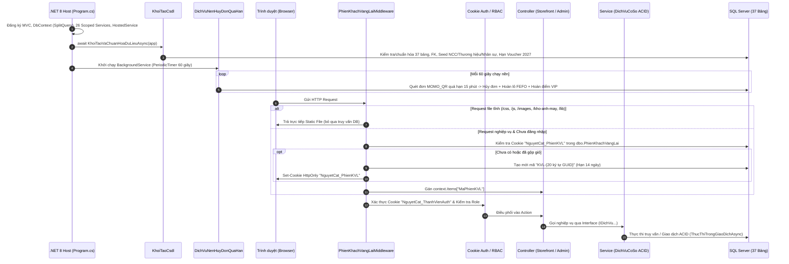
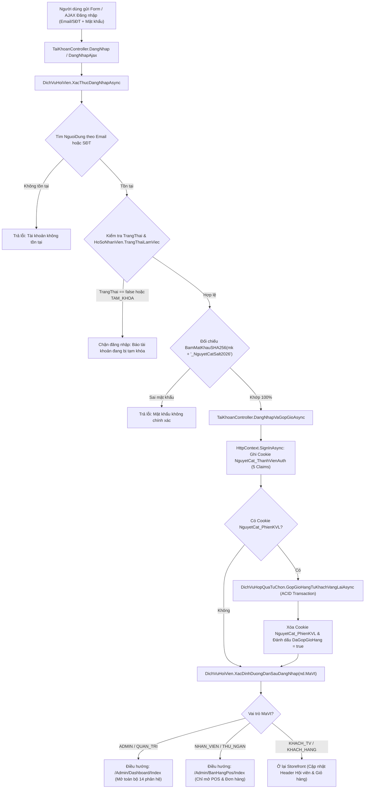
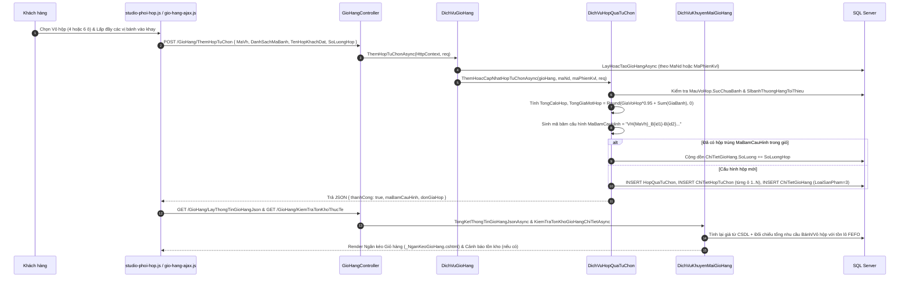
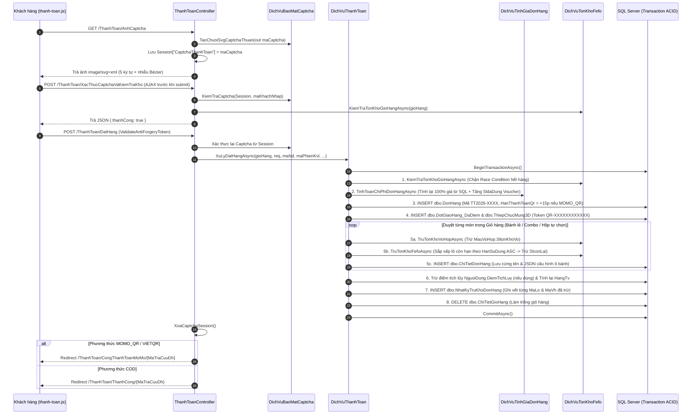
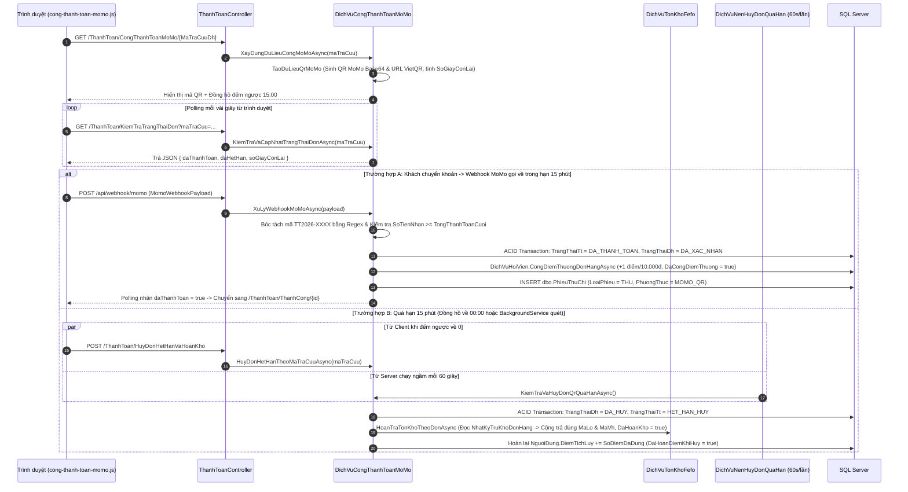
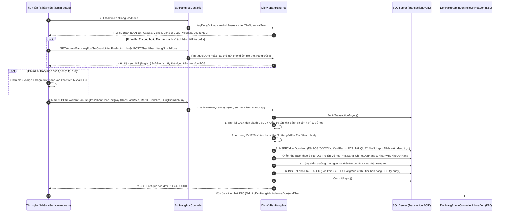
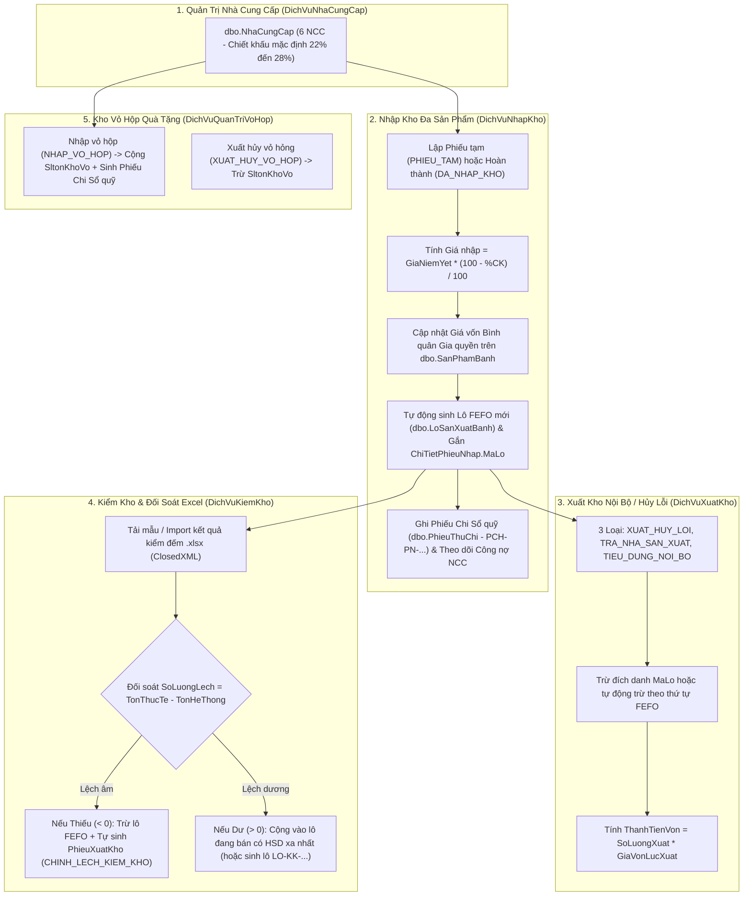
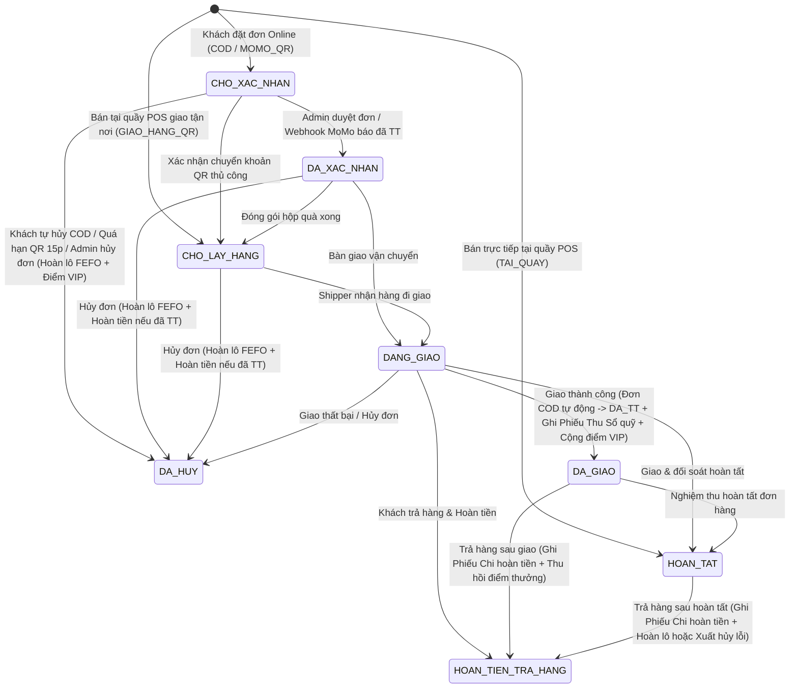

# Tài Liệu Chi Tiết Toàn Bộ Luồng Chạy Hệ Thống Nguyệt Cát ERP (`DoAn_WebBanhTrungThu`)

Tài liệu này mô tả chi tiết từ đầu đến cuối **tất cả các luồng thực thi (Execution & Business Flows)** của dự án **Nguyệt Cát ERP — Hệ Thống Thương Mại Điện Tử & Mini-ERP Quản Lý Phân Phối Bánh Trung Thu Đa Thương Hiệu**, đối chiếu trực tiếp 100% với mã nguồn thực tế trong `WebBanhTrungThu` (ASP.NET Core 8.0 MVC & SQL Server 37 bảng SQL-First).

---

## Mục Lục

1. [Luồng 1: Khởi Động Ứng Dụng, Chuẩn Hóa CSDL, Middleware & Tiến Trình Nền](#1-luong-1-khoi-dong-ung-dung-chuan-hoa-csdl-middleware--tien-trinh-nen)
2. [Luồng 2: Xác Thực (Auth), Phân Quyền RBAC 2 Vai Trò & Hợp Nhất Giỏ Hàng](#2-luong-2-xac-thuc-auth-phan-quyen-rbac-2-vai-tro--hop-nhat-gio-hang)
3. [Luồng 3: Phân Hệ Khách Hàng Storefront (Trang Chủ 5 Tầng, Trợ Lý Chọn Bánh, Chi Tiết SP)](#3-luong-3-phan-he-khach-hang-storefront-trang-chu-5-tang-tro-ly-chon-banh-chi-tiet-sp)
4. [Luồng 4: Studio Tự Phối Hộp Quà 4/6 Bánh & Giỏ Hàng AJAX Thời Gian Thực](#4-luong-4-studio-tu-phoi-hop-qua-46-banh--gio-hang-ajax-thoi-gian-thuc)
5. [Luồng 5: Thanh Toán Phẳng Anti-Tampering, Captcha SVG, Đặt Hàng ACID & Trừ Kho FEFO](#5-luong-5-thanh-toan-phang-anti-tampering-captcha-svg-dat-hang-acid--tru-kho-fefo)
6. [Luồng 6: Cổng Thanh Toán QR MoMo / VietQR 15 Phút, Webhook Tự Động & Rollback Hoàn Kho](#6-luong-6-cong-thanh-toan-qr-momo--vietqr-15-phut-webhook-tu-dong--rollback-hoan-kho)
7. [Luồng 7: Hồ Sơ Hội Viên VIP, Tự Hủy Đơn COD, Đặt Lại Đơn & Thiệp Chúc Mừng 3D QR](#7-luong-7-ho-so-hoi-vien-vip-tu-huy-don-cod-dat-lai-don--thiep-chuc-mung-3d-qr)
8. [Luồng 8: Bán Hàng Tại Quầy Web POS & In Hóa Đơn Nhiệt Khổ K80](#8-luong-8-ban-hang-tai-quay-web-pos--in-hoa-don-nhiet-kho-k80)
9. [Luồng 9: Chuỗi Cung Ứng Kho Đại Lý Mini-ERP (NCC – Nhập Kho – Xuất Kho – Kiểm Kho – Vỏ Hộp)](#9-luong-9-chuoi-cung-ung-kho-dai-ly-mini-erp-ncc--nhap-kho--xuat-kho--kiem-kho--vo-hop)
10. [Luồng 10: Quản Trị Đơn Hàng Đa Kênh, Hàng Hóa, Nhân Sự, Sổ Quỹ & Cài Đặt Hệ Thống](#10-luong-10-quan-tri-don-hang-da-kenh-hang-hoa-nhan-su-so-quy--cai-dat-he-thong)
11. [Bảng Tổng Hợp Đối Chiếu 37 Bảng SQL-First Theo Từng Luồng Nghiệp Vụ](#11-bang-tong-hop-doi-chieu-37-bang-sql-first-theo-tung-luong-nghiep-vu)
12. [Điều Phối Frontend Vanilla ES6 JavaScript (`21` Files) & Hệ Thống CSS (`5` Files)](#12-điều-phối-frontend-vanilla-es6-javascript--21-files--hệ-thống-css--5-files)

---

## 1. Luồng 1: Khởi Động Ứng Dụng, Chuẩn Hóa CSDL, Middleware & Tiến Trình Nền

### 1.1. Sơ Đồ Tổng Quan Pipeline Khởi Động & Xử Lý Request

### 1.2. Chi Tiết Từng Bước Tại `WebBanhTrungThu/Program.cs`

1. **Đăng ký MVC & Bộ tuần tự hóa JSON (`Dòng 19–24`):**
   - Cấu hình `ReferenceHandler.IgnoreCycles` để tránh lỗi vòng lặp tham chiếu khi trả JSON từ các thực thể EF Core có Navigation Properties hai chiều.
2. **Đăng ký `CSDLBanhTrungThuContext` (`Dòng 27–30`):**
   - Kết nối SQL Server qua chuỗi kết nối `"ChuoiKetNoiCSDL"` trong `appsettings.json`.
   - Bật toàn cục `UseQuerySplittingBehavior(QuerySplittingBehavior.SplitQuery)` giúp chia nhỏ các truy vấn có nhiều `.Include()` thành các câu lệnh SQL tách biệt, loại bỏ hiện tượng nhân tích Đề-các (Cartesian Explosion) và cảnh báo EF Core `EventId 20504`.
3. **Đăng ký Dependency Injection (`Dòng 33–59`):**
   - Đăng ký **26 Scoped Service Interfaces (`IDichVu...`)** cùng `IDichVuCoSo` (tổng 26 Interfaces trong `Services/Interfaces/`) và **1 Hosted Background Service** (`DichVuNenHuyDonQuaHan`).
4. **Cấu hình Cookie Authentication & Session (`Dòng 62–80`):**
   - Cookie xác thực tên `"NguyetCat_ThanhVienAuth"`, thời hạn `7` ngày (`SlidingExpiration = true`), `LoginPath = "/TaiKhoan/DangNhap"`, `LogoutPath = "/TaiKhoan/DangXuat"`, `AccessDeniedPath = "/TaiKhoan/TuChoiTruyCap"`.
   - Session có `IdleTimeout = 60 phút`, `HttpOnly = true`, `IsEssential = true` (phục vụ lưu mã Captcha SVG tại trang Thanh toán).
5. **Khởi tạo & Chuẩn hóa CSDL khi khởi động (`Dòng 85` — `Data/KhoiTaoCsdl.cs`):**
   - Gọi `await KhoiTaoCsdl.KhoiTaoVaChuanHoaDuLieuAsync(app)` thực hiện tuần tự:
     - `TaoCacBangMoRongVaDonBangThuaAsync`: Đảm bảo đầy đủ 37 bảng và các cột khóa ngoại chuẩn SQL-First, xóa các bảng thừa cũ nếu có.
     - `SeedNhaCungCapMacDinhAsync` & `SeedThuongHieuVaChuanHoaHangHoaAsync`: Đảm bảo 6 thương hiệu và 6 nhà cung cấp chính hãng có đủ khóa ngoại `MaThuongHieu`, `MaNccMacDinh`.
     - `DiTruDuLieuCauHinhMoRongAsync`: Đảm bảo bảng `CauHinhHeThong` chỉ giữ đúng 4 khóa cài đặt hệ thống (`CAU_HINH_QR_MOMO`, `CAU_HINH_CUA_HANG`, `CAU_HINH_VAN_CHUYEN`, `CAU_HINH_HOI_VIEN_VIP`).
     - `ChuanHoaMaKhuyenMaiVaLoBanhFefoAsync`: Gia hạn các mã khuyến mãi mẫu (`TRANGTRON2026`, `QUATANG15K`) đến `31/12/2027` và chuẩn hóa hạn sử dụng các lô bánh FEFO.
     - `SeedHoSoNhanVienVaDongBoVaiTroAsync`: Đồng bộ bảng `HoSoNhanVien` (`NV001`, `NV002`, `NV003`) và mô hình 2 vai trò nội bộ (`ADMIN`, `NHAN_VIEN`).
6. **Ánh xạ Kho ảnh ổ đĩa vật lý (`Dòng 97–106`):**
   - Dùng `PhysicalFileProvider` ánh xạ thư mục vật lý `C:\Users\MinhDuc\KhoAnhBanhTrungThu` (cấu hình tại `CauHinhKhoAnh:ThuMucODiaMay`) thành đường dẫn ảo `/kho-anh-may`.
7. **Kích hoạt `PhienKhachVangLaiMiddleware` (`Dòng 114` — `Middlewares/PhienKhachVangLaiMiddleware.cs`):**
   - Bỏ qua ngay lập tức nếu đường dẫn bắt đầu bằng `/css`, `/js`, `/images`, `/kho-anh-may`, `/lib`.
   - Nếu người dùng **chưa đăng nhập** (`!context.User.Identity.IsAuthenticated`):
     - Đọc cookie `NguyetCat_PhienKVL`.
     - Kiểm tra trong bảng `dbo.PhienKhachVangLai` xem `MaPhienKvl == maPhien && !DaGopGioHang` có tồn tại không.
     - Nếu chưa có hoặc không tồn tại: sinh mã mới `"KVL-" + Guid.NewGuid().ToString("N").ToUpper()[..20]`, lưu bản ghi vào `dbo.PhienKhachVangLai` (kèm IP, User-Agent, hạn 14 ngày), ghi Cookie `HttpOnly` sống 14 ngày và gán vào `context.Items["MaPhienKVL"]` để Controller sử dụng ngay trong cùng HTTP Request.
8. **Định tuyến Routing (`Dòng 117–129`):**
   - Route `"admin_soquy"`: `/Admin/SoQuy` -> `Area = Admin, Controller = SoQuyAdmin, Action = Index`.
   - Route `"areas"`: `{area:exists}/{controller=Dashboard}/{action=Index}/{id?}`.
   - Route `"default"`: `{controller=Home}/{action=Index}/{id?}`.

### 1.3. Luồng Tiến Trình Nền Tự Động Hủy Đơn QR Quá Hạn (`Services/Nen/DichVuNenHuyDonQuaHan.cs`)

- Kế thừa `BackgroundService`, chạy suốt vòng đời ứng dụng:
  1. Khi ứng dụng vừa bật, `Task.Delay(10 giây)` để chờ `KhoiTaoCsdl` hoàn tất.
  2. Khởi tạo `PeriodicTimer(TimeSpan.FromSeconds(60))`.
  3. Mỗi `60` giây: tạo một DI Scope mới (`_scopeFactory.CreateScope()`), lấy `IDichVuCongThanhToanMoMo` và gọi `await dichVuMoMo.KiemTraVaHuyDonQrQuaHanAsync()`.
  4. Nếu có đơn QR MoMo quá hạn `15` phút (`bayGio >= (d.HanThanhToanQr ?? d.NgayDat.AddMinutes(15))`), hệ thống tự động hủy đơn, hoàn trả bánh về đúng lô FEFO qua `NhatKyTruKhoDonHang` và hoàn điểm VIP ngay cả khi khách hàng đã tắt trình duyệt.

### 1.4. Luồng Quản Lý Giao Dịch ACID Cơ Sở (`Services/CoSo/DichVuCoSo.cs`)

- Mọi Service nghiệp vụ đều kế thừa lớp trừu tượng `DichVuCoSo`.
- Phương thức `ThucThiTrongGiaoDichAsync`:
  - Kiểm tra `_context.Database.CurrentTransaction`. Nếu đã có giao dịch mở sẵn (ví dụ hàm cha đã mở transaction), tự động tham gia vào giao dịch đó để tránh lỗi Nested Transaction.
  - Nếu chưa có, mở `await _context.Database.BeginTransactionAsync()`, thực thi tác vụ, gọi `await giaoDichMoi.CommitAsync()`. Nếu xảy ra bất kỳ ngoại lệ nào, lập tức `await giaoDichMoi.RollbackAsync()` để bảo toàn tính nguyên tử (Atomicity) giữa Kho hàng – Đơn hàng – Điểm VIP – Sổ quỹ.

---

## 2. Luồng 2: Xác Thực (Auth), Phân Quyền RBAC 2 Vai Trò & Hợp Nhất Giỏ Hàng

### 2.1. Sơ Đồ Luồng Đăng Nhập, Hợp Nhất Giỏ Hàng & Phân Quyền Điều Hướng

### 2.2. Chi Tiết Luồng Đăng Ký Hội Viên Mới (`TaiKhoanController.DangKyAjax` -> `DichVuHoiVien.DangKyHoiVienMoiAsync`)

1. Kiểm tra tính hợp lệ của `HoTen`, `Sdt`, `Email`, `MatKhau`.
2. Kiểm tra trùng lặp trong bảng `dbo.NguoiDung` (`Email == thuDienTu || Sdt == soDt`).
3. Băm mật khẩu theo chuẩn SHA-256 có Salt cố định tại `ThongTinPhienHelper.BamMatKhauSHA256`:
   $$\text{MatKhauHash} = \text{SHA256}(\text{UTF8}(\text{matKhauThuan} + \text{"\_NguyetCatSalt2026"}))$$
4. Tạo bản ghi `NguoiDung` mới với:
   - `MaVt = "KHACH_TV"`, `DiemTichLuy = 50` (**tặng ngay 50 điểm mở thẻ**), `HangTv = "Đồng"`, `TrangThai = true`.
5. Tự động gọi `DangNhapVaGopGioAsync(ndMoi)` để cấp Cookie đăng nhập và gộp toàn bộ giỏ hàng khách vãng lai vừa chọn trước khi đăng ký vào tài khoản mới.

### 2.3. Chi Tiết Thuật Toán Hợp Nhất Giỏ Hàng (`DichVuHopQuaTuChon.GopGioHangTuKhachVangLaiAsync`)

Khi khách vãng lai (đang có mã `MaPhienKVL` và đã thêm bánh/combo/hộp tự phối vào giỏ) thực hiện **Đăng nhập** hoặc **Đăng ký**, hệ thống chạy trong giao dịch ACID (`ThucThiTrongGiaoDichAsync`):
1. Tìm giỏ hàng của khách vãng lai (`gioHangGuest` theo `MaPhienKvl`) và giỏ hàng hiện có của tài khoản thành viên (`gioHangMember` theo `MaNd`).
2. **Trường hợp 1 (`gioHangMember == null` — Thành viên chưa có giỏ hàng):**
   - Chuyển trực tiếp quyền sở hữu `gioHangGuest` sang thành viên: `gioHangGuest.MaNd = maND`, `gioHangGuest.MaPhienKvl = null`.
   - Cập nhật toàn bộ `HopQuaTuChon` có `MaPhienKvl == maPhienKVL` sang `MaNd = maND`, `MaPhienKvl = null`.
3. **Trường hợp 2 (`gioHangMember != null` — Thành viên đã có giỏ hàng cũ):**
   - Duyệt từng dòng `monGuest` trong `gioHangGuest.ChiTietGioHangs`:
     - Nếu `LoaiSanPham == 1` (Bánh lẻ): tìm dòng trong `gioHangMember` có cùng `MaBanh`.
     - Nếu `LoaiSanPham == 2` (Combo có sẵn): tìm dòng trong `gioHangMember` có cùng `MaCb`.
     - Nếu `LoaiSanPham == 3` (Hộp quà tự chọn): so sánh chuỗi băm cấu hình **`MaBamCauHinh`** (`VH{MaVh}_B{MaBanh1}-B{MaBanh2}...`).
     - **Nếu trùng:** Cộng dồn `monTrungTrongMember.SoLuong += monGuest.SoLuong` và xóa dòng `monGuest`.
     - **Nếu không trùng:** Chuyển dòng `monGuest.MaGh = gioHangMember.MaGh` và gán `MaNd = maND` cho `HopQuaTuChon` tương ứng.
   - Kế thừa mã khuyến mãi `CodeKmdangApDung` nếu giỏ Guest đang áp dụng mã.
   - Xóa bản ghi `gioHangGuest` rỗng.
4. Cập nhật bản ghi `dbo.PhienKhachVangLai`: `DaGopGioHang = true`, `MaNdDaGop = maND`.
5. Xóa Cookie `NguyetCat_PhienKVL` trên trình duyệt.

### 2.4. Cơ Chế Phân Quyền RBAC 2 Vai Trò Nội Bộ (`ADMIN` vs `NHAN_VIEN`)

Hệ thống phân tách chặt chẽ quyền truy cập qua `[Authorize(Roles = ...)]` trên 14 Admin Controllers và thanh điều hướng `_ThanhDieuHuongQuanTri.cshtml`:

| Vai trò | Tài khoản Demo | Điều hướng sau đăng nhập | Phân hệ được phép truy cập | Phân hệ bị chặn (`302 -> /TaiKhoan/TuChoiTruyCap`) |
| :--- | :--- | :--- | :--- | :--- |
| **Chủ cửa hàng (`ADMIN`)** | `admin@nguyetcat.vn` (`NV001`) | `/Admin/Dashboard/Index` | **Toàn bộ 14/14 phân hệ** (`Dashboard`, `SanPhamAdmin`, `VoHopAdmin`, `NhapKhoAdmin`, `XuatKhoAdmin`, `KiemKhoAdmin`, `NhaCungCapAdmin`, `DonHangAdmin`, `BanHangPos`, `KhachHangAdmin`, `NhanVienAdmin`, `SoQuyAdmin`, `KhoAnhAdmin`, `CaiDatAdmin`) | Không bị chặn phân hệ nào |
| **Nhân viên Bán hàng (`NHAN_VIEN`)** | `thungan@nguyetcat.vn` (`NV002`), `giaohang@nguyetcat.vn` (`NV003`) | `/Admin/BanHangPos/Index` | **Chỉ 2/14 phân hệ tác nghiệp:** 1. `BanHangPosController` (Quầy POS) 2. `DonHangAdminController` (Đơn hàng & In K80, không có quyền Admin Override) | **Chặn tuyệt đối 12/14 phân hệ nhạy cảm** (Tổng quan KPI, Hàng hóa, Vỏ hộp, Nhập kho, Xuất kho, Kiểm kho, Nhà cung cấp, Khách hàng & KM, Nhân viên, Sổ quỹ, Kho ảnh, Cài đặt) |

---

## 3. Luồng 3: Phân Hệ Khách Hàng Storefront (Trang Chủ 5 Tầng, Trợ Lý Chọn Bánh, Chi Tiết SP)

### 3.1. Luồng Tải Trang Chủ 5 Tầng (`HomeController.Index` -> `DichVuTrangChu.XayDungDuLieuTrangChuAsync`)

Khi khách hàng truy cập `GET /` (`Home/Index.cshtml`):
1. `HomeController` gọi `LayThongTinPhienHienTai()` lấy cặp `(maND, maPhienKVL)` và chuyển cho `DichVuTrangChu.XayDungDuLieuTrangChuAsync`.
2. **Nạp từ điển hình ảnh 1 lần (`_dichVuHinhAnh.LayTuDienUrlAnhAsync()`):**
   - Truy vấn toàn bộ bảng `dbo.LienKetHinhAnh` kèm `KhoHinhAnh` và đóng gói vào `Dictionary<string, string>` với khóa `"{LoaiDoiTuong}_{MaDoiTuong}_{VaiTroAnh}"` (ví dụ: `"BANH_1_ANH_CHINH"`, `"BANH_1_TACH_NEN_SLOT"`, `"VOHOP_1_KHAY_HOP_RONG"`).
   - Giúp trang chủ hiển thị 60 sản phẩm, vỏ hộp và combo mà **không phát sinh lỗi N+1 Query**.
3. **Nạp cấu hình Landing Page & Danh mục hàng hóa:**
   - Lấy các phân khu đang kích hoạt trong `dbo.CauHinhLandingPage` (`HERO_BANNER`, `BOX_BUILDER_INTRO`).
   - Lấy danh sách `DanhMucBanh`, `SanPhamBanh` (`.Include(ThongSoDinhDuong)`, `.Include(LoSanXuatBanhs)`, `.Include(MaThuongHieuNavigation)`), `MauVoHop`, `ComboMauCoSan`, `ThuongHieu`, `BangChietKhauSiB2B` và `MaKhuyenMai` còn hạn.
4. **Render 5 tầng giao diện (`Views/Home/PhanKhu/`):**
   - **Tầng 1 (`_Tang1_HeroBanner.cshtml`):** Hero Banner mùa trăng, đồng hồ đếm ngược và CTA cuộn mượt.
   - **Tầng 2 (`_Tang2_StudioPhoiHop.cshtml`):** Studio Tự Phối Hộp Quà 4 bánh & 6 bánh tương tác trực tiếp (`studio-phoi-hop.js`).
   - **Tầng 3 (`_Tang3_BoSuuTapBanh.cshtml`):** Bộ sưu tập 60 vị bánh đa thương hiệu (**Kinh Đô, Đồng Khánh, Như Lan, Brodard, Givral**) hỗ trợ lọc tức thì theo thương hiệu, danh mục, hương vị, bánh chay và bánh đường ăn kiêng `Isomalt`.
   - **Tầng 4 (`_Tang4_ChietKhauSoLuong.cshtml`):** Bảng chiết khấu sỉ B2B theo bậc số lượng hộp (lên đến `22%`) và đặc quyền miễn phí khuôn in logo doanh nghiệp.
   - **Tầng 5 (`_Tang5_ThiepQrVaFooter.cshtml`):** Trình diễn tính năng Thiệp chúc mừng 3D QR và thông tin hệ thống đại lý.

### 3.2. Luồng Thuật Toán Trợ Lý Chọn Bánh Thông Minh 30 Giây (`GET /Home/GoiYBanhThongMinh`)

Khi khách hàng mở Modal Tư vấn (`_ModalTuVanVaTraCuu.cshtml`, `tu-van-va-tien-ich.js`) và chọn 4 tiêu chí (`doiTuong`, `sucKhoe`, `huongVi`, `nganSachMax`), `DichVuTrangChu.GoiYBanhThongMinhAsync` chấm điểm từng bánh theo **Ma trận trọng số $S(P)$ (tối đa 100 điểm)**:

$$S(P) = W_{\text{SứcKhỏe}} + W_{\text{NgânSách}} + W_{\text{ĐốiTượng}} + W_{\text{HươngVị}} - P_{\text{Phạt}}$$

- **Tiêu chí 1 — Sức khỏe ($W_1 = 35$ điểm):**
  - Nếu chọn `"TIEU_DUONG"`: Bánh có `MucDoNgot == "ISOMALT_TIEUDUONG"` và chỉ số đường huyết $\text{GI} \le 45$ đạt tuyệt đối `+35 điểm`; bánh `"IT_NGOT"` đạt `+21 điểm`; bánh ngọt thường bị phạt $P_{\text{Phạt}} = 500$ điểm (loại hoàn toàn khỏi danh sách gợi ý để bảo vệ sức khỏe người tiểu đường).
  - Nếu chọn `"AN_CHAY"`: Bánh có `LaBanhChay == true` đạt `+35 điểm`; bánh mặn bị phạt $P_{\text{Phạt}} = 500$ điểm.
  - Nếu chọn bình thường: đạt `+30 điểm`.
- **Tiêu chí 2 — Ngân sách dự kiến ($W_2 = 25$ điểm):**
  - Ước tính giá hộp 4 bánh ($\text{DonGiaLe} \times 4 \le \text{nganSachMax}$): đạt `+25 điểm`; nếu vượt ngân sách: đạt `+15 điểm`.
- **Tiêu chí 3 — Đối tượng biếu tặng ($W_3 = 20$ điểm):**
  - Cột `TheDoiTuongPhuHop` chứa mã đối tượng (`ONG_BA`, `SEP_VIP`, `DOI_TAC`, `TRE_EM`, ...): đạt `+20 điểm`, ngược lại `+8 điểm`.
- **Tiêu chí 4 — Gu hương vị ($W_4 = 20$ điểm):**
  - Khớp `NhomHuongVi`: đạt `+20 điểm`, ngược lại `+10 điểm`.
- Hệ thống lọc các bánh có $S(P) > 0$, sắp xếp giảm dần theo độ phù hợp (`Math.Min(99, Math.Round(tongDiem))`) và trả về **Top 3 vị bánh phù hợp nhất** kèm lý do giải thích chi tiết.

### 3.3. Luồng Xem Chi Tiết Sản Phẩm & Định Giá Lô Cận Date (`GET /SanPham/ChiTiet/{id}`)

Thực thi tại `SanPhamController.ChiTiet` -> `DichVuChiTietSanPham.LayChiTietSanPhamAsync` (kết hợp property mở rộng trong `Models/Entities/DuLieuMoRongHeThong.Partial.cs`):
1. Truy vấn `SanPhamBanh` kèm `ThongSoDinhDuong`, `LoSanXuatBanhs`, `MaDmNavigation`, `MaThuongHieuNavigation`, `MaNccMacDinhNavigation`.
2. **Xác định Lô FEFO gần hạn nhất & Giá bán thực tế (`DonGiaThucTe`):**
   - Lọc các lô còn hạn sử dụng (`HanSuDung > homNay`, `SlconLai > 0`, `TrangThaiLo in {"DANG_BAN", "XA_CAN_DATE", "CAN_DATE"}`), sắp xếp tăng dần theo `HanSuDung` (lô hết hạn trước đứng đầu).
   - Lấy lô đầu tiên làm `LoFefoGanNhat`, tính số ngày còn lại: `SoNgayConLaiHsd = loGanNhat.HanSuDung.DayNumber - homNay.DayNumber`.
   - Tính tồn kho khả dụng thực tế:
     $$\text{TonKhoKhaDung} = \min\left(\max(0, \text{TongTonKho}), \sum_{l \in \text{LôCònHạn}} l.\text{SlconLai}\right)$$
   - Nếu lô FEFO đang bật giảm giá xả kho cận date (`PhanTramGiamCanDateHieuLuc > 0`), đơn giá bán thực tế được tự động chiết khấu:
     $$\text{DonGiaThucTe} = \text{Round}\left(\text{DonGiaLe} \times \frac{100 - \text{PhanTramGiamCanDateHieuLuc}}{100}, 0\right)$$
3. **Tổng hợp thông tin chuyên sâu:**
   - Bảng dinh dưỡng `ThongSoDinhDuong` (`NangLuongCalo`, `LuongDuongGram`, `LuongDamGram`, `ChatBeoGram`, `ChiSoDuongHuyetGi`, `CanhBaoDiUng`).
   - Tự động sinh gợi ý thưởng trà (`XacDinhGoiYThuongTra`) dựa trên đặc tính bánh chay/Isomalt hoặc nhân Lava kim sa.
   - Tìm **4 sản phẩm liên quan** ưu tiên cùng Danh mục (+2 điểm), cùng Thương hiệu (+1 điểm) và còn tồn kho (+1 điểm).

---

## 4. Luồng 4: Studio Tự Phối Hộp Quà 4/6 Bánh & Giỏ Hàng AJAX Thời Gian Thực

### 4.1. Sơ Đồ Luồng Tự Phối Hộp Quà & Quản Lý Giỏ Hàng AJAX

### 4.2. Chi Tiết Quy Tắc Nghiệp Vụ Khi Tự Phối Hộp Quà (`DichVuHopQuaTuChon.cs`)

1. **Kiểm tra quy cách khay hộp:**
   - Số lượng bánh gửi lên `req.DanhSachMaBanh.Count` bắt buộc phải bằng đúng `voHop.SucChuaBanh` (4 bánh cho khay `2x2`, 6 bánh cho khay `3x2`).
   - Đếm số lượng bánh có `LaBanhThuongHang == true` trong khay; nếu nhỏ hơn `voHop.SlbanhThuongHangToiThieu` (ví dụ hộp Sơn Mài Hoàng Gia yêu cầu tối thiểu 1–2 bánh Thượng Hạng), hệ thống từ chối và báo lỗi rõ ràng.
2. **Công thức định giá Hộp tự chọn (Ưu đãi giảm 5% giá vỏ hộp):**
   $$\text{TongGiaMotHop} = \text{Round}\left(\text{GiaVoHopRieng} \times 0.95 + \sum_{i=1}^{N} \text{DonGiaThucTe}(B_i), 0\right)$$
3. **Định danh cấu hình bằng Mã Băm (`MaBamCauHinh`):**
   - Công thức: `"VH" + MaVh + "_B" + string.Join("-B", DanhSachMaBanh)` (Ví dụ: `VH1_B1-B5-B12-B18`).
   - Nếu trong giỏ hàng đã có dòng `LoaiSanPham == 3` mang cùng `MaBamCauHinh`, hệ thống chỉ tăng số lượng dòng đó thay vì sinh bản ghi trùng lặp.
4. **Dọn dẹp hộp tự chọn mồ côi (`XoaDongChiTietVaHopMoCoiAsync`):**
   - Khi khách hàng xóa dòng hộp tự chọn khỏi giỏ (hoặc giảm số lượng về 0), hệ thống kiểm tra xem `MaHopTc` đó đã từng gắn với đơn hàng nào (`ChiTietDonHang`) hay còn nằm trong giỏ hàng nào khác không. Nếu chưa gắn với đơn hàng nào, hệ thống tự động xóa sạch `ChiTietHopTuChon` và `HopQuaTuChon` để tránh rác CSDL.

### 4.3. Chi Tiết Kiểm Tra Tồn Kho Thực Tế Đa Sản Phẩm Trong Giỏ (`KiemTraTonKhoGioHangChiTietAsync`)

Một giỏ hàng có thể chứa đồng thời **Bánh lẻ (`LoaiSanPham = 1`)**, **Combo mẫu (`LoaiSanPham = 2`)** và **Hộp quà tự phối (`LoaiSanPham = 3`)** cùng sử dụng chung một vị bánh hoặc một mẫu vỏ hộp. Hệ thống quy đổi tổng nhu cầu thực tế như sau:
- **Tổng nhu cầu theo từng mã bánh (`nhuCauBanh[MaBanh]`):**
  $$\text{SoLuongCan}(b) = \sum_{\text{Bánh lẻ}} \text{SL} + \sum_{\text{Combo}} (\text{SL}_{\text{Combo}} \times \text{SL}_{\text{BánhTrongCombo}}) + \sum_{\text{HộpTựChọn}} (\text{SL}_{\text{Hộp}} \times \text{SốÔChứaBánh } b)$$
- **Tổng nhu cầu theo từng mẫu vỏ hộp (`nhuCauVoHop[MaVh]`):**
  $$\text{SoLuongCan}(vh) = \sum_{\text{Combo dùng vỏ } vh} \text{SL}_{\text{Combo}} + \sum_{\text{HộpTựChọn dùng vỏ } vh} \text{SL}_{\text{Hộp}}$$
- Đối chiếu với `tonThucTe = Math.Min(SanPhamBanh.TongTonKho, Sum(LoSanXuatBanh.SlconLai còn hạn))`. Nếu bất kỳ vị bánh hay mẫu vỏ hộp nào thiếu tồn kho, hệ thống trả về cảnh báo chính xác trên từng dòng `MaCtgh` trong ngăn kéo giỏ hàng.

---

## 5. Luồng 5: Thanh Toán Phẳng Anti-Tampering, Captcha SVG, Đặt Hàng ACID & Trừ Kho FEFO

### 5.1. Sơ Đồ Luồng Đặt Hàng Nguyên Tử ACID & Trừ Kho Theo Lô FEFO

### 5.2. Công Thức Tính Giá Đơn Hàng 5 Lớp Chống Giả Mạo F12 (`DichVuTinhGiaDonHang.cs`)

Mọi dữ liệu giá tiền từ phía trình duyệt đều bị bỏ qua. Server tính lại 100% từ CSDL qua `TinhToanChiPhiDonHangAsync`:

1. **Lớp 1 — Tổng tiền hàng gốc (`TongTienHang`):**
   - Bánh lẻ (`LoaiSanPham = 1`): $\text{DonGia} = \text{Round}(\text{SanPhamBanh.DonGiaThucTe}, 0)$ (đã bao gồm giảm giá xả cận date nếu có).
   - Combo mẫu (`LoaiSanPham = 2`): $\text{DonGia} = \text{Round}(\text{ComboMauCoSan.GiaUuDaiCombo}, 0)$.
   - Hộp tự chọn (`LoaiSanPham = 3`): $\text{DonGia} = \text{Round}(\text{GiaVoHopRieng} \times 0.95 + \sum \text{DonGiaThucTe}, 0)$.
   - $\text{TongTienHang} = \sum (\text{SoLuong} \times \text{DonGia})$.
2. **Lớp 2 — Chiết khấu sỉ B2B & Phí khuôn in Logo (`BangChietKhauSiB2B`):**
   - Tính tổng số hộp quà: $\text{TongSoHop} = \sum_{\text{LoaiSanPham} \in \{2,3\}} \text{SoLuong}$.
   - Tra bảng `dbo.BangChietKhauSiB2B` tìm bậc có $\text{SlhopToiThieu} \le \text{TongSoHop} \le \text{SlhopToiDa}$ (hoặc bậc cao nhất nếu vượt ngưỡng).
   - $\text{TienChietKhauB2B} = \text{Round}(\text{TongTienHang} \times \frac{\text{PhanTramCkB2B}}{100}, 0)$.
   - Nếu khách chọn đơn doanh nghiệp B2B kèm yêu cầu in Logo (`laDonDoanhNghiepB2B && yeuCauInLogo`): nếu bậc chiết khấu có `MienPhiInLogo == true` thì $\text{PhiInLogo} = 0$, ngược lại $\text{PhiInLogo} = \text{PhiKhuonInLogo}$ (mặc định `500.000 đ`).
3. **Lớp 3 — Mã khuyến mãi Voucher (`MaKhuyenMai`):**
   - Kiểm tra đủ 6 điều kiện: Mã tồn tại, `TrangThaiKichHoat == true`, `NgayBatDau <= bayGio <= NgayKetThuc`, `SldaDung < SltoiDa`, cho phép khách vãng lai (`maNd.HasValue || ChoPhepKhachVangLai`), và `TongTienHang >= DonToiThieu`.
   - Nếu `LoaiGiam == "PHAN_TRAM"`: $\text{TienGiamVoucher} = \min(\text{GiamToiDa}, \text{Round}(\text{TongTienHang} \times \frac{\text{GiaTriGiam}}{100}, 0))$.
   - Nếu `LoaiGiam == "TIEN_MAT"`: $\text{TienGiamVoucher} = \min(\text{TongTienHang}, \text{GiaTriGiam})$.
4. **Lớp 4 — Ưu đãi Hạng Hội viên VIP (`TienGiamVip`):**
   - Tiền hàng sau CK B2B & Voucher: $\text{TienSauCk} = \max(0, \text{TongTienHang} - \text{TienChietKhauB2B} - \text{TienGiamVoucher})$.
   - Xác định hạng VIP từ `DichVuHoiVien.TinhThongTinHangVipAsync` (`Đồng: 0%`, `Bạc: 3%`, `Vàng: 5%`, `Kim Cương: 10%`).
   - $\text{TienGiamVip} = \text{Round}(\text{TienSauCk} \times \frac{\text{PhanTramGiamVip}}{100}, 0)$.
5. **Lớp 5 — Tiêu điểm tích lũy VIP & Phí vận chuyển đa điểm (`TienGiamDiem` & `PhiVanChuyen`):**
   - Tiền hàng sau ưu đãi VIP: $\text{TienSauVip} = \max(0, \text{TienSauCk} - \text{TienGiamVip})$.
   - Trần tiêu điểm tối đa cho phép là **50% giá trị tiền hàng sau ưu đãi** ($1\text{ điểm} = 1.000\text{ đ}$):
     $$\text{SoDiemToiDaDuocDung} = \min\left(\text{DiemTichLuyHienCo}, \left\lfloor \frac{\text{TienSauVip} \times 0.5}{1000} \right\rfloor\right)$$
   - Tiền hàng sau giảm điểm: $\text{TienHangSauGiam} = \max(0, \text{TienSauVip} - \text{TienGiamDiem})$.
   - Kiểm tra mốc miễn phí giao hàng tiêu chuẩn: $\text{DuMocFreeship500k} = (\text{TienHangSauGiam} \ge 500.000\text{ đ})$.
   - Phí mỗi đợt giao (`PhiMoiDotGiao`):
     - Nếu `NHAN_TAI_CUA_HANG`: `0 đ`.
     - Nếu `GIAO_HOA_TOC` / `HOA_TOC_6H` và tất cả điểm nhận thuộc vùng hỗ trợ (**TP. Hồ Chí Minh** hoặc **An Giang / Long Xuyên**): `30.000 đ/điểm` (nếu đơn $\ge 500\text{k}$) hoặc `60.000 đ/điểm` (nếu đơn $< 500\text{k}$).
     - Nếu `GIAO_TIEU_CHUAN`: `0 đ/điểm` (nếu đơn $\ge 500\text{k}$) hoặc `30.000 đ/điểm` (nếu đơn $< 500\text{k}$).
   - Tổng phí vận chuyển theo số địa điểm nhận quà: $\text{PhiVanChuyen} = \text{SoDiemNhan} \times \text{PhiMoiDotGiao}$.
   - **Tổng thanh toán cuối cùng:**
     $$\text{TongThanhToanCuoi} = \max(0, \text{TienHangSauGiam} + \text{PhiInLogo} + \text{PhiVanChuyen})$$

### 5.3. Thuật Toán Trừ Kho FEFO & Ghi Nhật Ký Trừ Kho (`DichVuTonKhoFefo.TruTonKhoFefoAsync`)

Khi trừ số lượng `soLuongCanTru` cho mã bánh `maBanh`:
1. Giảm tổng tồn sản phẩm: `banh.TongTonKho = Math.Max(0, banh.TongTonKho - soLuongCanTru)`.
2. Lấy danh sách các lô khả dụng của bánh đó:
   - Điều kiện: `HanSuDung > homNay`, `TrangThaiLo in {"DANG_BAN", "XA_CAN_DATE"}`, `SlconLai > 0`.
   - Sắp xếp chuẩn **FEFO (First Expired, First Out)**: `.OrderBy(l => l.HanSuDung).ThenBy(l => l.MaLo)`.
3. Duyệt tuần tự qua từng lô từ hạn gần nhất đến hạn xa hơn:
   - `slTruLoNay = Math.Min(lo.SlconLai, conPhaiTru)`.
   - `lo.SlconLai -= slTruLoNay`; `conPhaiTru -= slTruLoNay`.
   - Ghi nhận cặp `(MaLo, MaBanh, SoLuongDaTru)` vào danh sách `danhSachLoDaTru`.
4. Toàn bộ các bản ghi trong `danhSachLoDaTru` và `danhSachVoHopDaTru` được lưu vào bảng vật lý **`dbo.NhatKyTruKhoDonHang`** (`LoaiDoiTuong = "LO_BANH"` hoặc `"VO_HOP"`, `DaHoanKho = false`). Nhờ bảng nhật ký này, khi đơn hàng bị hủy, hệ thống biết chính xác từng chiếc bánh đã được lấy ra từ lô sản xuất nào để hoàn trả về đúng lô đó.

---

## 6. Luồng 6: Cổng Thanh Toán QR MoMo / VietQR 15 Phút, Webhook Tự Động & Rollback Hoàn Kho

### 6.1. Sơ Đồ Luồng Thanh Toán QR 15 Phút (Webhook Thành Công vs Quá Hạn Tự Động Hủy)

### 6.2. Chi Tiết Kỹ Thuật Tại `DichVuCongThanhToanMoMo.cs`

1. **Cấu trúc Payload QR MoMo & VietQR (`TaoDuLieuQrMoMo`):**
   - Đọc cấu hình tài khoản nhận tiền từ `CauHinhHeThong` (`KhoaCauHinh = "CAU_HINH_QR_MOMO"`).
   - Sinh nội dung chuyển khoản không dấu: `NGUYETCAT TT2026-XXXX`.
   - Sinh chuỗi QR chuẩn ví MoMo: `2|99|{sdtMoMoRaw}|{tenChuTk}||0|0|{soTienNguyen}|{noiDungCk}|transfer_myqr` và render ra ảnh PNG Base64 bằng thư viện `QRCoder` (`ECCLevel.H`).
   - Đồng thời sinh đường dẫn ảnh VietQR (`https://img.vietqr.io/image/{bin}-{stk}-compact2.png?...`) nếu có cấu hình ngân hàng.
2. **Xử lý Webhook tự động (`XuLyWebhookMoMoAsync`):**
   - Endpoint: `POST /api/webhook/momo` (`[IgnoreAntiforgeryToken]`).
   - Tự động dùng Regex `TT2026[- ]?\d{4}` trích xuất mã đơn hàng từ nội dung chuyển khoản `Content` / `Description` / `OrderInfo`.
   - Kiểm tra chống gian lận: Đơn chưa quá hạn 15 phút, chưa bị hủy, và `soTienNhan >= Math.Round(donHang.TongThanhToanCuoi, 0)`.
   - Cập nhật trạng thái trong giao dịch ACID, cộng điểm thưởng VIP (có cờ khóa `DaCongDiemThuong` chống cộng điểm 2 lần nếu Webhook gọi lặp) và tự động ghi `PhieuThuChi` loại `THU` vào Sổ quỹ.
3. **Thuật toán Hoàn trả tồn kho theo Nhật ký (`DichVuTonKhoFefo.HoanTraTonKhoTheoDonAsync`):**
   - Kiểm tra cờ `if (donHang.DaRollbackKho) return;` để đảm bảo **Idempotent (không bao giờ cộng hoàn kho 2 lần)**.
   - Truy vấn các dòng `dbo.NhatKyTruKhoDonHang` của đơn có `DaHoanKho == false`.
   - Với mỗi dòng `LoaiDoiTuong == "LO_BANH"`:
     - Cộng lại `SanPhamBanh.TongTonKho += SoLuongDaTru`.
     - Tìm đúng lô gốc `MaLo == nkLo.MaLo`. Nếu lô gốc chưa bị đánh dấu `DA_HUY` và chưa `HET_HAN`, cộng trả chính xác `lo.SlconLai += SoLuongDaTru`. Nếu lô gốc đã bị hủy/hết hạn trong thời gian chờ, hệ thống tự động tìm lô `DANG_BAN` còn hạn xa nhất của sản phẩm đó để hoàn nhập an toàn.
     - Đánh dấu `nkLo.DaHoanKho = true`.
   - Với mỗi dòng `LoaiDoiTuong == "VO_HOP"`:
     - Cộng trả `MauVoHop.SltonKhoVo += SoLuongDaTru` và đánh dấu `nkVo.DaHoanKho = true`.
   - Đánh dấu `donHang.DaRollbackKho = true`.

---

## 7. Luồng 7: Hồ Sơ Hội Viên VIP, Tự Hủy Đơn COD, Đặt Lại Đơn & Thiệp Chúc Mừng 3D QR

### 7.1. Thuật Toán Xét Hạng Hội Viên VIP Chống Tụt Hạng (`DichVuHoiVien.XacDinhHangVipTheoChiTieu`)

Khi hội viên dùng điểm tích lũy để giảm giá đơn hàng, điểm hiện tại (`DiemTichLuy`) sẽ giảm xuống. Để đảm bảo **hội viên không bao giờ bị tụt hạng thẻ VIP khi tiêu điểm**, hệ thống tính `DiemXetHang` dựa trên giá trị lớn nhất giữa điểm hiện có và điểm quy đổi từ tổng chi tiêu tích lũy của các đơn hàng hợp lệ (`TrangThaiDh != "DA_HUY"`):

$$\text{DiemXetHang} = \max\left(\text{DiemHienTai}, \left\lfloor \frac{\text{TongChiTieuTichLuy}}{10.000} \right\rfloor\right)$$

| Hạng Hội Viên (`HangTv`) | Điều kiện Điểm xét hạng hoặc Tổng chi tiêu | Đặc quyền chiết khấu trực tiếp (`PhanTramGiamVip`) |
| :--- | :--- | :---: |
| **Kim Cương** | `DiemXetHang >= 600` hoặc `TongChiTieu >= 6.000.000 đ` | **Giảm 10%** trên mọi đơn hàng |
| **Vàng** | `DiemXetHang >= 300` hoặc `TongChiTieu >= 3.000.000 đ` | **Giảm 5%** trên mọi đơn hàng |
| **Bạc** | `DiemXetHang >= 100` hoặc `TongChiTieu >= 1.000.000 đ` | **Giảm 3%** trên mọi đơn hàng |
| **Đồng** | Mới đăng ký (Tặng `+50` điểm mở thẻ) | **0%** (Tích điểm đổi tiền $1\text{ điểm} = 1.000\text{ đ}$) |

### 7.2. Luồng Khách Hàng Tự Hủy Đơn COD (`TaiKhoanController.HuyDonHang` -> `DichVuHoiVien.KhachHangHuyDonCodAsync`)

1. **Kiểm tra bảo mật chống IDOR & Điều kiện nghiệp vụ:**
   - Bắt buộc đăng nhập (`[Authorize]`), có `[ValidateAntiForgeryToken]`.
   - Đơn hàng phải thuộc sở hữu của chính tài khoản đang đăng nhập (`don.MaNd == maNd`).
   - Phương thức thanh toán phải là `"COD"`.
   - Trạng thái đơn hàng hiện tại phải đang ở bước chờ duyệt (`TrangThaiDh == "CHO_XAC_NHAN"` hoặc `"CHO_DUYET"`). Nếu cửa hàng đã xác nhận hoặc đang giao thì chặn tự hủy trực tuyến.
2. **Thực thi hủy đơn trong giao dịch ACID (`ThucThiTrongGiaoDichAsync`):**
   - Cập nhật `don.TrangThaiDh = "DA_HUY"`, `don.LyDoHuy = "Khách hàng tự hủy: " + lyDo`, `don.NguoiCapNhatCuoi = "Khách hàng tự hủy"`.
   - Chuyển toàn bộ các đợt giao hàng `DotGiaoHangDaDiem` của đơn sang `TrangThaiGiao = "DA_HUY"`.
   - Gọi `_dichVuTonKho.HoanTraTonKhoTheoDonAsync(don)` để hoàn trả đầy đủ số bánh về đúng lô FEFO trong `NhatKyTruKhoDonHang` và hoàn trả tồn kho vỏ hộp.
   - Nếu đơn có dùng điểm tích lũy (`don.SoDiemDaDung > 0 && !don.DaHoanDiemKhiHuy`), cộng hoàn lại `nd.DiemTichLuy += don.SoDiemDaDung`, đánh dấu `don.DaHoanDiemKhiHuy = true` và tính lại hạng VIP.

### 7.3. Luồng Đặt Lại Đơn Hàng Cũ & Đặt Lại Hộp Tự Chọn (`DatLaiDonHang` & `DatLaiHopTuChon`)

- **Đặt lại toàn bộ đơn hàng cũ (`POST /GioHang/DatLaiDonHang` -> `DichVuHopQuaTuChon.SaoChepDonCuVaoGioHangAsync`):**
  - Đọc toàn bộ `ChiTietDonHang` của đơn cũ:
    - Với bánh lẻ (`LoaiSanPham = 1`) và Combo (`LoaiSanPham = 2`): thêm lại vào giỏ hàng với **đơn giá hiện hành mới nhất** từ CSDL.
    - Với Hộp quà tự chọn (`LoaiSanPham = 3`): gọi `SaoChepHopQuaTuChonAsync` tạo bản sao `HopQuaTuChon` mới cùng toàn bộ các ô bánh `ChiTietHopTuChon` và đưa vào giỏ.
- **Đặt lại một mẫu hộp từ Bộ sưu tập cá nhân (`POST /TaiKhoan/DatLaiHopTuChon` -> `DichVuHoiVien.DatLaiHopTuChonVaoGioAsync`):**
  - Đưa mẫu `HopQuaTuChon` đã lưu trong tab Bộ sưu tập hộp của hội viên vào lại giỏ hàng hiện tại.

### 7.4. Luồng Xem Thiệp Chúc Mừng 3D Qua Mã QR (`GET /Thiep3D/Xem/{id}`)

1. Khi người nhận quà quét mã QR in trên hộp bánh (hoặc bấm link `/Thiep3D/Xem/{MaTokenThiepQr}` từ trang Biên lai / Chi tiết đơn):
2. `Thiep3DController.Xem` tìm bản ghi `DotGiaoHangDaDiem` có `MaTokenThiepQr == tokenChuan && CoKemThiepQr == true` và bản ghi `dbo.ThiepChucMung3D` tương ứng.
3. Đồng bộ thông tin `TenNguoiGui`, `TenNguoiNhan`, `LoiChuc`, `MauGiaoDien` (`CO_PHONG_HOANG_GIA`, v.v.).
4. Tăng bộ đếm lượt mở thiệp trên cả 2 bảng: `thiepSql.SoLanMoThiep += 1` và `dotGiao.SoLanMoThiep += 1`, lưu xuống SQL Server (số liệu này được tổng hợp trực tiếp lên KPI Dashboard Quản trị).
5. Render giao diện thiệp 3D tương tác tại `Views/Thiep3D/Xem.cshtml`.

---

## 8. Luồng 8: Bán Hàng Tại Quầy Web POS & In Hóa Đơn Nhiệt Khổ K80

### 8.1. Sơ Đồ Luồng Tác Nghiệp Bán Hàng Tại Quầy POS (`BanHangPosController` & `DichVuBanHangPos`)

### 8.2. Điểm Đặc Trưng Nghiệp Vụ Quầy POS (`DichVuBanHangPos.cs`)

1. **Hỗ trợ đa tab hóa đơn chờ & phím tắt vật lý (`wwwroot/js/admin-pos.js`):**
   - Nhân viên có thể mở nhiều tab hóa đơn song song (`Hóa đơn 1`, `Hóa đơn 2`...) khi phục vụ nhiều khách cùng lúc tại quầy.
   - Phím tắt: `F3` (Focus ô tìm kiếm / máy quét mã vạch EAN-13), `F4` (Tìm khách hàng VIP), `F6` (Mở khay đóng hộp quà tự chọn tại quầy), `F9` (Xác nhận thanh toán).
2. **Ghi nhận Doanh số POS theo Nhân viên trực quầy (`DonHang.MaNdLap`):**
   - Khi tạo đơn POS, `LayMaNhanSuHienTai()` lấy `MaNd` của nhân viên đang đăng nhập từ Cookie Claims và lưu vào cột khóa ngoại `DonHang.MaNdLap`.
   - Phân hệ **Quản lý Nhân viên (`NhanVienAdmin`)** truy vấn trực tiếp cột `MaNdLap` này để thống kê chính xác số đơn đã lập và tổng doanh số bán hàng của từng nhân viên (`NV001`, `NV002`, `NV003`).
3. **Hai chế độ nhận hàng tại POS (`CheDoMua`):**
   - `TAI_QUAY` (Khách lấy bánh ngay tại quầy): `TrangThaiDh = "HOAN_TAT"`, `TrangThaiTt = "DA_TT"`, `PhiVanChuyen = 0`.
   - `GIAO_HANG_QR` (Khách mua tại quầy nhưng nhờ giao biếu tặng tận nơi kèm Thiệp 3D QR): `TrangThaiDh = "CHO_LAY_HANG"`, `TrangThaiTt = "DA_TT"`, `PhiVanChuyen = 30.000 đ`, tự động sinh bản ghi `DotGiaoHangDaDiem` và `ThiepChucMung3D`.

---

## 9. Luồng 9: Chuỗi Cung Ứng Kho Đại Lý Mini-ERP (NCC – Nhập Kho – Xuất Kho – Kiểm Kho – Vỏ Hộp)

### 9.1. Sơ Đồ Liên Thông Chuỗi Cung Ứng & Hạch Toán Giá Vốn / Sổ Quỹ

### 9.2. Luồng Nhập Kho Đại Lý & Công Thức Giá Vốn Bình Quân Gia Quyền (`DichVuNhapKho.cs`)

1. **Lập phiếu nhập (`POST /Admin/NhapKhoAdmin/LuuPhieuNhap`):**
   - Khi chọn Nhà cung cấp (`MaNcc`), giao diện `admin-nhap-kho.js` tự động lấy `% chiết khấu mặc định` của NCC đó (ví dụ Kinh Đô `28%`, Đồng Khánh `26%`) để tính đơn giá nhập từ giá bán lẻ niêm yết:
     $$\text{DonGiaNhap} = \text{Round}\left(\text{GiaNiemYet} \times \frac{100 - \text{PhanTramChietKhau}}{100}, 0\right)$$
   - Hỗ trợ 2 chế độ: **Lưu phiếu tạm (`PHIEU_TAM`)** (chưa sinh lô, chưa cộng tồn kho, cho phép sửa lại danh sách hàng) hoặc **Hoàn thành nhập kho (`DA_NHAP_KHO`)**.
2. **Khi duyệt Hoàn thành Nhập kho (`SinhLoVaCapNhatTonKhoKhiNhapAsync` trong giao dịch ACID):**
   - **Bước 1 — Tính lại Giá vốn bình quân gia quyền (`SanPhamBanh.GiaVon`):**
     Với mỗi dòng sản phẩm nhập có `DonGiaNhap > 0`, hệ thống lấy tổng tồn hiện có trước khi nhập (`TonCu`) và giá vốn hiện tại (`GiaVonCu`) để cập nhật giá vốn mới:
     $$\text{GiaVonMoi} = \begin{cases} \text{Round}\left(\dfrac{\text{TonCu} \times \text{GiaVonCu} + \text{SoLuongNhap} \times \text{DonGiaNhap}}{\text{TonCu} + \text{SoLuongNhap}}, 0\right) & \text{nếu } \text{TonCu} > 0 \text{ và } \text{GiaVonCu} > 0 \\ \text{Round}(\text{DonGiaNhap}, 0) & \text{ngược lại} \end{cases}$$
   - **Bước 2 — Tự động sinh Lô sản xuất FEFO mới (`dbo.LoSanXuatBanh`):**
     - Sinh mã lô `LO-{SoPhieuNhap}-{MaSp:D2}-{STT:D2}` (ví dụ `LO-PN-20260901-001-01-01`).
     - Gán `SlnhapBanDau = ct.SoLuong`, `SlconLai = ct.SoLuong`, `NgaySanXuat = ct.NgaySanXuat`, `HanSuDung = ct.HanSuDung`, `TrangThaiLo = (HanSuDung < homNay ? "HET_HAN" : "DANG_BAN")`.
     - Liên kết khóa ngoại `ChiTietPhieuNhap.MaLo = lo.MaLo`.
   - **Bước 3 — Đồng bộ Tổng tồn kho (`DongBoTongTonKhoSanPhamAsync`):**
     - Cập nhật `SanPhamBanh.TongTonKho = Sum(SlconLai)` của toàn bộ các lô có `TrangThaiLo != "DA_HUY"`.
   - **Bước 4 — Hạch toán Sổ quỹ & Công nợ NCC:**
     - Cập nhật `TrangThaiThanhToan`: `"CHUA_THANH_TOAN"` (nếu trả ngay = 0), `"THANH_TOAN_MOT_PHAN"` (nếu $0 < \text{DaThanhToan} < \text{TongPhaiTra}$), hoặc `"DA_THANH_TOAN"` (nếu $\text{DaThanhToan} \ge \text{TongPhaiTra}$).
     - Nếu `SoTienThanhToanNgay > 0`, tự động sinh bản ghi `dbo.PhieuThuChi` loại `CHI` (`PCH-PN-...`, hạng mục `"Chi thanh toán phiếu nhập hàng"`) có khóa ngoại `MaPhieuNhapLienKet = phieu.MaPn`.
3. **Luồng Thanh toán bổ sung Công nợ NCC (`POST /Admin/NhapKhoAdmin/ThanhToanPhieuNhap`):**
   - Kiểm tra số tiền trả không vượt quá phần còn nợ (`conNo = TongPhaiTra - DaThanhToan`).
   - Cộng `phieu.DaThanhToan += soTienTra`, cập nhật `TrangThaiThanhToan` và tự động sinh Phiếu Chi Sổ quỹ liên kết với phiếu nhập.
4. **Luồng Hủy Phiếu Nhập Kho (`POST /Admin/NhapKhoAdmin/XoaHoacHuyPhieu`):**
   - Nếu là `PHIEU_TAM`: xóa bản ghi khỏi CSDL.
   - Nếu là `DA_NHAP_KHO`: kiểm tra từng lô bánh đã sinh từ phiếu nhập đó. **Nếu có bất kỳ lô nào đã bị xuất/bán bớt (`SlconLai < SoLuong`), hệ thống chặn hủy phiếu** để bảo vệ toàn vẹn lịch sử xuất kho. Nếu toàn bộ các lô vẫn còn nguyên số lượng, hệ thống đặt `SlconLai = 0`, `TrangThaiLo = "DA_HUY"`, chuyển phiếu sang `DA_HUY` và đồng bộ lại `TongTonKho`.

### 9.3. Luồng Xuất Kho Nội Bộ / Xuất Hủy Hàng Hỏng (`DichVuXuatKho.cs`)

1. **Tạo phiếu xuất (`POST /Admin/XuatKhoAdmin/TaoPhieuXuat`):**
   - Hỗ trợ 3 nhóm lý do: `XUAT_HUY_LOI` (Xuất hủy hàng hỏng/quá hạn), `TRA_NHA_SAN_XUAT` (Xuất trả nhà cung cấp), `TIEU_DUNG_NOI_BO` (Xuất tiếp khách/tiêu dùng nội bộ — bắt buộc nhập ghi chú).
   - **Cơ chế trừ lô linh hoạt:**
     - Nếu người lập chọn một lô cụ thể (`d.MaLo > 0`): kiểm tra `lo.SlconLai >= d.SoLuongXuat`, trừ trực tiếp trên lô đó và ghi `ChiTietPhieuXuat`.
     - Nếu người lập chọn `"Tự động trừ theo FEFO"` (`d.MaLo == null`): hệ thống tự động lấy các lô khả dụng sắp xếp theo `HanSuDung ASC`, phân bổ số lượng cần xuất qua từng lô cho đến khi đủ và tạo các dòng `ChiTietPhieuXuat` tương ứng với từng lô đã trừ.
   - Ghi nhận giá trị vốn xuất kho: `ThanhTienVon = SoLuongXuat * GiaVonLucXuat`.
2. **Hủy phiếu xuất (`POST /Admin/XuatKhoAdmin/HuyPhieuXuat`):**
   - Chặn hủy lẻ đối với phiếu xuất có `LoaiXuat == "CHINH_LECH_KIEM_KHO"` (phiếu sinh tự động từ Kiểm kho đã cân bằng).
   - Với các phiếu xuất thường: cộng hoàn lại `loHoan.SlconLai += ct.SoLuongXuat`, đồng bộ lại `SanPhamBanh.TongTonKho` và đổi trạng thái phiếu sang `DA_HUY`.

### 9.4. Luồng Kiểm Kho Đối Soát Excel & Cân Bằng Kho Tự Động (`DichVuKiemKho.cs`)

1. **Xuất mẫu & Đọc file Excel đối soát (`ClosedXML` — `TienIchExcelCsv.cs`):**
   - `GET /Admin/KiemKhoAdmin/TaiFileMauExcel`: Xuất toàn bộ 60 sản phẩm ra file `.xlsx` (hoặc `.csv`) với 6 cột: `Mã SP`, `Tên bánh`, `Giá vốn`, `Tồn hệ thống`, `Tồn thực tế`, `Lý do lệch`.
   - `POST /Admin/KiemKhoAdmin/DocFileExcel` & `ImportExcel`: Đọc file `.xlsx` bằng `ClosedXML`, ánh xạ sản phẩm theo `MaSku` hoặc `TenBanh`, tự động tính độ lệch `SoLuongLech = TonThucTe - TonHeThong` và `GiaTriLech = SoLuongLech * GiaVon`.
2. **Thuật toán Cân bằng kho tự động (`ThucHienCanBangNoiBoAsync` trong giao dịch ACID):**
   - Khi duyệt cân bằng phiếu kiểm kho (`CanBangNgay = true` hoặc gọi `POST /Admin/KiemKhoAdmin/CanBangKho`):
     - **Trường hợp Thiếu hụt (`SoLuongLech < 0`):**
       - Hệ thống lấy `slThieu = Math.Abs(SoLuongLech)` và trừ dần vào các lô sản xuất theo đúng thứ tự **FEFO** (`HanSuDung ASC`).
       - Đồng thời **tự động khởi tạo một Phiếu Xuất Kho (`dbo.PhieuXuatKho`)** có `LoaiXuat = "CHINH_LECH_KIEM_KHO"`, ghi chi tiết từng lô bị trừ vào `dbo.ChiTietPhieuXuat`, và gắn khóa ngoại `PhieuKiemKho.MaPxLienKet = phieuXuatThieu.MaPx`.
     - **Trường hợp Dư thừa (`SoLuongLech > 0`):**
       - Hệ thống tìm lô đang bán có hạn sử dụng xa nhất (`OrderByDescending(l => l.HanSuDung)`) để cộng thêm số lượng dư `loMoiNhat.SlconLai += slDu` (hoặc tự tạo lô điều chỉnh `LO-KK-...` nếu sản phẩm chưa có lô nào).
     - Đồng bộ `SanPhamBanh.TongTonKho` khớp 100% với tổng tồn các lô sau cân bằng và chuyển trạng thái phiếu sang `"DA_CAN_BANG"`.

### 9.5. Luồng Quản Trị Danh Mục Vỏ Hộp & Kho Vỏ Hộp (`DichVuQuanTriVoHop.cs`)

1. **Quản lý mẫu vỏ hộp (`POST /Admin/VoHopAdmin/LuuMauVoHop`):**
   - Thêm mới hoặc cập nhật `MauVoHop` (`MaCodeVh`, `TenVoHop`, `SucChuaBanh`, `GiaVoHopRieng`, `SlbanhThuongHangToiThieu`, `KieuBoCucLuoi`, `KemTraOlong`), hỗ trợ tải ảnh vỏ hộp mới vào `/images/vohop/` và tự động đồng bộ vào `KhoHinhAnh` + `LienKetHinhAnh` (`VaiTroAnh = "KHAY_HOP_RONG"`).
2. **Nhập kho / Xuất hủy Vỏ hộp (`POST /Admin/VoHopAdmin/NhapXuatKhoVoHop`):**
   - Lưu chứng từ vào bảng **`dbo.PhieuKhoVoHop`**:
     - Nếu `LoaiGiaoDich == "NHAP_VO_HOP"`: sinh mã phiếu `PVH-NH-yyyyMMdd-XXX`, cộng `voHop.SltonKhoVo += req.SoLuong`. Nếu chọn `ThanhToanNgay == true`, tự động sinh Phiếu Chi Sổ quỹ (`PCH-PVH-...`, hạng mục `"Chi nhập kho vỏ hộp quà tặng"`) vào `dbo.PhieuThuChi` và gắn khóa ngoại `PhieuKhoVoHop.MaPhieuChi = phieuChi.MaPhieu`.
     - Nếu `LoaiGiaoDich == "XUAT_HUY_VO_HOP"`: kiểm tra `req.SoLuong <= voHop.SltonKhoVo`, sinh mã phiếu `PVH-XH-yyyyMMdd-XXX` và trừ `voHop.SltonKhoVo -= req.SoLuong`.

---

## 10. Luồng 10: Quản Trị Đơn Hàng Đa Kênh, Hàng Hóa, Nhân Sự, Sổ Quỹ & Cài Đặt Hệ Thống

### 10.1. Sơ Đồ Máy Trạng Thái Đơn Hàng (Order State Machine — `DichVuQuanTriDonHang.cs`)

### 10.2. Chi Tiết Nghiệp Vụ Quản Trị Đơn Hàng (`DonHangAdminController` & `DichVuQuanTriDonHang.cs`)

1. **Kiểm soát chuyển trạng thái (`KiemTraChuyenTrangThaiHopLe`):**
   - Các trạng thái khóa cứng (`DA_HUY`, `HOAN_TIEN_TRA_HANG`) không bao giờ được chuyển ngược sang trạng thái khác.
   - Đơn đã `DA_GIAO` hoặc `HOAN_TAT` không thể lùi về `CHO_XAC_NHAN`, `DA_XAC_NHAN`, `CHO_LAY_HANG`, `DANG_GIAO`.
   - Quyền `laAdminOverride` (điều chỉnh trạng thái đặc biệt kèm ghi chú) được kiểm tra chặt ở Controller: chỉ `ADMIN` / `QUAN_TRI` mới được phép sử dụng; `NHAN_VIEN` bị chặn hoàn toàn.
2. **Tự động ghi Sổ quỹ & Cộng điểm khi đơn COD hoàn tất:**
   - Khi đơn `PhuongThucTt == "COD"` chuyển sang `DA_GIAO` hoặc `HOAN_TAT`: hệ thống tự động đổi `TrangThaiTt = "DA_TT"`, kiểm tra chống trùng và tự động sinh bản ghi `dbo.PhieuThuChi` loại `THU` (`PTH-yyMMddHHmmss`, hạng mục `"Thu tiền đơn hàng COD"`), đồng thời gọi `DichVuHoiVien.CongDiemThuongDonHangAsync`.
3. **Luồng Hủy đơn & Hoàn tiền trả hàng 2 chế độ kho (`HuyDonVaHoanTienAsync`):**
   - Hỗ trợ 2 tùy chọn xử lý hàng hóa trả về:
     - **Chế độ 1 — Hoàn nhập lại vào Lô đang bán (`[HOAN_NHAP_LO]`):** Đọc `NhatKyTruKhoDonHang` cộng trả số bánh về đúng lô FEFO gốc và cộng trả tồn vỏ hộp.
     - **Chế độ 2 — Xuất hủy hàng lỗi / móp hộp (`[XUAT_HUY_LOI]`):** Không cộng lại vào tồn kho bán để tránh bán nhầm bánh bị móp hỏng cho khách sau.
   - Nếu đơn hàng đã thanh toán (`TrangThaiTt in {"DA_TT", "DA_THANH_TOAN"}`), hệ thống **bắt buộc nhập Ngân hàng, Số tài khoản và Tên chủ tài khoản nhận tiền hoàn**, chuyển `TrangThaiTt = "DA_HOAN_TIEN"` và tự động lập Phiếu Chi (`PCH-...`, hạng mục `"Chi hoàn tiền trả hàng"`) vào `dbo.PhieuThuChi`.
   - Gọi `DichVuHoiVien.HoanDiemKhiHuyDonAsync`: hoàn lại số điểm khách đã dùng để giảm giá đơn đó, đồng thời thu hồi số điểm thưởng đã cộng của đơn đó (nếu đơn từng hoàn tất trước khi trả hàng).

### 10.3. Luồng Quản Trị Hàng Hóa, Bảng Giá & Import/Export Excel (`SanPhamAdminController`)

- **Quản lý 60 sản phẩm bánh lẻ & Combo (`DichVuQuanTriSanPham.cs`):**
  - Thêm/sửa thông tin bánh, mã SKU, mã vạch EAN-13, thương hiệu (`dbo.ThuongHieu`), nhà cung cấp mặc định (`dbo.NhaCungCap`), vị trí kệ kho, thông số dinh dưỡng 1-1 (`dbo.ThongSoDinhDuong`) và thành phần Combo (`dbo.ChiTietComboMau`).
  - Xuất danh sách hàng hóa ra file Excel `.xlsx` chuẩn định dạng (`XuatExcelHangHoaAsync`), tải file mẫu (`TaoFileMauImportHangHoaAsync`) và Import hàng loạt từ file `.xlsx` / `.csv` (`NhapExcelHangHoaAsync`) qua `ClosedXML`.
- **Quản lý Lô FEFO & Kích hoạt xả kho nhanh -30% (`DichVuQuanTriKhoFefo.cs`):**
  - Nhập lô bánh lẻ mới (`ThemLoBanhMoiAsync`), tùy chọn tự động ghi Phiếu Chi Sổ quỹ (`PCH-NH-...`).
  - Nút **Kích hoạt xả kho nhanh (`KichHoatXaKhoNhanhAsync`)**: đặt `PhanTramGiamCanDate = 30%`, `TrangThaiLo = "XA_CAN_DATE"`, tự động giảm giá bán thực tế của sản phẩm đó trên Storefront và POS để đẩy nhanh vòng quay lô cận hạn.

### 10.4. Luồng Quản Trị Nhân Sự & Bảo Vệ Tài Khoản Chủ Cửa Hàng (`NhanVienAdminController`)

- Thực thi tại `DichVuQuanTriNhanVien.cs`:
  - Quản lý đồng bộ 1-1 giữa bảng `dbo.NguoiDung` và `dbo.HoSoNhanVien` (`MaCodeNv`, `ChucVu`, `ChiNhanh`, `CaLamViec`, `NgayVaoLam`, `TrangThaiLamViec`).
  - Chuẩn hóa mô hình 2 vai trò nội bộ: `ADMIN` (Chủ cửa hàng) và `NHAN_VIEN` (Nhân viên Bán hàng).
  - **Cơ chế tự bảo vệ (Self-Lockout Prevention):** Trong cả `LuuNhanVienAsync` và `ChuyenTrangThaiKhoaAsync`, nếu `maNdMucTieu == maNdDangNhap` (Admin đang thao tác trên chính tài khoản của mình), hệ thống **chặn tuyệt đối thao tác tự khóa tài khoản (`TAM_KHOA`) hoặc tự hạ quyền từ `ADMIN` xuống `NHAN_VIEN`**.

### 10.5. Luồng Sổ Quỹ Thu/Chi SQL-First (`SoQuyAdminController` -> `DichVuThongKeVaSoQuy.cs`)

Toàn bộ biến động dòng tiền của đại lý đều hội tụ về bảng vật lý **`dbo.PhieuThuChi`**:
- **Các nguồn sinh Phiếu Thu (`LoaiPhieu = "THU"`) tự động & thủ công:**
  1. Webhook MoMo xác nhận thanh toán đơn Online (`MOMO_QR`).
  2. Admin/Thu ngân bấm xác nhận đã nhận chuyển khoản QR đơn Online.
  3. Đơn hàng `COD` chuyển sang trạng thái `DA_GIAO` hoặc `HOAN_TAT`.
  4. Thanh toán hóa đơn bán trực tiếp tại quầy POS (`POS_TAI_QUAY`).
  5. Lập phiếu thu thủ công tại trang Sổ quỹ (`LapPhieuThuChiThuCongAsync`).
- **Các nguồn sinh Phiếu Chi (`LoaiPhieu = "CHI"`) tự động & thủ công:**
  1. Thanh toán ngay khi duyệt Phiếu Nhập Kho bánh từ Nhà cung cấp (`MaPhieuNhapLienKet`).
  2. Thanh toán trả tiếp công nợ Phiếu Nhập Kho NCC.
  3. Thanh toán khi nhập kho Vỏ hộp quà tặng (`PhieuKhoVoHop.MaPhieuChi`).
  4. Nhập lô bánh lẻ có tích chọn tự động ghi phiếu chi.
  5. Chi hoàn tiền khi hủy đơn / trả hàng đối với đơn đã thanh toán (`MaDonHangLienKet`).
  6. Lập phiếu chi vận hành thủ công tại trang Sổ quỹ.
- **Công thức Tồn quỹ thực tế (`SoQuyAdminViewModel`):**
  $$\text{TonQuyHienTai} = \text{QuyDauKy } (25.000.000\text{ đ}) + \sum \text{PhieuThu} - \sum \text{PhieuChi}$$

### 10.6. Luồng Quản Lý Kho Ảnh Đa Nguồn & Cài Đặt Hệ Thống (`KhoAnhAdminController` & `CaiDatAdminController`)

- **Kho Hình Ảnh 3 Nguồn (`DichVuHinhAnh.ThemAnhDaNguonAsync`):**
  - `LoaiLuuTru = 1` (Upload trực tiếp vào `wwwroot/images/banh/`).
  - `LoaiLuuTru = 2` (Lưu trên ổ cứng máy chủ `C:\Users\MinhDuc\KhoAnhBanhTrungThu`, truy xuất qua đường dẫn ảo `/kho-anh-may/...`).
  - `LoaiLuuTru = 3` (Link đám mây Google Drive, tự động dùng Regex tách `MaFileDrive`).
  - Tự động tạo bản ghi `dbo.KhoHinhAnh`, gắn `dbo.LienKetHinhAnh` và cập nhật `MaAnhChinh` cho Bánh / Vỏ hộp / Combo trong 1 giao dịch ACID.
- **Cài đặt hệ thống (`DichVuCaiDatHeThong.cs`):**
  - Lưu trữ 4 nhóm cấu hình hệ thống vào bảng `dbo.CauHinhHeThong` (`CAU_HINH_QR_MOMO`, `CAU_HINH_CUA_HANG`, `CAU_HINH_VAN_CHUYEN`, `CAU_HINH_HOI_VIEN_VIP`) và quản lý trực tiếp các phân khu Banner trang chủ trên bảng `dbo.CauHinhLandingPage`.

---

## 11. Bảng Tổng Hợp Đối Chiếu 37 Bảng SQL-First Theo Từng Luồng Nghiệp Vụ

| Cụm Nghiệp Vụ | Tên Bảng SQL (`dbo.`) | Entity Class (`Models/Entities/`) | Các Luồng Nghiệp Vụ Đọc / Ghi Chính |
| :--- | :--- | :--- | :--- |
| **1. Nhân sự, Tài khoản & Phân quyền (4 bảng)** | `VaiTro` | `VaiTro.cs` | Luồng 1 (Khởi tạo), Luồng 2 (Auth & RBAC `ADMIN`, `NHAN_VIEN`, `KHACH_TV`) |
| | `NguoiDung` | `NguoiDung.cs` | Luồng 2 (Đăng ký/Đăng nhập), Luồng 5 (Trừ điểm VIP), Luồng 6 & 8 (Cộng/Hoàn điểm VIP), Luồng 10 (Nhân sự & Khách hàng) |
| | `HoSoNhanVien` | `HoSoNhanVien.cs` | Luồng 2 (Kiểm tra khóa mềm `TAM_KHOA`), Luồng 10 (Quản trị nhân sự `NV001`..`NV003`) |
| | `SoDiaChi` | `SoDiaChi.cs` | Luồng 5 (Chọn nhanh địa chỉ thanh toán), Luồng 7 (CRUD Sổ địa chỉ biếu tặng) |
| **2. Danh mục, Thương hiệu, Sản phẩm & Lô FEFO (8 bảng)** | `ThuongHieu` | `ThuongHieu.cs` | Luồng 3 (Lọc bánh theo 5 thương hiệu lớn), Luồng 9 & 10 (Quản trị hàng hóa & NCC) |
| | `DanhMucBanh` | `DanhMucBanh.cs` | Luồng 3 (Bộ sưu tập trang chủ), Luồng 8 (Tab lọc POS), Luồng 10 (Quản trị hàng hóa) |
| | `SanPhamBanh` | `SanPhamBanh.cs` | Luồng 3, 4, 5, 8 (Định giá & Trừ tồn kho), Luồng 9 (Cập nhật Giá vốn bình quân & Kiểm kho) |
| | `ThongSoDinhDuong` | `ThongSoDinhDuong.cs` | Luồng 3 (Trợ lý chọn bánh 30s theo chỉ số GI & Chi tiết dinh dưỡng), Luồng 4 (Tính tổng Calo hộp quà) |
| | `LoSanXuatBanh` | `LoSanXuatBanh.cs` | Luồng 3 (Cảnh báo cận date), Luồng 5 & 8 (Trừ kho FEFO), Luồng 6 & 7 (Hoàn kho), Luồng 9 (Sinh lô nhập kho, Xuất kho, Kiểm kho) |
| | `MauVoHop` | `MauVoHop.cs` | Luồng 4 (Studio tự phối hộp), Luồng 5 & 8 (Trừ tồn vỏ hộp), Luồng 9 (Nhập/Xuất hủy kho vỏ hộp) |
| | `ComboMauCoSan` | `ComboMauCoSan.cs` | Luồng 3, 4, 5, 8 (Mua bộ Combo lễ hộp), Luồng 10 (Thiết lập giá Combo) |
| | `ChiTietComboMau` | `ChiTietComboMau.cs` | Luồng 4, 5, 8 (Bóc tách các vị bánh thành phần trong Combo để kiểm tra & trừ lô FEFO) |
| **3. Khách vãng lai, Hộp tự chọn & Giỏ hàng (5 bảng)** | `PhienKhachVangLai` | `PhienKhachVangLai.cs` | Luồng 1 (`PhienKhachVangLaiMiddleware` cấp cookie `KVL-...`), Luồng 2 (Đánh dấu `DaGopGioHang`) |
| | `HopQuaTuChon` | `HopQuaTuChon.cs` | Luồng 2 (Gộp giỏ theo `MaBamCauHinh`), Luồng 4 (Lưu hộp tự phối), Luồng 7 (Đặt lại hộp), Luồng 8 (Đóng hộp tại POS) |
| | `ChiTietHopTuChon` | `ChiTietHopTuChon.cs` | Luồng 4, 5, 7, 8 (Lưu vị trí từng ô bánh `1..N` và đơn giá lúc chọn trong hộp tự phối) |
| | `GioHang` | `GioHang.cs` | Luồng 2 (Hợp nhất giỏ Guest -> Member), Luồng 4 (Lưu giỏ hàng & `CodeKmdangApDung`), Luồng 5 (Thanh toán) |
| | `ChiTietGioHang` | `ChiTietGioHang.cs` | Luồng 4 (Thêm/Sửa/Xóa 3 loại sản phẩm), Luồng 5 (Xóa sạch sau khi tạo `DonHang` thành công) |
| **4. Đơn hàng, Giao hàng, Thiệp 3D & Nhật ký kho (5 bảng)** | `DonHang` | `DonHang.cs`, `DonHang.Partial.cs` | Luồng 1 (Quét hủy nền), Luồng 5 & 6 (Đặt đơn Online & Webhook MoMo), Luồng 7 (Tự hủy COD), Luồng 8 (Đơn POS), Luồng 10 (Điều phối & Doanh số `MaNdLap`) |
| | `ChiTietDonHang` | `ChiTietDonHang.cs` | Luồng 5 & 8 (Lưu cứng chi tiết sản phẩm & `CauHinhHopJson`), Luồng 7 (Sao chép đặt lại đơn cũ), Luồng 10 (Top bán chạy & In K80) |
| | `DotGiaoHang_DaDiem` | `DotGiaoHangDaDiem.cs` | Luồng 5 & 8 (Giao hàng đa điểm nhận), Luồng 7 (Tăng `SoLanMoThiep`), Luồng 10 (Đồng bộ trạng thái giao) |
| | `ThiepChucMung3D` | `ThiepChucMung3d.cs` | Luồng 5 & 8 (Khởi tạo thiệp kèm Token QR), Luồng 7 (`Thiep3DController.Xem` hiển thị thiệp & đếm lượt mở) |
| | `NhatKyTruKhoDonHang` | `NhatKyTruKhoDonHang.cs` | Luồng 5 & 8 (Ghi vết từng `MaLo` & `MaVh` đã trừ), Luồng 6, 7 & 10 (Đọc vết để hoàn trả chính xác về lô gốc khi hủy đơn) |
| **5. Mini-ERP Kho Đại lý, NCC & Sổ Quỹ (9 bảng)** | `NhaCungCap` | `NhaCungCap.cs` | Luồng 9 (Quản trị đối tác NCC, `% chiết khấu mặc định` & đối soát công nợ) |
| | `PhieuNhapKho` | `PhieuNhapKho.cs` | Luồng 9 (Lập phiếu tạm, Duyệt nhập kho ACID, Thanh toán công nợ NCC, Hủy phiếu nhập) |
| | `ChiTietPhieuNhap` | `ChiTietPhieuNhap.cs` | Luồng 9 (Lưu chi tiết dòng nhập, `%CK`, `DonGiaNhap`, `NgaySanXuat`, `HanSuDung` và liên kết `MaLo` vừa sinh) |
| | `PhieuXuatKho` | `PhieuXuatKho.cs` | Luồng 9 (Xuất hủy lỗi, Xuất trả NCC, Xuất nội bộ, và Phiếu xuất `CHINH_LECH_KIEM_KHO` tự động từ Kiểm kho) |
| | `ChiTietPhieuXuat` | `ChiTietPhieuXuat.cs` | Luồng 9 (Lưu số lượng xuất, `MaLo` bị trừ và `GiaVonLucXuat` / `ThanhTienVon`) |
| | `PhieuKiemKho` | `PhieuKiemKho.cs` | Luồng 9 (Lưu phiếu kiểm đếm, Import Excel, Cân bằng kho tự động & liên kết `MaPxLienKet`) |
| | `ChiTietKiemKho` | `ChiTietKiemKho.cs` | Luồng 9 (Lưu `TonHeThong`, `TonThucTe`, `SoLuongLech`, `GiaTriLech`, `LyDoLech`) |
| | `PhieuKhoVoHop` | `PhieuKhoVoHop.cs` | Luồng 9 (Lưu lịch sử `NHAP_VO_HOP` và `XUAT_HUY_VO_HOP` kèm liên kết `MaPhieuChi`) |
| | `PhieuThuChi` | `PhieuThuChi.cs` | Luồng 6 (Thu Webhook MoMo), Luồng 8 (Thu POS), Luồng 9 (Chi nhập bánh, Chi trả nợ NCC, Chi nhập vỏ hộp), Luồng 10 (Thu COD/QR, Chi hoàn tiền, Sổ quỹ) |
| **6. Khuyến mãi, Hình ảnh & Cấu hình (6 bảng)** | `MaKhuyenMai` | `MaKhuyenMai.cs` | Luồng 4 & 5 (Kiểm tra 6 điều kiện Voucher & tăng `SldaDung`), Luồng 8 (Áp mã POS), Luồng 10 (Quản trị khuyến mãi) |
| | `BangChietKhauSiB2B` | `BangChietKhauSiB2b.cs` | Luồng 3 (Bảng giá sỉ Tầng 4), Luồng 5 & 8 (Tính `% chiết khấu B2B` & miễn phí in Logo theo tổng số hộp), Luồng 10 (Thiết lập giá) |
| | `KhoHinhAnh` | `KhoHinhAnh.cs`, `KhoHinhAnh.Partial.cs` | Luồng 3 (Từ điển ảnh), Luồng 9 & 10 (Tải ảnh Bánh / Vỏ hộp / Banner từ 3 nguồn: WebRoot, Ổ cứng `/kho-anh-may`, Google Drive) |
| | `LienKetHinhAnh` | `LienKetHinhAnh.cs` | Luồng 3 (`LayTuDienUrlAnhAsync` 1 truy vấn chống N+1), Luồng 9 & 10 (Ánh xạ ảnh đa vai trò cho Bánh, Vỏ hộp, Combo, Banner) |
| | `CauHinhLandingPage` | `CauHinhLandingPage.cs` | Luồng 3 (Render Hero Banner & Studio Intro trên Trang chủ), Luồng 10 (Tab Cài đặt Banner Trang chủ) |
| | `CauHinhHeThong` | `CauHinhHeThong.cs` | Luồng 6, 8 & 10 (Lưu đúng 4 khóa cài đặt hệ thống: `CAU_HINH_QR_MOMO`, `CAU_HINH_CUA_HANG`, `CAU_HINH_VAN_CHUYEN`, `CAU_HINH_HOI_VIEN_VIP`) |

---

## 12. Luồng 12: Điều Phối Frontend Vanilla ES6 JavaScript (`21` Files) & Hệ Thống CSS (`5` Files)

Hệ thống Frontend của **Nguyệt Cát ERP** không sử dụng SPA framework nặng mà tách thành **21 module Vanilla ES6 JavaScript độc lập** và **5 tệp CSS chuyên biệt**, liên kết chặt chẽ với các JSON API của Backend:

### 12.1. Phân Khu Khách Hàng Storefront (`12` Files JS)

| Tệp JavaScript (`wwwroot/js/`) | Các Hàm / Sự Kiện Cốt Lõi | API Backend Tương Tác & Luồng Chạy |
| :--- | :--- | :--- |
| `site.js` | `window.addEventListener("error")`, `hienThiThongBaoGioHang()`, `DOMContentLoaded` | Nhân khởi tạo trung tâm, tự động bắt lỗi ảnh vỡ (``) để gán ảnh dự phòng `/images/default/banh-mac-dinh.png` hoặc `INLINE_FALLBACK_SVG`, hiển thị Toast thông báo phong cách Hoàng gia. |
| `modules/cuon-fullpage.js` | `khoiTaoSectionScrollObserver()`, `khoiTaoBoMayChuyenCanhRoiRac()`, `khoiTaoLienKetNeoMuot()` | Điều phối cuộn 5 tầng trang chủ (`Home/Index.cshtml`), đồng bộ chấm chỉ mục bên phải màn hình và hiệu ứng xuất hiện từng phân khu. |
| `modules/studio-phoi-hop.js` | `chonMauVoHop()`, `themBanhVaoKhay()`, `xoaBanhKhoiO()`, `renderKhayHop()`, `luuHopTuChonVaoGio()` | Quản lý trạng thái khay hộp 4/6 ô phía Client, tính nhẩm tổng Calo/tổng tiền theo thời gian thực, kiểm tra số bánh Thượng Hạng tối thiểu và gọi `POST /GioHang/ThemHopTuChon`. |
| `modules/gio-hang-ajax.js` | `themVaoGioAjax()`, `taiLaiGioHangOffcanvas()`, `capNhatSlMonGio()`, `xoaMonGio()`, `apDungVoucherOffcanvas()` | Điều khiển ngăn kéo giỏ hàng (`_NganKeoGioHang.cshtml`), gọi `GET /GioHang/LayThongTinGioHangJson`, `GET /GioHang/KiemTraTonKhoThucTe`, `POST /GioHang/ThemBanhHoacCombo`, `POST /GioHang/CapNhatSoLuong`, `POST /GioHang/XoaMon`, `POST /GioHang/ApDungVoucher`. |
| `modules/tu-van-va-tien-ich.js` | `chayGoiYBanhThongMinh()`, `traCuuDonHangNhanh()`, `khoiChayDongHoDemNguoc()` | Gọi `GET /Home/GoiYBanhThongMinh` (Trợ lý chọn bánh 30s), `GET /Home/TraCuuDonHangNhanh` (Tra cứu đơn Guest) và xử lý đăng nhập/đăng ký AJAX (`POST /TaiKhoan/DangNhapAjax`, `POST /TaiKhoan/DangKyAjax`). |
| `modules/chi-tiet-san-pham.js` | `doiAnhChinhChiTiet()`, `tangGiamSoLuongChiTiet()`, `muaNgayChiTiet()` | Đổi ảnh gallery trên trang `/SanPham/ChiTiet/{id}`, kiểm tra giới hạn tồn kho khả dụng của lô FEFO gần nhất và thêm nhanh vào giỏ. |
| `thanh-toan.js` | `capNhatBangTinhThanhToan()`, `apDungMaGiamGiaTrangThanhToan()`, `taiMaCaptchaMoi()`, `xacThucCaptchaVaDatHang()` | Trung tâm điều phối trang `/ThanhToan/Index`: đồng bộ bảng tính 5 lớp giá (CK B2B, Voucher, Hạng VIP, Điểm tích lũy, Phí ship), gọi `GET /ThanhToan/LayMaCaptchaMoi`, `POST /ThanhToan/XacThucCaptchaVaKiemTraKho` trước khi submit form `POST /ThanhToan/DatHang`. |
| `modules/nhan-hang-thay.js` | `capNhatGiaoDienNguoiKhacNhan()`, `dongBoNguoiMuaSangNguoiNhan()`, `kiemTraTinhThanhVaCapNhatHoaToc()` | Xử lý bật/tắt chế độ `"Người khác nhận hàng (Biếu tặng)"`, kiểm tra địa chỉ thuộc **TP. Hồ Chí Minh** hoặc **An Giang (Long Xuyên)** để mở khóa tùy chọn Giao hỏa tốc 6h và cấu hình Thiệp chúc mừng 3D QR. |
| `modules/kiem-tra-email-ux.js` | Kiểm tra định dạng Email & gợi ý tên miền phổ biến (`@gmail.com`, `@nguyetcat.vn`) | Ngăn lỗi nhập sai Email nhận biên lai điện tử trên trang Thanh toán. |
| `modules/cong-thanh-toan-momo.js` | Đồng hồ đếm ngược 15 phút (`900` giây), Polling trạng thái đơn | Định kỳ gọi `GET /ThanhToan/KiemTraTrangThaiDon?maTraCuu=...`; tự động chuyển sang `/ThanhToan/ThanhCong/{id}` khi nhận `daThanhToan = true`, hoặc gọi `POST /ThanhToan/HuyDonHetHanVaHoanKho` khi hết 15 phút. |
| `modules/so-dia-chi.js` | Điền nhanh dữ liệu vào Modal Sửa địa chỉ & Đặt lại đơn/hộp tại `/TaiKhoan/HoSo` | Hỗ trợ thao tác Sổ địa chỉ biếu tặng và gọi `POST /GioHang/DatLaiDonHang` từ lịch sử đơn hàng của Hội viên. |
| `modules/pos-in-hoa-don-k80.js` | Định dạng & gọi lệnh `window.print()` khổ giấy nhiệt K80 (`80mm`) | Dùng chung cho trang in hóa đơn `/Admin/DonHangAdmin/InHoaDon/{id}` và luồng in ngay sau khi thanh toán tại quầy POS. |

### 12.2. Phân Khu Quản Trị Mini-ERP & Quầy POS (`9` Files JS)

| Tệp JavaScript (`wwwroot/js/`) | Phân Hệ Quản Trị | Chức Năng Điều Phối Cốt Lõi |
| :--- | :--- | :--- |
| `admin-pos.js` | `BanHangPos` (`/Admin/BanHangPos/Index`) | Quản lý đa tab hóa đơn chờ (`Hóa đơn 1, 2...`), bắt phím tắt vật lý (`F3` tìm/quét mã vạch EAN-13, `F4` tra cứu/mở thẻ VIP, `F6` đóng hộp quà tự chọn tại quầy, `F9` thanh toán `POST /Admin/BanHangPos/ThanhToanTaiQuay`). |
| `admin-san-pham.js` | `SanPhamAdmin` (`/Admin/SanPhamAdmin/Index`) | Quản lý bảng hàng hóa & lô FEFO mở rộng, modal thêm/sửa bánh lẻ & Combo, tạo nhanh Nhóm hàng / Thương hiệu / Vị trí kệ (`POST /Admin/SanPhamAdmin/TaoDanhMucNhanhAjax`), kích hoạt xả kho nhanh `-30%`. |
| `admin-vo-hop.js` | `VoHopAdmin` (`/Admin/VoHopAdmin/Index`) | Điều khiển modal thêm/sửa mẫu vỏ hộp quà tặng (upload ảnh hoặc chọn từ kho ảnh) và modal lập phiếu Nhập kho / Xuất hủy vỏ hộp (`POST /Admin/VoHopAdmin/NhapXuatKhoVoHop`). |
| `admin-nha-cung-cap.js` | `NhaCungCapAdmin` (`/Admin/NhaCungCapAdmin/Index`) | Gọi `GET /Admin/NhaCungCapAdmin/ChiTietJson/{id}` nạp dữ liệu vào modal cập nhật Nhà cung cấp, thiết lập `% chiết khấu nhập mặc định`. |
| `admin-nhap-kho.js` | `NhapKhoAdmin` (`/Admin/NhapKhoAdmin/Index`) | Quản lý lưới chi tiết phiếu nhập đa sản phẩm: tự động áp `%CK` theo NCC để tính `DonGiaNhap` từ `GiaNiemYet`, đóng gói `ChiTietJson`, gọi `GET /Admin/NhapKhoAdmin/ChiTietJson/{id}` để sửa phiếu tạm và mở modal thanh toán công nợ NCC. |
| `admin-xuat-kho.js` | `XuatKhoAdmin` (`/Admin/XuatKhoAdmin/Index`) | Quản lý lưới tạo phiếu xuất kho (`XUAT_HUY_LOI`, `TRA_NHA_SAN_XUAT`, `TIEU_DUNG_NOI_BO`), nạp danh sách lô khả dụng theo từng sản phẩm hoặc chọn chế độ trừ FEFO tự động. |
| `admin-kiem-kho.js` | `KiemKhoAdmin` (`/Admin/KiemKhoAdmin/Index`) | Tính chênh lệch kiểm kho trực tiếp trên bảng (`TonThucTe - TonHeThong`), gửi file Excel qua `POST /Admin/KiemKhoAdmin/DocFileExcel` để xem trước kết quả đối soát trước khi lưu phiếu tạm hoặc Cân bằng kho ngay. |
| `admin-don-hang.js` | `DonHangAdmin` (`/Admin/DonHangAdmin/Index`) | Điều khiển modal điều phối trạng thái đơn hàng, bật/tắt chế độ `Admin Override` (chỉ dành cho `ADMIN`) và modal Hủy đơn / Hoàn tiền trả hàng 2 chế độ kho (`[HOAN_NHAP_LO]` vs `[XUAT_HUY_LOI]`). |
| `admin-nhan-vien.js` | `NhanVienAdmin` (`/Admin/NhanVienAdmin/Index`) | Gọi `GET /Admin/NhanVienAdmin/ChiTietJson/{id}` nạp hồ sơ nhân sự, mở modal thêm/sửa nhân viên (`ADMIN` / `NHAN_VIEN`), modal đặt lại mật khẩu và xem lịch sử các đơn hàng POS do nhân viên đó lập. |
