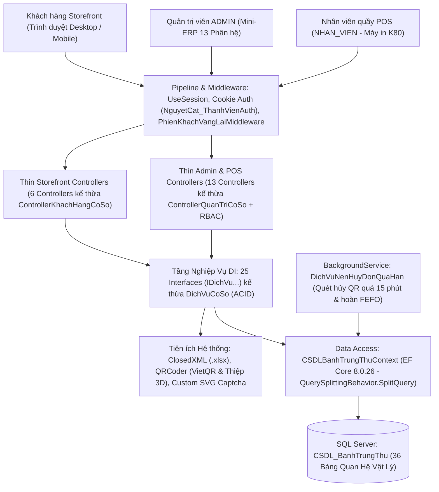
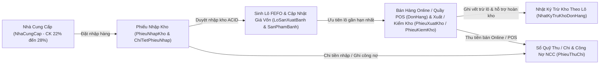

# Nguyệt Cát ERP — Hệ Thống Thương Mại Điện Tử & Mini-ERP Quản Lý Phân Phối Bánh Trung Thu Đa Thương Hiệu

[](https://dotnet.microsoft.com/)
[](https://learn.microsoft.com/aspnet/core/)
[](https://learn.microsoft.com/ef/core/)
[](https://www.microsoft.com/sql-server)
[](https://github.com/ClosedXML/ClosedXML)
[](https://github.com/codebude/QRCoder)
[](https://getbootstrap.com/)
[](#10-ket-qua-kiem-dinh-nghiem-thu-5-pha-qa--release-verification)
[](#10-ket-qua-kiem-dinh-nghiem-thu-5-pha-qa--release-verification)

**Nguyệt Cát ERP** (`DoAn_WebBanhTrungThu`) là nền tảng web hợp nhất giữa **Thương mại điện tử B2C/B2B** và **Mini-ERP quản lý phân phối đại lý bánh trung thu đa thương hiệu** (**Kinh Đô, Đồng Khánh, Như Lan, Brodard, Givral**). Hệ thống số hóa toàn trình từ trải nghiệm khách hàng (**Storefront 5 tầng + Studio tự phối hộp quà + Thiệp chúc mừng 3D QR**) đến vận hành nội bộ tại đại lý (**Quầy bán hàng POS + Quản lý lô FEFO + Chuỗi cung ứng NCC–Nhập–Xuất–Kiểm kho + Sổ quỹ Thu/Chi SQL-First**).

---

## Mục Lục

1. [Tiêu đề, Badges & Tổng quan Dự án](#1-tieu-de-badges--tong-quan-du-an)
2. [Điểm Nổi Bật Về Kiến Trúc & Kỹ Thuật (Architecture Highlights)](#2-diem-noi-bat-ve-kien-truc--ky-thuat-architecture-highlights)
3. [Công Nghệ & Thư Viện Sử Dụng (Tech Stack)](#3-cong-nghe--thu-vien-su-dung-tech-stack)
4. [Hệ Sinh Thái Tính Năng Chi Tiết (Feature Matrix)](#4-he-sinh-thai-tinh-nang-chi-tiet-feature-matrix)
5. [Cơ Sở Dữ Liệu Quan Hệ (36 Bảng SQL-First)](#5-co-so-du-lieu-quan-he-36-bang-sql-first)
6. [Cấu Trúc Thư Mục Dự Án (Project Structure)](#6-cau-truc-thu-muc-du-an-project-structure)
7. [Cơ Chế Bảo Mật & Toàn Vẹn Dữ Liệu (Security & Data Integrity)](#7-co-che-bao-mat--toan-ven-du-lieu-security--data-integrity)
8. [Hướng Dẫn Cài Đặt & Khởi Chạy Nhanh (Getting Started)](#8-huong-dan-cai-dat--khoi-chay-nhanh-getting-started)
9. [Tài Khoản Demo & Dữ Liệu Mẫu Thực Tế (Demo Accounts & Seed Snapshot)](#9-tai-khoan-demo--du-lieu-mau-thuc-te-demo-accounts--seed-snapshot)
10. [Kết Quả Kiểm Định Nghiệm Thu 5 Pha (QA & Release Verification)](#10-ket-qua-kiem-dinh-nghiem-thu-5-pha-qa--release-verification)
11. [Tác Giả & Thông Tin Đồ Án](#11-tac-gia--thong-tin-do-an)

---

## 1. Tiêu Đề, Badges & Tổng Quan Dự Án

### Bài toán thực tế
Hoạt động phân phối bánh trung thu theo mùa vụ tại các đại lý đa thương hiệu thường đối mặt với 4 nút thắt lớn:
- **Kiểm soát hạn sử dụng (FEFO):** Bánh trung thu có vòng đời ngắn; nếu xuất bán không đúng lô gần hạn trước sẽ dẫn tới tồn đọng quá hạn và thất thoát biên lợi nhuận.
- **Định giá & chiết khấu đa lớp:** Khách mua lẻ, khách sỉ B2B (chiết khấu theo số lượng), hộp quà tự phối nhiều vị bánh, mã khuyến mãi và ưu đãi hạng thành viên VIP chồng chéo dễ gây sai lệch khi tính tay.
- **Đứt gãy giữa bán hàng và kế toán kho:** Đơn Online, đơn bán trực tiếp tại quầy POS, phiếu nhập hàng từ nhà cung cấp, phiếu xuất hủy/nội bộ, kiểm kho thực tế và sổ quỹ tiền mặt/chuyển khoản thường tách rời trên các file Excel rời rạc.
- **Trải nghiệm quà biếu doanh nghiệp:** Khách đặt hộp quà cần xem trực quan thành phần bánh, thông số dinh dưỡng (Calo/Đường/Chỉ số GI cho người ăn kiêng) và gửi kèm thiệp chúc mừng điện tử qua mã QR.

**Nguyệt Cát ERP** giải quyết bài toán trên bằng một hệ thống đồng nhất trên **ASP.NET Core 8 MVC** và **SQL Server 36 bảng**, đảm bảo mọi biến động hàng hóa và dòng tiền đều liên thông trực tiếp trong giao dịch ACID.

---

## 2. Điểm Nổi Bật Về Kiến Trúc & Kỹ Thuật (Architecture Highlights)

- **Clean Modular MVC + SOLID:**
  - Tầng **Controllers** mỏng (trung bình `62,25` dòng/Controller), kế thừa 2 lớp cơ sở trừu tượng `ControllerKhachHangCoSo` (Storefront) và `ControllerQuanTriCoSo` (`[Area("Admin")]`) để tái sử dụng trích xuất phiên, kiểm tra quyền và chuẩn hóa JSON.
  - Tầng **ViewModels** tách riêng `11` file chuyên biệt theo từng nghiệp vụ, không truyền trực tiếp Entity thô sang View phức tạp.
  - Tầng **Services** kế thừa lớp trừu tượng `DichVuCoSo` (hỗ trợ giao dịch ACID qua `ThucThiTrongGiaoDichAsync`), áp dụng Dependency Inversion với **25 Service Interfaces (`IDichVu...`)** đăng ký Scoped DI trong `Program.cs`.
- **View Decomposition & Modular Assets:**
  - Các View gốc được giữ gọn nhẹ (`Views/Home/Index.cshtml` `43` dòng, `Views/SanPham/ChiTiet.cshtml` `25` dòng, `Areas/Admin/Views/NhanVienAdmin/Index.cshtml` `38` dòng) bằng cách phân rã thành Partial Views trong `PhanKhu/` và `ThanhPhan/`.
  - Tách riêng **10 module JavaScript khách hàng** (`wwwroot/js/modules/`), **2 script điều phối chính** (`site.js`, `thanh-toan.js`), **8 module JavaScript quản trị** (`wwwroot/js/admin-*.js`) và **5 file CSS chuyên biệt** (`site.css`, `thanh-toan.css`, `hieu-ung-ux.css`, `admin-layout.css`, `admin-pos.css`).
- **SQL-First 100% (Zero Business JSON — Zero Virtual Data):**
  - Toàn bộ thực thể nghiệp vụ (`ThuongHieu`, `NhaCungCap`, `HoSoNhanVien`, `NhatKyTruKhoDonHang`, hệ thống chứng từ `PhieuNhapKho` / `PhieuXuatKho` / `PhieuKiemKho` và Sổ quỹ `PhieuThuChi`) được mô hình hóa thành **36 bảng quan hệ vật lý** trong `CSDLBanhTrungThuContext`.
  - Bật toàn cục `QuerySplittingBehavior.SplitQuery` tại `Program.cs` giúp chia nhỏ các truy vấn `.Include()` nhiều nhánh và triệt tiêu hoàn toàn cảnh báo EF Core `EventId 20504`.
- **Tự động hóa nền & Tiện ích chuyên sâu:**
  - `DichVuNenHuyDonQuaHan` (`BackgroundService`) chạy nền tự động rà quét, hủy các đơn thanh toán QR quá hạn `15` phút và hoàn trả tồn kho đúng lô FEFO theo `NhatKyTruKhoDonHang`.
  - Xuất/nhập bảng tính Excel `.xlsx` chuẩn định dạng qua thư viện `ClosedXML` (`TienIchExcelCsv`).
  - Sinh mã QR động cho cổng thanh toán VietQR/MoMo và link xem Thiệp chúc mừng 3D bằng `QRCoder`.
  - `PhienKhachVangLaiMiddleware` tự động cấp mã phiên khách vãng lai (`PhienKhachVangLai`) lưu giỏ hàng/hộp tự chọn và đồng bộ gộp giỏ khi người dùng đăng nhập.

### Sơ Đồ Kiến Trúc Hệ Thống



---

## 3. Công Nghệ & Thư Viện Sử Dụng (Tech Stack)

Bảng thông số kỹ thuật được đối chiếu trực tiếp từ `WebBanhTrungThu/WebBanhTrungThu.csproj` và `WebBanhTrungThu/Program.cs`:

| Thành phần | Công nghệ / Gói thư viện | Phiên bản | Vai trò trong hệ thống |
| :--- | :--- | :---: | :--- |
| **Nền tảng Backend** | `.NET` (`net8.0`) & ASP.NET Core MVC | `8.0` | Kiến trúc MVC 3 tầng, Areas (`Admin`), Middleware, Hosted BackgroundService |
| **ORM & Truy cập CSDL** | `Microsoft.EntityFrameworkCore.SqlServer` | `8.0.26` | Ánh xạ 36 bảng SQL-First, quản lý giao dịch ACID & `SplitQuery` |
| **Công cụ EF Core** | `Microsoft.EntityFrameworkCore.Design` / `.Tools` | `8.0.26` | Hỗ trợ Scaffold và quản trị mô hình dữ liệu EF Core |
| **Hệ quản trị CSDL** | Microsoft SQL Server (`CSDL_BanhTrungThu`) | `2019+` | Lưu trữ quan hệ chuẩn hóa 36 bảng, ràng buộc khóa ngoại & chỉ mục duy nhất |
| **Xử lý Excel** | `ClosedXML` | `0.105.1` | Xuất bảng giá, nhập sản phẩm hàng loạt, tải mẫu & import phiếu kiểm kho `.xlsx` |
| **Sinh mã QR** | `QRCoder` | `1.8.1` | Tạo mã QR thanh toán VietQR/MoMo và mã QR dẫn tới trang Thiệp chúc mừng 3D |
| **Tuần tự hóa JSON** | `System.Text.Json` & `Newtonsoft.Json` | `8.0` / `13.0.4` | API phản hồi AJAX (`ReferenceHandler.IgnoreCycles`) và xử lý dữ liệu tích hợp |
| **Giao diện Frontend** | Razor Views (`.cshtml`), Bootstrap 5, Vanilla ES6 JS | `5.x` / `ES6` | 5 CSS chuyên biệt, 20 file JS mô-đun hóa, hỗ trợ in nhiệt hóa đơn khổ K80 |
| **Xác thực & Bảo mật** | Cookie Authentication, Session, SHA-256 + Salt | `Core 8.0` | Cookie `NguyetCat_ThanhVienAuth`, RBAC 2 vai trò, AntiForgery, Captcha SVG |

---

## 4. Hệ Sinh Thái Tính Năng Chi Tiết (Feature Matrix)

### A. Phân hệ Khách Hàng (Storefront — 6 Controllers)
Phục vụ tại `HomeController`, `SanPhamController`, `GioHangController`, `ThanhToanController`, `TaiKhoanController` và `Thiep3DController`:
- **Trang chủ trình diễn 5 tầng (`Home/Index.cshtml` & `PhanKhu/`):**
  1. `_Tang1_HeroBanner.cshtml`: Trình chiếu thương hiệu và điều hướng nhanh.
  2. `_Tang2_StudioPhoiHop.cshtml`: **Studio Tự Phối Hộp Quà (4 bánh & 6 bánh)** cho phép chọn mẫu vỏ hộp (`MauVoHop`), ghép từng vị bánh kèm tính tổng năng lượng Calo và tổng giá trực tiếp.
  3. `_Tang3_BoSuuTapBanh.cshtml`: **Bộ sưu tập 60 vị bánh** lọc đa chiều theo 5 thương hiệu (**Kinh Đô, Đồng Khánh, Như Lan, Brodard, Givral**), nhóm hương vị, mức độ ngọt và dòng bánh ăn kiêng đường `Isomalt`.
  4. `_Tang4_ChietKhauSoLuong.cshtml`: Bảng **chiết khấu sỉ B2B lên đến 22%** theo bậc số lượng từ `BangChietKhauSiB2B`.
  5. `_Tang5_ThiepQrVaFooter.cshtml`: Giới thiệu Thiệp chúc mừng 3D QR và thông tin đại lý.
- **Chi tiết sản phẩm (`SanPham/ChiTiet.cshtml`):** Hiển thị thông tin bánh, bảng `ThongSoDinhDuong` (Calo, Đường, Đạm, Béo, chỉ số đường huyết GI), gợi ý sản phẩm liên quan và ẩn toàn bộ mã kỹ thuật nội bộ.
- **Giỏ hàng AJAX & Thanh toán an toàn (`GioHangController`, `ThanhToanController`):**
  - Ngăn kéo giỏ hàng AJAX thời gian thực (`_NganKeoGioHang.cshtml`, `gio-hang-ajax.js`).
  - Trang thanh toán phẳng chống chỉnh giá F12, tính lại toàn bộ giá ở Server qua `IDichVuTinhGiaDonHang`, áp mã Voucher (`MaKhuyenMai`), chiết khấu hạng VIP, quy đổi điểm thưởng, phí ship đa vùng, nhận hàng thay và xác thực **Captcha SVG động**.
  - Cổng thanh toán **MoMo / VietQR** (`CongThanhToanMoMo.cshtml`) có đồng hồ đếm ngược `15` phút (`HanThanhToanQr`).
- **Tài khoản Hội viên & Thiệp 3D (`TaiKhoanController`, `Thiep3DController`):**
  - Hồ sơ 4 hạng VIP (**Đồng / Bạc / Vàng / Kim Cương**), Sổ địa chỉ giao hàng (`SoDiaChi`), Bộ sưu tập hộp đã phối (`HopQuaTuChon`).
  - Lịch sử đơn hàng hỗ trợ **Khách tự hủy đơn COD chưa xác nhận** (`CHO_XAC_NHAN`), tự động hoàn tồn kho theo đúng lô trong `NhatKyTruKhoDonHang` và hoàn lại điểm VIP đã dùng.
  - Xem **Thiệp chúc mừng 3D** qua đường dẫn/mã QR (`Thiep3D/Xem.cshtml`).

### B. Phân hệ Quản Trị Mini-ERP Chủ Cửa Hàng (`ADMIN` — 13 Controllers)
Phục vụ tại khu vực `[Area("Admin")]`:

| Controller | Service Interface chính | Chức năng cốt lõi |
| :--- | :--- | :--- |
| `DashboardController` | `IDichVuThongKeVaSoQuy` | Thống kê KPI doanh thu, đơn hàng đa kênh, tồn kho và cảnh báo lô cận hạn |
| `SanPhamAdminController` | `IDichVuQuanTriSanPham`, `IDichVuQuanTriBangGia`, `IDichVuQuanTriKhoFefo` | Quản lý 60 sản phẩm, danh mục, thương hiệu (`ThuongHieu`), bảng giá sỉ/lẻ, vị trí kho, mã vạch EAN-13, cảnh báo lô FEFO, Import/Export `.xlsx` (`ClosedXML`) |
| `NhaCungCapAdminController` | `IDichVuNhaCungCap` | Quản lý Nhà cung cấp chính hãng (chiết khấu mặc định `22%–28%`), theo dõi tổng mua và công nợ |
| `NhapKhoAdminController` | `IDichVuNhapKho` | Lập/duyệt Phiếu Nhập Kho đa sản phẩm, tự tính giá nhập theo `%CK`, sinh lô FEFO mới, cập nhật giá vốn bình quân gia quyền, tự động sinh Phiếu Chi Sổ quỹ & quản lý trả nợ NCC |
| `XuatKhoAdminController` | `IDichVuXuatKho` | Lập Phiếu Xuất Kho (xuất tiêu dùng nội bộ, xuất hủy hàng hỏng/quá hạn, xuất cân bằng kiểm kho) |
| `KiemKhoAdminController` | `IDichVuKiemKho` | Lập Phiếu Kiểm Kho, xuất/import file Excel `.xlsx` kết quả kiểm đếm, đối soát chênh lệch và tự động sinh Phiếu Xuất cân bằng kho |
| `DonHangAdminController` | `IDichVuQuanTriDonHang` | Quản lý đơn hàng kênh `WEB_ONLINE` và `POS_TAI_QUAY`, điều phối trạng thái giao, hoàn tiền và hoàn lô kho qua `NhatKyTruKhoDonHang`, in hóa đơn K80 |
| `KhachHangAdminController` | `IDichVuHoiVien`, `IDichVuKhuyenMaiGioHang` | Quản lý khách hàng thành viên VIP (tách biệt hoàn toàn với nhân sự) và mã khuyến mãi |
| `NhanVienAdminController` | `IDichVuQuanTriNhanVien` | Quản lý `HoSoNhanVien`, thống kê đơn/doanh số POS theo `DonHang.MaNdLap`, khóa mềm `TAM_KHOA`, đặt lại mật khẩu, chặn Admin tự khóa/hạ quyền chính mình |
| `SoQuyAdminController` | `IDichVuThongKeVaSoQuy` | Quản lý Sổ Quỹ Thu/Chi SQL-First (`PhieuThuChi`), tự động liên kết chứng từ nhập kho và tính tồn quỹ thực tế |
| `KhoAnhAdminController` | `IDichVuHinhAnh` | Quản lý Kho Hình Ảnh đa nguồn (`KhoHinhAnh`, `LienKetHinhAnh`) ánh xạ thư mục `/kho-anh-may` |
| `CaiDatAdminController` | `IDichVuCaiDatHeThong`, `IDichVuCauHinhHeThong` | Giao diện menu dọc 4 tab (`MoMo/VietQR`, `Cửa hàng`, `Vận chuyển`, `Hội viên VIP`) |
| `BanHangPosController` | `IDichVuBanHangPos` | Bán hàng trực tiếp tại quầy POS (dùng chung cho cả `ADMIN` và `NHAN_VIEN`) |

### C. Phân hệ Bán Hàng Tại Quầy POS & Phân Quyền Nhân Viên (`NHAN_VIEN` — RBAC 2 Vai Trò)
- **Giao diện Quầy POS (`BanHangPosController`, `admin-pos.js`, `pos-in-hoa-don-k80.js`):**
  - Hỗ trợ mở nhiều tab hóa đơn chờ song song (`Hóa đơn 1, 2...`).
  - Hệ thống phím tắt tác nghiệp nhanh: Tìm kiếm nhanh / quét mã vạch (`F3`), Tra cứu khách hàng thành viên VIP (`F4`), Đóng hộp quà tự chọn tại quầy (`F6`), Thanh toán tiền mặt hoặc QR (`F9`) và xuất mẫu in hóa đơn khổ nhiệt **K80** (`DonHangAdmin/InHoaDon.cshtml`).
- **Kiểm soát truy cập RBAC (`ControllerQuanTriCoSo`):**
  - Tài khoản vai trò `NHAN_VIEN` sau khi đăng nhập được điều hướng thẳng tới `/Admin/BanHangPos/Index`.
  - Chỉ được phép truy cập **2 phân hệ tác nghiệp**: `BanHangPos` và `DonHangAdmin`.
  - Mọi truy cập trái phép vào **11 phân hệ quản trị nhạy cảm còn lại** (`Dashboard`, `SanPhamAdmin`, `NhapKhoAdmin`, `XuatKhoAdmin`, `KiemKhoAdmin`, `NhaCungCapAdmin`, `KhachHangAdmin`, `NhanVienAdmin`, `SoQuyAdmin`, `KhoAnhAdmin`, `CaiDatAdmin`) đều bị chặn `HTTP 302 -> /TaiKhoan/TuChoiTruyCap`.

---

## 5. Cơ Sở Dữ Liệu Quan Hệ (36 Bảng SQL-First)

Cơ sở dữ liệu `CSDL_BanhTrungThu` được thiết kế chuẩn SQL-First gồm **36 bảng quan hệ vật lý**, chia thành 6 cụm nghiệp vụ rõ ràng (tham chiếu `WebBanhTrungThu/Data/CSDLBanhTrungThuContext.cs`):

| STT | Cụm Nghiệp Vụ | Số bảng | Danh sách Bảng SQL (`DbSet` trong `CSDLBanhTrungThuContext`) |
| :---: | :--- | :---: | :--- |
| **1** | **Nhân sự, Tài khoản & Phân quyền** | `4` | `VaiTro`, `NguoiDung`, `HoSoNhanVien`, `SoDiaChi` |
| **2** | **Danh mục, Thương hiệu, Sản phẩm & Lô FEFO** | `8` | `ThuongHieu`, `DanhMucBanh`, `SanPhamBanh`, `ThongSoDinhDuong`, `LoSanXuatBanh`, `MauVoHop`, `ComboMauCoSan`, `ChiTietComboMau` |
| **3** | **Khách vãng lai, Hộp tự chọn & Giỏ hàng** | `5` | `PhienKhachVangLai`, `HopQuaTuChon`, `ChiTietHopTuChon`, `GioHang`, `ChiTietGioHang` |
| **4** | **Đơn hàng, Giao hàng, Thiệp 3D & Nhật ký kho** | `5` | `DonHang`, `ChiTietDonHang`, `DotGiaoHang_DaDiem` (`DotGiaoHangDaDiem`), `ThiepChucMung3D`, `NhatKyTruKhoDonHang` |
| **5** | **Mini-ERP Kho Đại lý, NCC & Sổ Quỹ** | `8` | `NhaCungCap`, `PhieuNhapKho`, `ChiTietPhieuNhap`, `PhieuXuatKho`, `ChiTietPhieuXuat`, `PhieuKiemKho`, `ChiTietKiemKho`, `PhieuThuChi` |
| **6** | **Khuyến mãi, Hình ảnh & Cấu hình hệ thống** | `6` | `MaKhuyenMai`, `BangChietKhauSiB2B`, `KhoHinhAnh`, `LienKetHinhAnh`, `CauHinhLandingPage`, `CauHinhHeThong` *(chỉ lưu đúng 4 khóa cài đặt hệ thống)* |

> **Ghi chú thiết kế:** Bảng `CauHinhHeThong` chỉ lưu đúng **4 khóa cài đặt hệ thống** tương ứng 4 tab trong trang Cài đặt; toàn bộ dữ liệu nghiệp vụ (Thương hiệu, Nhà cung cấp, Nhân viên, Chứng từ Nhập/Xuất/Kiểm kho, Nhật ký trừ kho và Sổ quỹ) được lưu hoàn toàn trên các bảng quan hệ chuẩn hóa (**Zero Business JSON**).

### Sơ Đồ Luồng Nghiệp Vụ Chuỗi Cung Ứng Mini-ERP



---

## 6. Cấu Trúc Thư Mục Dự Án (Project Structure)

```text
DoAn_WebBanhTrungThu/
├── DoAn_WebBanhTrungThu.slnx               # Solution .NET 8.0
├── don-dep-dong-goi.ps1                    # Script dọn rác biên dịch & đóng gói bản nộp sạch
├── README.md                               # Tài liệu hệ thống
└── WebBanhTrungThu/
    ├── Program.cs                          # Cấu hình DI (25 Interfaces), EF Core SplitQuery, Auth, Middleware
    ├── WebBanhTrungThu.csproj              # Khai báo .NET 8.0 & các gói NuGet
    ├── appsettings.json                    # Chuỗi kết nối CSDL & cấu hình ánh xạ kho ảnh
    ├── Areas/
    │   └── Admin/
    │       ├── Controllers/
    │       │   ├── CoSo/
    │       │   │   └── ControllerQuanTriCoSo.cs     # Controller cơ sở Admin & kiểm tra RBAC
    │       │   ├── BanHangPosController.cs          # Bán hàng tại quầy POS
    │       │   ├── CaiDatAdminController.cs         # Cài đặt hệ thống 4 tab
    │       │   ├── DashboardController.cs           # Tổng quan KPI ERP
    │       │   ├── DonHangAdminController.cs        # Quản lý đơn hàng & in hóa đơn K80
    │       │   ├── KhachHangAdminController.cs      # Quản lý khách hàng & khuyến mãi
    │       │   ├── KhoAnhAdminController.cs         # Quản lý kho hình ảnh đa nguồn
    │       │   ├── KiemKhoAdminController.cs        # Kiểm kho & đối soát Excel
    │       │   ├── NhaCungCapAdminController.cs     # Quản lý nhà cung cấp
    │       │   ├── NhanVienAdminController.cs       # Quản lý nhân sự & doanh số POS
    │       │   ├── NhapKhoAdminController.cs        # Nhập kho đại lý & công nợ NCC
    │       │   ├── SanPhamAdminController.cs        # Hàng hóa, bảng giá & lô FEFO
    │       │   ├── SoQuyAdminController.cs          # Sổ quỹ Thu/Chi SQL-First
    │       │   └── XuatKhoAdminController.cs        # Xuất hủy / xuất nội bộ / cân bằng kho
    │       └── Views/                               # Razor Views Admin & các thư mục PhanKhu/, ThanhPhan/
    ├── Controllers/
    │   ├── CoSo/
    │   │   └── ControllerKhachHangCoSo.cs           # Controller cơ sở Storefront
    │   ├── GioHangController.cs                     # Giỏ hàng AJAX & hộp quà tự chọn
    │   ├── HomeController.cs                        # Trang chủ 5 tầng
    │   ├── SanPhamController.cs                     # Chi tiết bánh & bảng dinh dưỡng
    │   ├── TaiKhoanController.cs                    # Đăng nhập, hồ sơ VIP, tự hủy đơn COD
    │   ├── ThanhToanController.cs                   # Thanh toán phẳng, Captcha, MoMo/VietQR
    │   └── Thiep3DController.cs                     # Hiển thị Thiệp chúc mừng 3D qua QR
    ├── Data/
    │   ├── CSDLBanhTrungThuContext.cs               # DbContext 36 bảng SQL-First
    │   └── KhoiTaoCsdl.cs                           # Khởi tạo & chuẩn hóa schema khi chạy
    ├── Middlewares/
    │   └── PhienKhachVangLaiMiddleware.cs           # Quản lý phiên giỏ hàng khách vãng lai
    ├── Models/
    │   ├── ErrorViewModel.cs
    │   └── Entities/                                # 36 Entity classes + các file Partial mở rộng
    ├── Services/
    │   ├── CoSo/DichVuCoSo.cs                       # Base Service & Transaction ACID (ThucThiTrongGiaoDichAsync)
    │   ├── Interfaces/                              # 25 Service Interfaces (IDichVu...)
    │   ├── GiaoDien/                                # DichVuTrangChu, DichVuChiTietSanPham
    │   ├── GioHang/                                 # DichVuHopQuaTuChon, DichVuKhuyenMaiGioHang
    │   ├── Nen/DichVuNenHuyDonQuaHan.cs             # BackgroundService quét hủy đơn QR quá 15 phút
    │   ├── QuanTri/                                 # 13 Service quản trị Mini-ERP, POS & TienIchExcelCsv
    │   ├── TaiKhoan/DichVuHoiVien.cs                # Nghiệp vụ hội viên VIP & lịch sử đơn
    │   ├── ThanhToan/                               # Captcha, cổng MoMo/VietQR, tính giá & trừ kho FEFO
    │   ├── DichVuCauHinhHeThong.cs
    │   ├── DichVuGioHang.cs
    │   ├── DichVuHinhAnh.cs
    │   ├── DichVuThanhToan.cs
    │   └── ThongTinPhienHelper.cs
    ├── ViewModels/                                  # 11 file ViewModels chuyên biệt
    ├── Views/                                       # Storefront Views & PhanKhu/, ThanhPhan/
    └── wwwroot/
        ├── css/                                     # 5 file CSS (site, thanh-toan, hieu-ung-ux, admin-layout, admin-pos)
        ├── images/                                  # Tài nguyên ảnh tĩnh giao diện
        └── js/
            ├── admin-*.js                           # 8 module JS khu vực Admin & POS
            ├── modules/                             # 10 module JS chuyên biệt Storefront & in K80
            ├── site.js                              # Điều phối giao diện chung Storefront
            └── thanh-toan.js                        # Điều phối quy trình thanh toán
```

---

## 7. Cơ Chế Bảo Mật & Toàn Vẹn Dữ Liệu (Security & Data Integrity)

- **Chống giả mạo giá phía Client (F12 Price Tampering):** Toàn bộ đơn giá bánh, giá hộp quà tự chọn, bậc chiết khấu số lượng, mã giảm giá, chiết khấu hạng VIP, quy đổi điểm tích lũy và phí ship tại Giỏ hàng, Thanh toán Online và Quầy POS đều được Server tính toán độc lập từ SQL Server thông qua `DichVuTinhGiaDonHang` và `DichVuBanHangPos`, bỏ qua mọi giá trị tiền gửi lên từ trình duyệt.
- **Bảo mật xác thực & phân quyền (Authentication & RBAC):**
  - Cookie Authentication (`NguyetCat_ThanhVienAuth`) cấu hình `SlidingExpiration` `7` ngày; Session bật `HttpOnly` và `IsEssential`.
  - Mật khẩu người dùng được băm bằng `SHA-256 + Salt`.
  - Phân quyền RBAC 2 vai trò nội bộ (`ADMIN`, `NHAN_VIEN`) kết hợp cơ chế khóa mềm tài khoản `TAM_KHOA` và ràng buộc chặn Admin tự khóa hoặc tự hạ quyền chính mình.
- **Chống CSRF, IDOR & Spam đơn hàng:**
  - Các action thay đổi trạng thái POST được bảo vệ bằng `[ValidateAntiForgeryToken]`.
  - Xác minh quyền sở hữu `MaNd` / `MaPhienKvl` trên từng đơn hàng khi truy vấn chi tiết hoặc tự hủy đơn (chống IDOR).
  - Tích hợp **Captcha SVG động** (`DichVuBaoMatCaptcha`) chống spam đặt đơn tự động.
- **Toàn vẹn kho FEFO & dòng tiền ACID:**
  - Mọi tác vụ đặt đơn, tự hủy đơn, nhập/xuất/kiểm kho và ghi Sổ quỹ được bọc trong giao dịch nguyên tử (`DichVuCoSo.ThucThiTrongGiaoDichAsync`).
  - Thuật toán xuất kho FEFO (`DichVuTonKhoFefo`) luôn trừ tồn từ các lô `LoSanXuatBanh` còn hạn sử dụng ngắn nhất trước, ghi nhận vết vào `NhatKyTruKhoDonHang`, và hoàn trả chính xác về lô gốc khi hủy đơn (đồng thời chặn cộng hoàn vào các lô đã đánh dấu `DA_HUY`).

---

## 8. Hướng Dẫn Cài Đặt & Khởi Chạy Nhanh (Getting Started)

### Yêu cầu môi trường
- **.NET 8.0 SDK** (`8.0.x`)
- **SQL Server 2019+** (Express / Developer / Standard) & **SSMS** (SQL Server Management Studio)
- Trình duyệt hiện đại: Microsoft Edge hoặc Google Chrome

### Các bước cài đặt & chạy cục bộ

1. **Giải nén gói nộp hoặc clone mã nguồn:**
   ```bash
   # Giải nén tệp NopDoAn_WebBanhTrungThu_Sach.zip hoặc clone từ Git repository:
   git clone <repository-url>
   cd DoAn_WebBanhTrungThu
   ```

2. **Cấu hình chuỗi kết nối SQL Server trong `WebBanhTrungThu/appsettings.json`:**
   ```json
   {
     "Logging": {
       "LogLevel": {
         "Default": "Information",
         "Microsoft.AspNetCore": "Warning"
       }
     },
     "AllowedHosts": "*",
     "ConnectionStrings": {
       "ChuoiKetNoiCSDL": "Server=DESKTOP-R0BDS56;Database=CSDL_BanhTrungThu;Trusted_Connection=True;TrustServerCertificate=True;"
     },
     "CauHinhKhoAnh": {
       "ThuMucODiaMay": "C:\\Users\\MinhDuc\\KhoAnhBanhTrungThu",
       "DuongDanAo": "/kho-anh-may"
     }
   }
   ```
   *(Cập nhật tên `Server=` theo SQL Server Instance trên máy của bạn và đảm bảo `ThuMucODiaMay` có quyền ghi).*

3. **Khởi tạo Cơ sở dữ liệu & Dữ liệu mẫu:**
   - Tạo database tên `CSDL_BanhTrungThu` trên SQL Server và thực thi script dữ liệu mẫu chuẩn thực tế `ResetVaSeed_CSDL_BanhTrungThu_60SP_v3_Final.sql` trong SSMS.
   - Khi khởi chạy ứng dụng, `WebBanhTrungThu/Data/KhoiTaoCsdl.cs` sẽ tự động kiểm tra và chuẩn hóa cấu trúc/dữ liệu nền nếu cần.

4. **Khôi phục gói NuGet, biên dịch và khởi chạy ứng dụng:**
   ```bash
   dotnet restore DoAn_WebBanhTrungThu.slnx
   dotnet build DoAn_WebBanhTrungThu.slnx
   dotnet run --project WebBanhTrungThu
   ```

5. **Truy cập hệ thống trên trình duyệt (theo `WebBanhTrungThu/Properties/launchSettings.json`):**
   - **Storefront Khách hàng:** `http://localhost:5138`
   - **Quản trị Mini-ERP (`ADMIN`):** `http://localhost:5138/Admin/Dashboard`
   - **Quầy bán hàng POS (`NHAN_VIEN` / `ADMIN`):** `http://localhost:5138/Admin/BanHangPos/Index`

6. **Đóng gói bản nộp mã nguồn sạch (tùy chọn):**
   ```powershell
   powershell -ExecutionPolicy Bypass -File ./don-dep-dong-goi.ps1
   ```
   Lệnh này tự động dọn `bin/`, `obj/`, `graphify-out/`, đóng gói tệp `NopDoAn_WebBanhTrungThu_Sach.zip` sạch và chạy lại `dotnet build`.

---

## 9. Tài Khoản Demo & Dữ Liệu Mẫu Thực Tế (Demo Accounts & Seed Snapshot)

### Tài khoản Demo (Mật khẩu dùng chung: `123456`)

| Email đăng nhập | Mã NV | Vai trò | Phạm vi & Dữ liệu Demo nổi bật |
| :--- | :---: | :--- | :--- |
| `admin@nguyetcat.vn` | `NV001` | Chủ cửa hàng (`ADMIN`) | Toàn quyền truy cập 13 phân hệ Mini-ERP, Kho FEFO, NCC, Sổ quỹ, Cài đặt & POS |
| `thungan@nguyetcat.vn` | `NV002` | Nhân viên Bán hàng (`NHAN_VIEN`) | Đăng nhập vào thẳng POS; ghi nhận doanh số POS `8.095.760 đ`; chỉ mở `BanHangPos` & `DonHangAdmin` |
| `giaohang@nguyetcat.vn` | `NV003` | Nhân viên Bán hàng (`NHAN_VIEN`) | Đăng nhập vào thẳng POS; ghi nhận doanh số POS `1.066.000 đ`; chỉ mở `BanHangPos` & `DonHangAdmin` |
| `minhchau@gmail.com` | — | Khách hàng VIP **Kim Cương** (`KHACH_TV`) | Tổng chi tiêu hoàn tất `5.720.700 đ`, `802` điểm tích lũy, sẵn đơn COD `#TT2026-1010` chờ xác nhận để thử nút tự hủy đơn & 3 Thiệp 3D QR (`THIEP-NC-2026-001`..`003`) |

### Tổng Quan Bộ Dữ Liệu Mẫu Chuẩn Zero-Diff (`CSDL_BanhTrungThu`)

| Nhóm dữ liệu | Quy mô thực tế trong CSDL | Chi tiết nghiệp vụ kiểm chứng |
| :--- | :--- | :--- |
| **Thương hiệu & Sản phẩm** | `6` thương hiệu / `60` sản phẩm bánh | Phủ 5 thương hiệu lớn (**Kinh Đô, Đồng Khánh, Như Lan, Brodard, Givral**) cùng vỏ hộp và combo mẫu |
| **Tồn kho Lô FEFO** | `67` lô sản xuất (`2.438` bánh tồn) | Tích hợp sẵn `2` lô xả cận date trên mã sản phẩm `KD-08` & `DK-08` để kiểm thử cảnh báo và xuất FEFO |
| **Nhà cung cấp & Nhập kho** | `6` NCC / `6` Phiếu nhập kho | Chiết khấu NCC `22%–28%`; tổng giá trị nhập `271.021.750 đ`; công nợ NCC còn `76.541.610 đ` |
| **Đơn hàng Online & POS** | `10` đơn hàng đa kênh | Phối hợp đơn `WEB_ONLINE` và `POS_TAI_QUAY`; tổng doanh thu đã thu `15.912.060 đ` |
| **Xuất kho & Kiểm kho** | `3` Phiếu xuất / `1` Phiếu kiểm kho | Bao quát xuất hủy/nội bộ và kiểm kê đối soát tồn thực tế tự cân bằng kho |
| **Sổ quỹ Thu/Chi** | `14` chứng từ `PhieuThuChi` | Khớp 100% biến động dòng tiền bán hàng & chi trả NCC; tồn quỹ thực tế `69.581.920 đ` |

---

## 10. Kết Quả Kiểm Định Nghiệm Thu 5 Pha (QA & Release Verification)

Hệ thống đã hoàn tất quy trình kiểm định nghiệm thu **Final Release Candidate (5/5 Pha — 100% ALL-GREEN PASS, 0 tồn đọng)**:

| Pha kiểm định | Hạng mục kiểm tra | Kết quả thực tế |
| :--- | :--- | :--- |
| **Pha 1: Kiến trúc & Biên dịch** | Build Solution, DI Container, EF Core Log | `0 Error / 0 Warning`, `25/25` DI Interfaces hợp lệ, Controllers mỏng trung bình `62,25` dòng, `0` Exception, `0` cảnh báo `EventId 20504` |
| **Pha 2: Toàn vẹn CSDL SQL-First** | Lược đồ quan hệ & Đối soát dữ liệu | `36` bảng quan hệ vật lý, `0` JSON nghiệp vụ trá hình, `0` sai số giữa tồn kho sản phẩm, tổng tồn các lô FEFO và Sổ quỹ |
| **Pha 3: Nghiệp vụ & Bảo mật HTTP + SQL** | Luồng Mini-ERP, Excel, RBAC, F12, CSRF/IDOR | Pass toàn bộ luồng NCC–Nhập–Xuất–Kiểm kho–Sổ quỹ; Excel `.xlsx` (`ClosedXML`); RBAC chặn `11/11` route nhạy cảm của `NHAN_VIEN`; chống F12 tampering; tự hủy đơn COD hoàn đúng lô & hoàn điểm |
| **Pha 4: Giao diện Đa thiết bị (UI/UX)** | Browser Test trên `1440x900`, `1080x800`, `450x838` | Kiểm thử đủ 3 vai trò (`Khách hàng`, `NHAN_VIEN`, `ADMIN`): `0` Console Error, `0` Network `>= 400`, `0` ảnh vỡ, `0` lỗi tràn ngang |
| **Pha 5: Khôi phục & Đóng gói** | Snapshot SQL & Gói mã nguồn nộp đồ án | Khôi phục CSDL đối soát `Total diffs = 0`; tạo gói sạch `NopDoAn_WebBanhTrungThu_Sach.zip` với `0` thư mục rác |

---

## 11. Tác Giả & Thông Tin Đồ Án

- **Sinh viên thực hiện:** Lê Minh Đức
- **Đơn vị:** Khoa Công nghệ thông tin — Trường Đại học An Giang (AGU — ĐHQG-HCM)
- **GitHub:** [https://github.com/vitlearningcode](https://github.com/vitlearningcode)

> **Lời cảm ơn & Bản quyền:** Xin chân thành cảm ơn Giảng viên hướng dẫn và quý Thầy/Cô Khoa Công nghệ thông tin — Trường Đại học An Giang đã đồng hành, góp ý chuyên môn trong suốt quá trình thực hiện đồ án. Mã nguồn được phát hành phục vụ mục đích học tập, nghiên cứu học thuật (Academic & Educational Use — MIT License).
